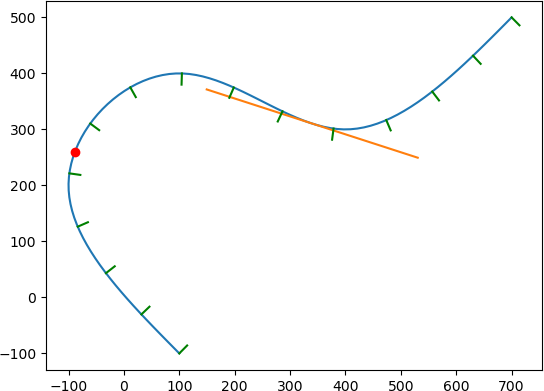

TinySpline
========


TinySpline is a small, yet powerful library for interpolating, transforming,
and querying arbitrary NURBS, B-Splines, and Bézier curves. The core of the
library is written in ANSI C (C89) with a C++ wrapper for an object-oriented
programming model. Based on the C++ wrapper, auto-generated bindings for C#, D,
Go, Java, Javascript, Lua, Octave, PHP, Python, R, and Ruby are provided.

### Table of Contents

- [License](#license)
- [Features](#features)
- [Installation](#installation)
  * [Pre-built Binaries](#pre-built-binaries)
  * [Compiling From Source](#compiling-from-source)
- [Getting Started](#getting-started)
- [Documentation](#documentation)
- [Publications](#publications)
- [Theoretical Backgrounds](#theoretical-backgrounds)

### License
MIT License - see the LICENSE file in the source distribution.

### Features

- Object-oriented programming model
- B-Splines of any degree and dimensionality
- Spline interpolation
  - Cubic natural
  - Centripetal Catmull–Rom
- Evaluation
  - Knots
  - Sampling (multiple knots at once)
  - Equidistant points
  - Components (find y for given x)
  - Global point projection / snapping (nearest point with a certified
    distance bracket)
- Reparametrization by arc length
  - Mapping length <--> knot
- Knot insertion (refinement)
- Sub-spline extraction
- Bézier curve decomposition
  - (also known as subdivision)
- Derivative
- Degree elevation
- Computation of rotation minimizing frames
- Morphing
- Serialization (JSON)
- Vector math

### Installation

#### Pre-built Binaries

Releases can be downloaded from the
[releases](https://github.com/msteinbeck/tinyspline/releases) page. In
addition, the following package manager are supported:

Conan (C/C++):  
https://conan.io/center/tinyspline

NuGet (C#):
```xml
<PackageReference Include="tinyspline" Version="0.6.0.1" />
```

Go:
```bash
go get github.com/tinyspline/go@v0.6.0
```

Luarocks (Lua):
```bash
luarocks install --server=https://tinyspline.github.io/lua tinyspline
```

Maven (Java):
```xml
<dependency>
   <groupId>org.tinyspline</groupId>
   <artifactId>tinyspline</artifactId>
   <version>0.6.0-1</version>
</dependency>
```

PyPI (Python):
```bash
python -m pip install tinyspline
```

RubyGems (Ruby):
```bash
gem install tinyspline
```

#### Compiling From Source

See [BUILD.md](BUILD.md).

### Getting Started

A variety of examples (tests) can be found in the [test](test)
subdirectory.

The following listing shows a Python example:

```python
from tinyspline import *
import matplotlib.pyplot as plt

spline = BSpline.interpolate_cubic_natural(
  [
     100, -100, # P1
    -100,  200, # P2
     100,  400, # P3
     400,  300, # P4
     700,  500  # P5
  ], 2) # <- dimensionality of the points

# Draw spline as polyline.
points = spline.sample(100)
x = points[0::2]
y = points[1::2]
plt.plot(x, y)

# Draw point at knot 0.3.
vec2 = spline.eval(0.3).result_vec2()
plt.plot(vec2.x, vec2.y, 'ro')

# Draw tangent at knot 0.7.
pos = spline(0.7).result_vec2() # operator () -> eval
der = spline.derive()(0.7).result_vec2().normalize() * 200
s = pos - der
t = pos + der
plt.plot([s.x, t.x], [s.y, t.y])

# Draw 15 normals with equidistant distribution.
knots = spline.equidistant_knot_seq(15)
frames = spline.compute_rmf(knots)
for i in range(frames.size()):
    pos = frames.at(i).position
    nor = pos + frames.at(i).normal * 20
    # You can also fetch the tangent and binormal:
    #     frames.at(i).tangent
    #     frames.at(i).binormal
    plt.plot([pos.x, nor.x], [pos.y, nor.y], 'g')

plt.show()
```
Result:



### Point Projection (Snapping)

Snapping a cursor or a point to a curve is a *global* nearest-point problem.
Sampling the curve at uniform parameters only finds the nearest of a finite
set of samples, so it misses solutions on a fold-back; `ts_bspline_bisect`
(and `BSpline::bisect`) solve a single monotone coordinate and therefore
cannot be applied to a spline that doubles back. Point projection is neither
of those: a reusable `tsProjectionIndex` / `tinyspline::ProjectionIndex`
searches every knot interval with certified distance bounds and returns the
globally nearest curve point.

The index is built once and answers many queries. It is an independent,
owning snapshot of the source spline — modifying or freeing the spline
afterwards does not affect it — and queries on a `const` index use no shared
mutable state, so they may run concurrently.

Each result carries a **certified distance bracket** rather than a single
guess:

```
distance_lower <= true shortest distance <= distance_upper
0 <= distance_upper - distance_lower <= epsilon
```

`distance_upper` is the Euclidean distance from the query point to the
returned curve point. `epsilon` is a tolerance in *curve space* (a distance),
not a parameter step; it must be at least `1e-10 * max(1, diagonal of the
control point bounding box)`. Pieces that cannot improve the bracket are
pruned from their bounding-box lower bounds without any local geometry work,
so a query does not rescan the whole curve and `visited_pieces` reports how
many original knot intervals were actually refined.

At an internal knot with full multiplicity the curve is discontinuous. The
result's `span_index` is the left index (in the original knot vector) of the
non-zero interval that contains the returned point, which distinguishes the
left-hand and right-hand one-sided limits at the break instead of
arbitrarily choosing one of the two `DeBoorNet` results.

C example:

```c
#include "tinyspline.h"
#include "tinyspline_projection.h"

tsBSpline spline = ts_bspline_init();
tsProjectionIndex index = ts_projection_index_init();
tsProjection result;

ts_bspline_new(4, 2, 3, TS_BEZIERS, &spline, NULL);
ts_bspline_set_control_points(&spline,
    (tsReal[]){0,0, 10,5, 10,15, 0,20}, NULL);

/* Reusable snapshot; the spline may be changed or freed afterwards. */
ts_projection_index_new(&spline, &index, NULL);

/* epsilon is a space distance, not a parameter step. */
if (!ts_projection_index_query(&index, (tsReal[]){5.0, 10.0}, 2,
                               1e-7, &result, NULL)) {
    /* result.knot, result.span_index, result.point,
       result.distance_lower / distance_upper, result.visited_pieces */
}

ts_projection_index_free(&index);
ts_bspline_free(&spline);
```

C++ example:

```cpp
#include "tinysplinecxx.h"
using namespace tinyspline;

BSpline curve(4, 2, 3, BSpline::Beziers);
curve.setControlPoints({0.0, 0.0, 10.0, 5.0, 10.0, 15.0, 0.0, 20.0});

ProjectionIndex index(curve);                 // reusable, thread-safe
Projection nearest = index.query({5.0, 10.0}, /* epsilon */ 1e-7);

nearest.knot();          // parameter of the nearest curve point
nearest.spanIndex();     // original knot interval; disambiguates break sides
nearest.point();         // the actual curve point
nearest.distanceLower(); // certified lower bound of the true minimum
nearest.distanceUpper(); // Euclidean distance to point()
nearest.visitedPieces(); // intervals that needed local refinement
```

### Documentation

The latest Doxygen documentation can be found at:
https://msteinbeck.github.io/tinyspline/

The documentation of the C interface
(https://msteinbeck.github.io/tinyspline/tinyspline_8h.html) is quite
extensive and also serves as an entry point for the C++ interface
documentation (as well as the documentation for the bindings created
from the C++ interface).

### Publications

If you use TinySpline in your research, please cite it as below.

```
@INPROCEEDINGS{Steinbeck:SANER:21,
  author =       {Steinbeck, Marcel and Koschke, Rainer},
  booktitle =    {2021 IEEE International Conference on Software
                  Analysis, Evolution and Reengineering (SANER)},
  title =        {TinySpline: A Small, yet Powerful Library for
                  Interpolating, Transforming, and Querying NURBS,
                  B-Splines, and Bézier Curves},
  year =         {2021},
  pages =        {572-576},
  doi =          {10.1109/SANER50967.2021.00068}
}
```

Other publications:

```
@INPROCEEDINGS{Steinbeck:VISSOFT:22,
  author =       {Steinbeck, Marcel and Koschke, Rainer},
  booktitle =    {2022 Working Conference on Software Visualization
                  (VISSOFT)},
  title =        {Edge Animation in Software Visualization},
  year =         {2022},
  pages =        {63-74},
  doi =          {10.1109/VISSOFT55257.2022.00015}
}
```

### Theoretical Backgrounds
[[1]](http://www.cs.mtu.edu/~shene/COURSES/cs3621/NOTES/spline/B-spline/bspline-curve.html)
is a very good starting point for B-Splines.

[[2]](http://www.cs.mtu.edu/~shene/COURSES/cs3621/NOTES/spline/B-spline/de-Boor.html)
explains De Boor's Algorithm and gives some pseudo code.

[[3]](http://www.codeproject.com/Articles/996281/NURBS-curve-made-easy)
provides a good overview of NURBS with some mathematical background.

[[4]](http://www.cs.mtu.edu/~shene/COURSES/cs3621/NOTES/spline/NURBS/NURBS-def.html)
is useful if you want to use NURBS in TinySpline.

