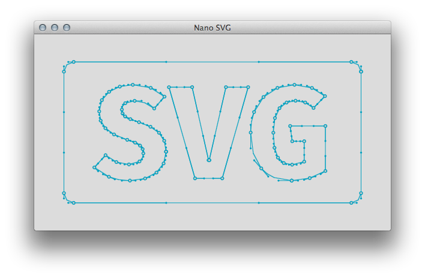

*This project is not actively maintained.*

Nano SVG
==========

## Parser



NanoSVG is a simple stupid single-header-file SVG parse. The output of the parser is a list of cubic bezier shapes.

The library suits well for anything from rendering scalable icons in your editor application to prototyping a game.

NanoSVG supports a wide range of SVG features, but something may be missing, feel free to create a pull request!

The shapes in the SVG images are transformed by the viewBox and converted to specified units.
That is, you should get the same looking data as your designed in your favorite app.

NanoSVG can return the paths in few different units. For example if you want to render an image, you may choose
to get the paths in pixels, or if you are feeding the data into a CNC-cutter, you may want to use millimeters. 

The units passed to NanoSVG should be one of: 'px', 'pt', 'pc' 'mm', 'cm', or 'in'.
DPI (dots-per-inch) controls how the unit conversion is done.

If you don't know or care about the units stuff, "px" and 96 should get you going.

## Rasterizer


The parser library is accompanied with really simpler SVG rasterizer. Currently it only renders flat filled shapes.

The intended usage for the rasterizer is to for example bake icons of different size into a texture. The rasterizer is not particular fast or accurate, but it's small and packed in one header file.

## Markers

The parser and rasterizer implement the subset of SVG [markers](https://www.w3.org/TR/SVG11/painting.html#MarkerElement) needed to put arrowheads and similar symbols on the vertices of a path. Marker definitions live in the root `<defs>` with a unique `id`; a definition is found even when it appears after the shapes that reference it. `path`, `line`, `polyline` and `polygon` accept `marker-start`, `marker-mid` and `marker-end` as presentation attributes or inside an inline `style`, and inherit them through enclosing `<g>` scopes. Setting a position to `none` disables just that position, and a reference that cannot be resolved is skipped while the shape itself still draws.

Save the following as `arrow.svg` and open it, or pass it to `nsvgParseFromFile` followed by `nsvgRasterize`:

```svg
<svg width="120" height="40" xmlns="http://www.w3.org/2000/svg">
  <defs>
    <marker id="arrow" markerWidth="10" markerHeight="10"
            refX="8" refY="5" orient="auto"
            markerUnits="strokeWidth" overflow="visible">
      <path d="M0,0 L10,5 L0,10 Z" fill="#d1495b"/>
    </marker>
  </defs>
  <line x1="10" y1="20" x2="100" y2="20"
        stroke="#2e4057" stroke-width="3"
        marker-end="url(#arrow)"/>
</svg>
```

The same file is checked in at [example/marker.svg](example/marker.svg).

Supported scope:

- `markerWidth`/`markerHeight` (default 3), `refX`/`refY` (default 0) as unitless finite numbers; a non-positive width or height suppresses that marker.
- `markerUnits` of `strokeWidth` (default) and `userSpaceOnUse`. A `strokeWidth` marker with a zero reference stroke width is not drawn; a `userSpaceOnUse` marker is drawn even when the referencing shape has no stroke.
- `orient` as a unitless angle, `auto`, and `auto-start-reverse` (the last one only reverses the automatic direction at each subpath start by 180°).
- Optional `viewBox` with four finite numbers and positive width/height, plus the default `xMidYMid meet` and `none` forms of `preserveAspectRatio`. Without a viewBox the marker content coordinates are used directly.
- Marker content may contain solid-color filled or stroked paths and nested `<g>` elements with `transform`. Paint and stroke width follow the style scope at the definition site; the referencing shape's colors are not inherited, and `context-fill`/`context-stroke` are not implemented.
- Placement follows the original path segments (a normalized arc still counts as one segment), including mid markers at every connection point, separate start/end markers on closed subpaths, and tangent handling for degenerate zero-length segments.
- Markers participate in the existing `paint-order` slots, drawn start, then mid, then end, while later ordinary sibling shapes keep their normal occlusion behavior.

Not supported: `<use>`, external resources, nested markers, gradients or other non-solid paints inside markers, CSS selectors beyond the existing class styles, group opacity, and marker viewport clipping (the bundled materials set `overflow="visible"`).

## Example Usage

``` C
// Load
struct NSVGimage* image;
image = nsvgParseFromFile("test.svg", "px", 96);
printf("size: %f x %f\n", image->width, image->height);
// Use...
for (shape = image->shapes; shape != NULL; shape = shape->next) {
	for (path = shape->paths; path != NULL; path = path->next) {
		for (i = 0; i < path->npts-1; i += 3) {
			float* p = &path->pts[i*2];
			drawCubicBez(p[0],p[1], p[2],p[3], p[4],p[5], p[6],p[7]);
		}
	}
}
// Delete
nsvgDelete(image);
```

## Using NanoSVG in your project

In order to use NanoSVG in your own project, just copy nanosvg.h to your project.
In one C/C++ define `NANOSVG_IMPLEMENTATION` before including the library to expand the NanoSVG implementation in that file.
NanoSVG depends on `stdio.h` ,`string.h` and `math.h`, they should be included where the implementation is expanded before including NanoSVG. 

``` C
#include <stdio.h>
#include <string.h>
#include <math.h>
#define NANOSVG_IMPLEMENTATION	// Expands implementation
#include "nanosvg.h"
```

By default, NanoSVG parses only the most common colors. In order to get support for full list of [SVG color keywords](http://www.w3.org/TR/SVG11/types.html#ColorKeywords), define `NANOSVG_ALL_COLOR_KEYWORDS` before expanding the implementation.

``` C
#include <stdio.h>
#include <string.h>
#include <math.h>
#define NANOSVG_ALL_COLOR_KEYWORDS	// Include full list of color keywords.
#define NANOSVG_IMPLEMENTATION		// Expands implementation
#include "nanosvg.h"
```

Alternatively, you can install the library using CMake and import it into your project using the standard CMake `find_package` command.

```CMake
add_executable(myexe main.c)

find_package(NanoSVG REQUIRED)

target_link_libraries(myexe NanoSVG::nanosvg NanoSVG::nanosvgrast)
```

## Compiling Example Project

In order to compile the demo project, your will need to install [GLFW](http://www.glfw.org/) to compile.

NanoSVG demo project uses [premake4](http://industriousone.com/premake) to build platform specific projects, now is good time to install it if you don't have it already. To build the example, navigate into the root folder in your favorite terminal, then:

- *OS X*: `premake4 xcode4`
- *Windows*: `premake4 vs2010`
- *Linux*: `premake4 gmake`

See premake4 documentation for full list of supported build file types. The projects will be created in `build` folder. An example of building and running the example on OS X:

```bash
$ premake4 gmake
$ cd build/
$ make
$ ./example
```

# License

The library is licensed under [zlib license](LICENSE.txt)
