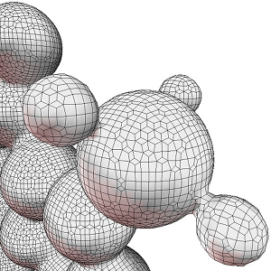

# Introduction
This project provides a simple C++ implementation of the dual marching cubes
algorithm described in the paper
[Dual Marching Cubes](https://dl.acm.org/citation.cfm?id=1034484)
from Gregory M. Nielson.
It is a byproduct of some work I did as a student assistent back in 2009.
Though there are other implementations out there it might still be helpfull
to someone.

Unfortunately, under rare circumstances the original algorithm can create
non-manifold meshes. See the remarks of the original paper on this problem.
In chapter 3.3.5 of his book "Isosurfaces: Geometry, Topology, and Algorithms"
Rephael Wenger proposed the *manifold* dual marching cubes algorithm as a
possible solution, which is also included in this implementation.

# Requirements
* C++11
* No other dependencies

# Implementation
The algorithm is implemented in the files `dualmc.h`, `dualmc.tpp`,
and `dualmc_tables.tpp`. A simple example command-line application which demonstrates
basic usage is provided as well. An application for generating the (manifold)
dual marching cubes tables is implemented in `apps/gentables`.

Dual point computation could be improved using Hermite data or at least first
derivatives as described in [Dual Contouring of Hermite Data](https://dl.acm.org/citation.cfm?id=566586).
So feel free to contribute :)

# Example Application
To build the example and see the available options in a Linux environment type:

    $ make
    $ ./dmc -help

A basic CMAKE file is provided as well.
If this still does not suit you under Windows or OS X the adept programmer should have no problems
setting up a small project.

## RAW Files
The example application can only read 8-bit and 16-bit volume data sets in the
very limited *RAW* format (i.e. only stores raw data, no further information such
as the volume grid dimension is included).
A classic source for RAW files is http://www.volvis.org/ . Currently, the site
does not seem to be available.
The [OpenQVis](http://openqvis.sourceforge.net/index.html) project also provides some
data sets in RAW format.
Another source is [The Volume Library](http://www9.informatik.uni-erlangen.de/External/vollib/)
from Stefan Roettger. This site provides files in the more versatile *PMV* format
but also code which can convert these files to RAW.

The example application provides a small cube data set (32^3)and can also generate a
caffeine molecule.
To extract a surface from the cube volume type:

    $ ./dmc -raw data/cube.raw 32 32 32 -iso 0.5

The iso value of 0.5 is mapped to a middle density w.r.t. the bit-depth of the data set.
For the caffeine data set type:

    $ ./dmc -caffeine -iso 0.5



For code simplicity the example outputs surfaces in the
[Wavefront OBJ](http://www.fileformat.info/format/wavefrontobj/egff.htm)
format.

# Streaming Extraction
Some volumes can only be read one z-plane at a time. For these
`DualMC<T>` offers `buildStreaming`, which applies the same (manifold)
dual marching cubes rules as `build` but hands vertices and quads directly
to caller supplied callbacks instead of materializing the whole mesh.
Only O(dimX\*dimY) working storage is used, independent of the volume
depth and the extracted surface size.

The following example streams a float volume plane by plane and writes the
surface directly in Wavefront OBJ format (OBJ indices are one-based):

```cpp
#include <cstdio>
#include "dualmc.h"

bool streamObj(FILE* in, FILE* out,
               int32_t nx, int32_t ny, int32_t nz, float iso) {
    dualmc::DualMC<float> builder;
    dualmc::StreamStats stats;
    return builder.buildStreaming(nx, ny, nz, iso, true,
        [&](int32_t z, float* dst, std::size_t count) {
            (void)z; // planes are requested in ascending z order
            return std::fread(dst, sizeof(float), count, in) == count;
        },
        [&](dualmc::QuadIndexType, const dualmc::Vertex& v) {
            return std::fprintf(out, "v %f %f %f\n", v.x, v.y, v.z) >= 0;
        },
        [&](const dualmc::Quad& q) {
            return std::fprintf(out, "f %d %d %d %d\n",
                q.i0 + 1, q.i1 + 1, q.i2 + 1, q.i3 + 1) >= 0;
        },
        stats);
}
```

Each callback may abort the extraction by returning `false`, in which case
`buildStreaming` returns `false` as well. `stats` reports how many vertices
and quads were emitted and the peak number of simultaneously kept sample
values and vertex keys.

# License
[BSD 3-Clause License](LICENSE)
