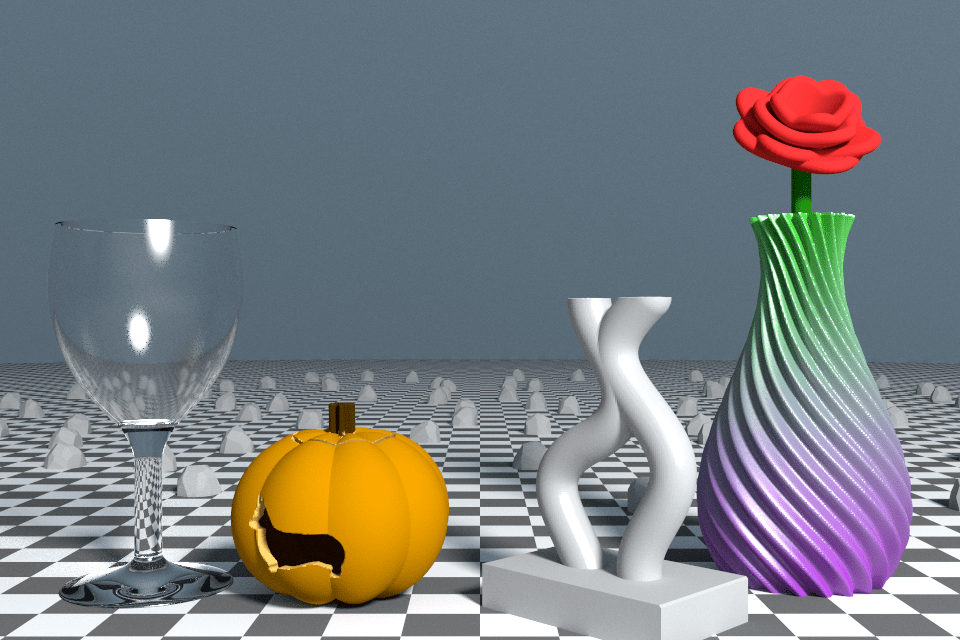
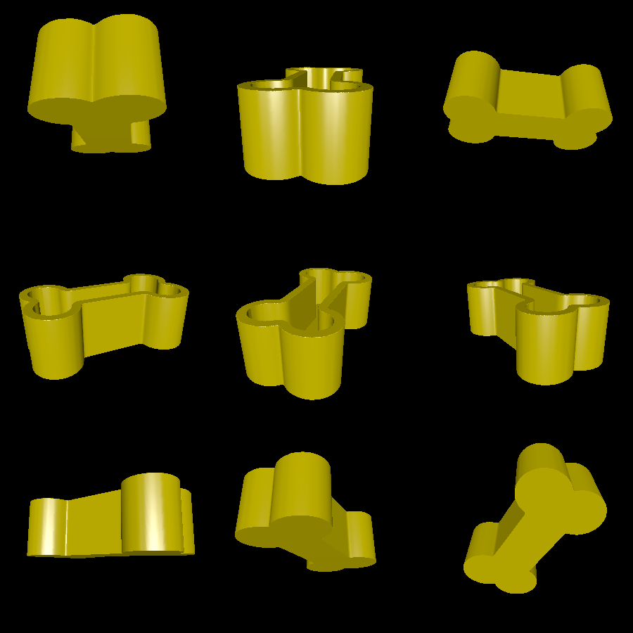

# model3d [](https://godoc.org/github.com/unixpickle/model3d/model3d) 

This is a collection of tools for programmatically creating, manipulating, and rendering 3D models.

The following image was created completely from models made with `model3d`, rendered with the `render3d` sub-package of `model3d`:



See the [showcase example](examples/renderings/showcase) for details on how that image was created, and which models it uses (all of which are included in the [examples](examples) directory).

# Examples

If you are eager to get started, you may jump right into the [examples](examples) directory. Most of these examples produce models which can be 3D printed, although a few are more focused on cool-looking renderings.

Here's a few examples you may want to check out first:

 * [vase](examples/decoration/vase) - a 3D-printable vase. This example gives a really simple picture of how to create a custom `model3d.Solid` implementation and turn it into a mesh.
 * [heart_box](examples/romantic/heart_box) - a 3D-printable heart-shaped box. This example incorporates a 2D image (a heart) into a 3D design using the `model2d` sub-package. It gives an overview of how to inset (i.e. shrink) shapes, and how to build 3D solids out of them.
 * [table](examples/usable/table) - a multi-part 3D printable bedside table. This example shows how to compose simple solids into more complex solids. It also shows how to use the `toolbox3d` sub-package to print parts with built-in screws and screw-holes.
 * [cornell_box](examples/renderings/cornell_box) - a classic ray tracing demo. This example shows how to construct 3D scenes and objects and render them with the `render3d` sub-package.

# Creating models as Solids

There are four ways to represent objects in `model3d`. These are `Solid`, `Collider`, `Mesh`, and `SDF`. The GoDoc has more information on these representations, so let's focus on the `Solid`.

A `Solid` represents an object as a boolean function, where the function returns `true` for points inside the object. In particular, a `Solid` is a simple interface:

```go
type Solid interface {
	Min() Coord3D
	Max() Coord3D
	Contains(p Coord3D) bool
}
```

Due to their simple and flexible representation, `Solid`s are easy to implement, compose, and derive from other shapes. The `model3d` package includes several APIs for composing solids, such as `JoinedSolid` and `SubtractedSolid`. It also includes several pre-built solids, such as `Sphere`, `Cylinder`, and `Rect`.

Once you have a `Solid` that you want to render or print, you can convert it into a triangle mesh using marching cubes. Here's an example of creating a sphere 3D model out of a `Solid`:

```go
solid := &model3d.Sphere{Radius: 1.0}
mesh := model3d.MarchingCubesSearch(solid, 0.01, 8)
mesh.SaveGroupedSTL("output.stl")
```

The resulting `.stl` file `output.stl` can be loaded into external applications, sent to a 3D printer, etc.

# Rendering models

The `render3d` sub-package provides a variety of ways to render a 3D model. For the easiest API, use `render3d.SaveRandomGrid`, which renders a model from a variety of random angles (but assuming the z-axis is the axis of gravity), and saves the renderings to a file. It can take `*model3d.Mesh`, `model3d.Collider`, and `render3d.Object` arguments, and automatically adds colors/textures if needed.

Here's an example when using this API to render a dog-bone-shaped box:



That rendering was created with this one line of code:

```go
render3d.SaveRandomGrid("rendering_box.png", mesh, 3, 3, 300, nil)
```

# Multi-process dual contouring

`DualContouring.Mesh` runs entirely inside one process. When the field is
expensive to sample, `DualContouring.MeshProcess` splits the global grid into
z-axis slabs and extracts each slab in a separate worker process, while the
parent process only reads the `Solid`'s bounds and assembles the final surface.

```go
dc := &model3d.DualContouring{
    S:     model3d.SolidSurfaceEstimator{Solid: solid},
    Delta: 0.1,
    // Repair runs globally in the parent after every slab reports.
    Repair: true,
}
mesh, err := dc.MeshProcess(ctx, command, field, workers, slabRows)
```

* `command` is a fully-specified command line that starts a worker program.
  The `cmd/dcprocess` example is both a parent and a worker (its `-worker`
  flag); worker programs call
  `model3d.ServeDualContourWorker(os.Stdin, os.Stdout, factory)`.
* `field` is an opaque byte description passed unchanged to the worker's
  `factory func([]byte) (SolidSurfaceEstimator, error)`. **The caller owns the
  field encoding and is responsible for rebuilding the `Solid` inside the
  factory.** The `model3d` package never interprets these bytes. The rebuilt
  field's `Min()`/`Max()` must match the parent's bounds or the call fails.
* `workers` bounds the number of concurrently running processes; `slabRows`
  is the number of global z-axis cube layers owned by each slab. Every slab
  shares the same global grid origin, padding, jitter and grid-edge identity,
  so each face is generated exactly once even though neighboring slabs
  recompute a one-layer halo. No floating-point coordinate welding is used.
* All geometry sampling, Hermite data and per-cube QEF solves happen in the
  workers. The parent keeps the final mesh and the global identity table only.
  When `Repair` is set, singular edges and vertices are repaired once, in the
  parent, against the full global grid after every unrepaired face has been
  collected.

## Wire protocol

The protocol runs over the worker's stdout as length-prefixed binary frames
(`1` message-type byte, a big-endian `uint32` length, then a JSON payload);
stderr is drained separately and can never be parsed as a response.

1. The parent sends a `hello` frame containing the full DC configuration
   (bounds, grid coordinates, repair/clipping/QEF/triangulation settings and
   the estimator tuning from the parent's `SolidSurfaceEstimator`) plus the
   opaque field bytes.
2. The worker rebuilds the field through the factory, verifies the bounds and
   answers with a `ready` frame carrying its `min`/`max`.
3. The parent sends `request` frames describing one slab each (z range and the
   current global must-clip coordinate set). The worker answers with a
   `result` frame of owned cube positions and triangles, or an `error` frame.
4. With `Repair` enabled and `Clip` disabled, duplicate cube coordinates drive
   the same global must-clip retry loop as the in-process algorithm: the
   parent gathers every slab's coordinates, records new clip coordinates and
   re-dispatches all slabs until a round adds none.

## Statistics

Set the optional `DualContouring.ProcessStats func(DCProcessStats)` callback to
receive one `DCProcessStats` value before every `MeshProcess` return, including
failures and up-front validation errors:

```go
type DCProcessStats struct {
    Slabs           int   // slabs actually dispatched
    Retries         int   // global must-clip retry rounds
    PeakActiveSlabs int   // largest number of simultaneously running workers
    PIDs            []int // worker PIDs, sorted ascending and unique
}
```

The delivered `PIDs` slice is a copy, so mutating it cannot affect internal
state. Cancellation, worker crashes and protocol corruption all return a `nil`
mesh plus an error after every started worker has been reaped; independent
calls share no pending jobs and a failed call can be retried with a fresh one.
`RandomSearchNormals` is not supported across processes and is rejected before
any worker starts.

