# Voxel Space

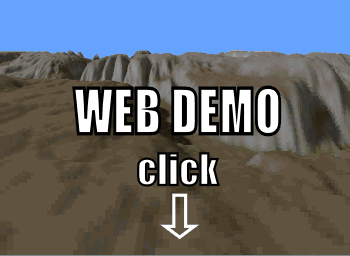

# **[Web Demo of the Voxel Space Engine][project demo]**

## History

Let us go back to the year 1992. The CPUs were 1000 times slower than today and the acceleration via a GPU was unknown or unaffordable. 3D games were calculated exclusively on the CPU and the rendering engine rendered filled polygons with a single color.

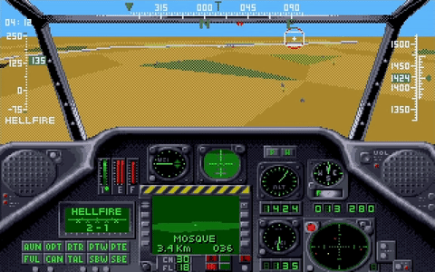
*Game Gunship 2000 published by MicroProse in 1991*

It was during that year [NovaLogic](http://www.novalogic.com/) published the game [Comanche](https://en.wikipedia.org/wiki/Comanche_(video_game_series)).

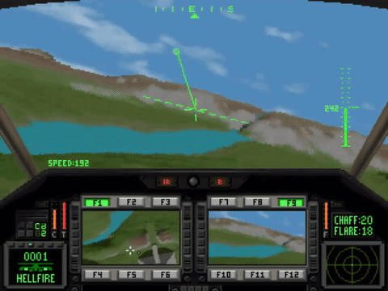
*Game Comanche published by NovaLogic in 1992*

The graphics were breathtaking for the time being and in my opinion 3 years ahead of its time. You see many more details such as textures on mountains and valleys, and for the first time a neat shading and even shadows. Sure, it's pixelated, but all games in those years were pixelated.

## Render algorithm

[Comanche](https://en.wikipedia.org/wiki/Comanche_(video_game_series)) uses a technique called [Voxel Space](https://en.wikipedia.org/wiki/Voxel_Space), which is based on the same ideas like [ray casting](https://en.wikipedia.org/wiki/Ray_casting). Hence the Voxel Space engine is a 2.5D engine, it doesn't have all the levels of freedom that a regular 3D engine offers.

### Height map and color map

The easiest way to represent a terrain is through a height map and color map. For the game Comanche a 1024 \* 1024 one byte height map and a 1024 \* 1024 one byte color map is used which you can download on this site. These maps are periodic:

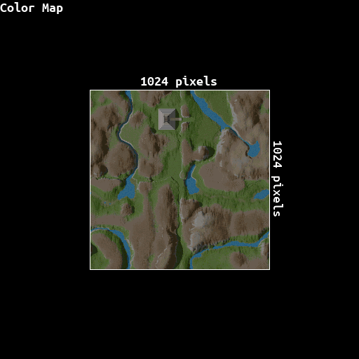

Such maps limit the terrain to "one height per position on the map" - Complex geometries such as buildings or trees are not possible to represent. However, a great advantage of the colormap is, that it already contains the shading and shadows. The Voxel Space engine just takes the color and doesn't have to compute illumination during the render process.

### Basic algorithm
For a 3D engine the rendering algorithm is amazingly simple. The Voxel Space engine rasters the height and color map and draws vertical lines. The following figure demonstrate this technique.

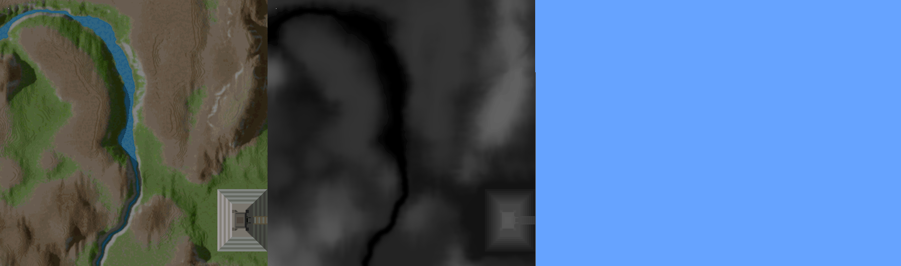

 * Clear Screen.
 * To guarantee occlusion start from the back and render to the front. This is called painter algorithm.
 * Determine the line on the map, which corresponds to the same optical distance from the observer. Consider the field of view and the [perspective projection](https://en.wikipedia.org/wiki/3D_projection) (Objects are smaller farther away)
 * Raster the line so that it matches the number of columns of the screen.
 * Retrieve the height and color from the 2D maps corresponding of the segment of the line.
 * Perform the [perspective projection](https://en.wikipedia.org/wiki/3D_projection) for the height coordinate.
 * Draw a vertical line with the corresponding color with the height retrieved from the perspective projection.

The core algorithm contains in its simplest form only a few lines of code (python syntax):

```python
def Render(p, height, horizon, scale_height, distance, screen_width, screen_height):
    # Draw from back to the front (high z coordinate to low z coordinate)
    for z in range(distance, 1, -1):
        # Find line on map. This calculation corresponds to a field of view of 90°
        pleft  = Point(-z + p.x, -z + p.y)
        pright = Point( z + p.x, -z + p.y)
        # segment the line
        dx = (pright.x - pleft.x) / screen_width
        # Raster line and draw a vertical line for each segment
        for i in range(0, screen_width):
            height_on_screen = (height - heightmap[pleft.x, pleft.y]) / z * scale_height. + horizon
            DrawVerticalLine(i, height_on_screen, screen_height, colormap[pleft.x, pleft.y])
            pleft.x += dx

# Call the render function with the camera parameters:
# position, height, horizon line position,
# scaling factor for the height, the largest distance, 
# screen width and the screen height parameter
Render( Point(0, 0), 50, 120, 120, 300, 800, 600 )
```

### Add rotation

With the algorithm above we can only view to the north. A different angle needs a few more lines of code to rotate the coordinates.

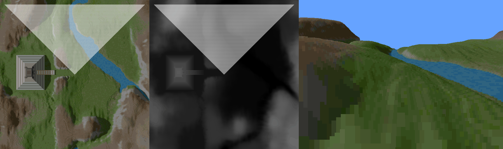

```python
def Render(p, phi, height, horizon, scale_height, distance, screen_width, screen_height):
    # precalculate viewing angle parameters
    var sinphi = math.sin(phi);
    var cosphi = math.cos(phi);

    # Draw from back to the front (high z coordinate to low z coordinate)
    for z in range(distance, 1, -1):

        # Find line on map. This calculation corresponds to a field of view of 90°
        pleft = Point(
            (-cosphi*z - sinphi*z) + p.x,
            ( sinphi*z - cosphi*z) + p.y)
        pright = Point(
            ( cosphi*z - sinphi*z) + p.x,
            (-sinphi*z - cosphi*z) + p.y)
        
        # segment the line
        dx = (pright.x - pleft.x) / screen_width
        dy = (pright.y - pleft.y) / screen_width

        # Raster line and draw a vertical line for each segment
        for i in range(0, screen_width):
            height_on_screen = (height - heightmap[pleft.x, pleft.y]) / z * scale_height. + horizon
            DrawVerticalLine(i, height_on_screen, screen_height, colormap[pleft.x, pleft.y])
            pleft.x += dx
            pleft.y += dy

# Call the render function with the camera parameters:
# position, viewing angle, height, horizon line position, 
# scaling factor for the height, the largest distance, 
# screen width and the screen height parameter
Render( Point(0, 0), 0, 50, 120, 120, 300, 800, 600 )
```

### More performance

There are of course a lot of tricks to achieve higher performance.

* Instead of drawing from back to the front we can draw from front to back. The advantage is, the we don't have to draw lines to the bottom of the screen every time because of occlusion. However, to guarantee occlusion we need an additional y-buffer. For every column, the highest y position is stored. Because we are drawing from the front to back, the visible part of the next line can only be larger then the highest line previously drawn.
* Level of Detail. Render more details in front but less details far away. 

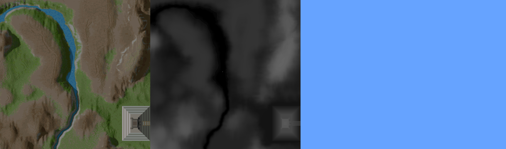

```python
def Render(p, phi, height, horizon, scale_height, distance, screen_width, screen_height):
    # precalculate viewing angle parameters
    var sinphi = math.sin(phi);
    var cosphi = math.cos(phi);
    
    # initialize visibility array. Y position for each column on screen 
    ybuffer = np.zeros(screen_width)
    for i in range(0, screen_width):
        ybuffer[i] = screen_height

    # Draw from front to the back (low z coordinate to high z coordinate)
    dz = 1.
    z = 1.
    while z < distance
        # Find line on map. This calculation corresponds to a field of view of 90°
        pleft = Point(
            (-cosphi*z - sinphi*z) + p.x,
            ( sinphi*z - cosphi*z) + p.y)
        pright = Point(
            ( cosphi*z - sinphi*z) + p.x,
            (-sinphi*z - cosphi*z) + p.y)

        # segment the line
        dx = (pright.x - pleft.x) / screen_width
        dy = (pright.y - pleft.y) / screen_width

        # Raster line and draw a vertical line for each segment
        for i in range(0, screen_width):
            height_on_screen = (height - heightmap[pleft.x, pleft.y]) / z * scale_height. + horizon
            DrawVerticalLine(i, height_on_screen, ybuffer[i], colormap[pleft.x, pleft.y])
            if height_on_screen < ybuffer[i]:
                ybuffer[i] = height_on_screen
            pleft.x += dx
            pleft.y += dy

        # Go to next line and increase step size when you are far away
        z += dz
        dz += 0.2

# Call the render function with the camera parameters:
# position, viewing angle, height, horizon line position, 
# scaling factor for the height, the largest distance, 
# screen width and the screen height parameter
Render( Point(0, 0), 0, 50, 120, 120, 300, 800, 600 )
```

## Perspective ray-casting mode

The classic engine above is a 2.5D column renderer: it can only sweep vertical
screen columns and "looking up/down" just shifts the horizon. `terrain-renderer.js`
adds a second, fully 3D perspective mode with real pitch, yaw and roll. The old
renderer is kept unchanged for comparison and is still the default in
`VoxelSpace.html` (switch with the **Mode** control).

### Column terrain convention

The height field is a field of solid columns, not a smooth surface:

* Every integer XY cell `(cx, cy)` is one column filling the box
  `[cx, cx+1) × [cy, cy+1) × (−∞, altitude]`.
* `map.width` and `map.height` may be any positive integers. Cells are stored
  row-major at `altitude[x + width*y]` / `color[x + width*y]` and plain numeric
  arrays are fine — no image files are required.
* Columns repeat **periodically** in both X and Y, including for negative
  coordinates: a cell is addressed with a floor modulo,
  `index = mod(cx, width) + width * mod(cy, height)`.
* Heights are never interpolated; a column keeps one constant altitude. Only
  column tops and the vertical walls created by an altitude difference between
  neighbours are surfaces. A grid line between two equal-height columns is not
  a surface.
* The colour of a hit is the `color` value of the column that owns the surface.

### Camera convention

`renderPerspective(map, camera, width, height)` takes a camera with
`position`, `yaw`, `pitch`, `roll`, `fovY`, `near`, `far` and `background`
(angles in radians). World **Z points up**. With every angle zero the forward
vector is `(0, −1, 0)` and the right vector is `(1, 0, 0)`:

1. **yaw** rotates around world Z,
2. **pitch** then rotates around the resulting right vector,
3. **roll** finally rotates around the forward vector,

each using the right-hand rule with positive angles. Rays pass through pixel
centres, are shaped by the vertical field of view `fovY`, and are normalized to
unit vectors. The call returns `{color: Uint32Array, depth: Float64Array}`;
`depth` is the world distance to the first intersection and is `Infinity` for
background pixels.

### Ray traversal

`traceTerrain(map, origin, direction, near, far)` walks one ray using a DDA
that advances only on XY grid-line crossing events and on the current column's
top plane — never on a fixed step size. `near`/`far` are world distances along
the ray and the search interval is closed. If the origin (or the `near` point)
is inside a column, the first boundary that *leaves* the solid is returned
rather than `near` itself. Coincident events at one distance follow the face
priority **Z, then X, then Y**, and every normal points out of the solid
column. Zero direction components, simultaneous X/Y crossings, rays riding a
grid line and exact top-edge hits all terminate deterministically. It returns
`{distance, position, normal, cell}` where `cell` is the modulo-wrapped
`[x, y]`, or `null` when nothing is hit.

The module works both as a browser `<script>` (global `TerrainRenderer`) and as
a CommonJS module. Tests live in `test/perspective.js` and validate whole
frames against a slow, independent per-column slab/interval reference;
`examples/generate-perspective-ppm.js` writes a rolled, pillar-occluded PPM.

## Links

[Web Project demo][project demo] page

[Voxel terrain engine - an introduction](https://web.archive.org/web/20131113094653/http://www.codermind.com/articles/Voxel-terrain-engine-building-the-terrain.html)

[Personal website](http://www.simulationcorner.net)


## Maps
[color](maps/C1W.png),
[height](maps/D1.png)

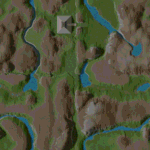
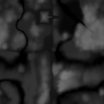

[color](maps/C2W.png),
[height](maps/D2.png)

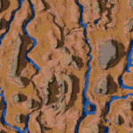
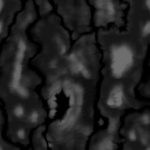

[color](maps/C3.png),
[height](maps/D3.png)

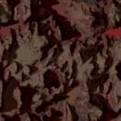
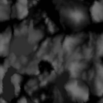

[color](maps/C4.png),
[height](maps/D4.png)

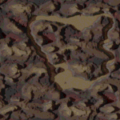
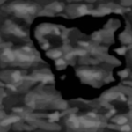

[color](maps/C5W.png),
[height](maps/D5.png)

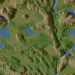
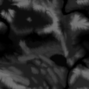

[color](maps/C6W.png),
[height](maps/D6.png)

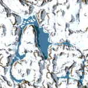


[color](maps/C7W.png),
[height](maps/D7.png)

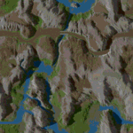
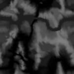

[color](maps/C8.png),
[height](maps/D6.png)

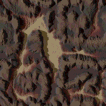


[color](maps/C9W.png),
[height](maps/D9.png)

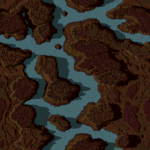
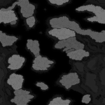

[color](maps/C10W.png),
[height](maps/D10.png)

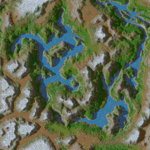
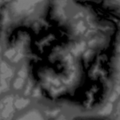

[color](maps/C11W.png),
[height](maps/D11.png)

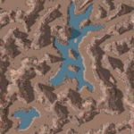
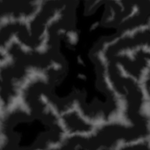

[color](maps/C12W.png),
[height](maps/D11.png)

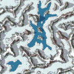


[color](maps/C13.png),
[height](maps/D13.png)

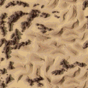
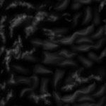

[color](maps/C14.png),
[height](maps/D14.png)


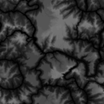

[color](maps/C14W.png),
[height](maps/D14.png)

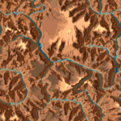


[color](maps/C15.png),
[height](maps/D15.png)

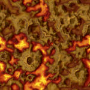
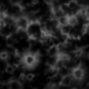

[color](maps/C16W.png),
[height](maps/D16.png)

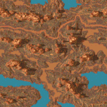
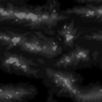

[color](maps/C17W.png),
[height](maps/D17.png)

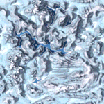
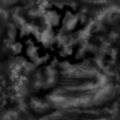

[color](maps/C18W.png),
[height](maps/D18.png)

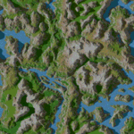
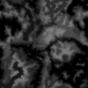

[color](maps/C19W.png),
[height](maps/D19.png)

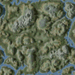
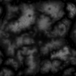

[color](maps/C20W.png),
[height](maps/D20.png)

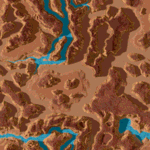
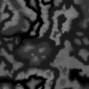

[color](maps/C21.png),
[height](maps/D21.png)

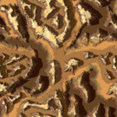


[color](maps/C22W.png),
[height](maps/D22.png)

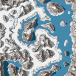
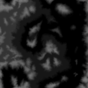

[color](maps/C23W.png),
[height](maps/D21.png)

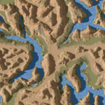


[color](maps/C24W.png),
[height](maps/D24.png)

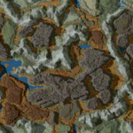
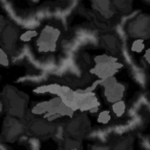

[color](maps/C25W.png),
[height](maps/D25.png)


[color](maps/C26W.png),
[height](maps/D18.png)


[color](maps/C27W.png),
[height](maps/D15.png)


[color](maps/C28W.png),
[height](maps/D25.png)


[color](maps/C29W.png),
[height](maps/D16.png)


## License

The software part of the repository is under the MIT license. Please read the license file for more information. Please keep in mind, that the Voxel Space technology might be still [patented](https://patents.justia.com/assignee/novalogic-inc) in some countries. The color and height maps are reverse engineered from the game Comanche and are therefore excluded from the license.

[project demo]: https://s-macke.github.io/VoxelSpace/VoxelSpace.html
