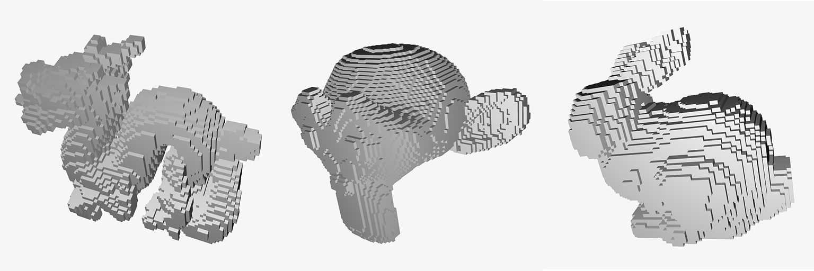

# Mesh voxelizer
_Header only mesh voxelizer in ANSI C_



**About**

Converts meshes and performs triangle-cube intersection to output a voxelized mesh.

**How to use**

Include the header only file as following once:
```c
#define VOXELIZER_IMPLEMENTATION
#include "voxelizer.h"
```

To generate a voxelized mesh, create an instance of `vx_mesh_t` and initialize its
vertices and indices like this:

```c
vx_mesh_t* mesh;
vx_mesh_t* result;

mesh = vx_mesh_alloc(nvertices, nindices);

// Add vertices and indices from the original mesh you want to voxelize
// [...]

// Precision factor to reduce "holes" artifact
float precision = 0.01;

// Run voxelization
result = vx_voxelize(mesh, 0.025, 0.025, 0.025, precision);

vx_mesh_free(result);
vx_mesh_free(mesh);
```

## Solid occupancy (3d texture)

`vx_voxelize_pc` and `vx_voxelize` only cover the triangle *surface*. For a
closed model you can instead rasterize a solid occupancy volume, directly
usable as a 3d texture, with the independent entry point
`vx_voxelize_solid`. It shares no state or color logic with the surface entry
points and leaves them unchanged.

```c
int vx_voxelize_solid(const vx_mesh_t* mesh,
                      const double origin[3],
                      const double step[3],
                      const unsigned int size[3],
                      unsigned char* out);
```

- `origin` is the world position of the **first sampling center**, `step` the
  positive spacing between centers on each axis, and `size` the positive number
  of voxels per axis.
- `out` is a caller-owned buffer of `size[0]*size[1]*size[2]` bytes. Every
  byte is written to strictly `0` or `1`, stored x-fastest:
  `out[(z*size[1]+y)*size[0]+x]`.
- Returns `1` on success, `0` on invalid arguments or allocation failure.

### Occupancy and orientation

Occupancy uses the **generalized (integer) winding number**, accumulated from
directed triangle crossings along world +X — never an odd/even parity toggle
and never a flood fill.

- A voxel center lying exactly on any non-degenerate triangle is always `1`.
- Otherwise the voxel is `1` when its winding number is non-zero.
- Each shell must be closed and consistently oriented. Multiple shells may
  overlap and an entire shell may be flipped; zero-area faces are ignored.
- A same-oriented inner shell stays solid; a reversed inner shell carves a
  cavity. Two coincident shells with opposite orientation cancel inside while
  their surface samples remain `1`.
- `colors` and `normals` take no part, and no precision/epsilon inflation is
  applied, so distinct parallel shells keep the cavity between them.

The grid is sampled at center coordinates only. A mesh may extend beyond the
output range: crossings outside the output X range are still accumulated, so
voxelizing the whole volume at once and voxelizing tiles with shifted origins
produce byte-identical results, including with negative coordinates and
non-uniform spacing.

### Validation and memory ownership

The function rejects (returns `0`, leaving `out` untouched) null pointers,
non-finite vertex coordinates or steps, non-positive steps, zero sizes, and
`size_t` overflow of the total voxel count. An empty mesh is valid and yields
all zeros. Other topology errors are not checked.

All scratch memory is internal and released before returning, including on
failure. The only buffer the caller owns is `out`.

The allocation macros can be overridden by defining them before including the
header (they are guarded with `#ifndef`, so the default macros and the old
entry points are unchanged):

```c
#define VX_MALLOC(T, N) my_malloc((N) * sizeof(T))
#define VX_CALLOC(T, N) my_calloc((N) * sizeof(T))
#define VX_FREE(T)       my_free(T)
#define VOXELIZER_IMPLEMENTATION
#include "voxelizer.h"
```

