# Voxel Space


# **[Web Demo of the Voxel Space Engine][project demo]**

## History

Let us go back to the year 1992. The CPUs were 1000 times slower than today and the acceleration via a GPU was unknown or unaffordable. 3D games were calculated exclusively on the CPU and the rendering engine rendered filled polygons with a single color.


*Game Gunship 2000 published by MicroProse in 1991*

It was during that year [NovaLogic](http://www.novalogic.com/) published the game [Comanche](https://en.wikipedia.org/wiki/Comanche_(video_game_series)).

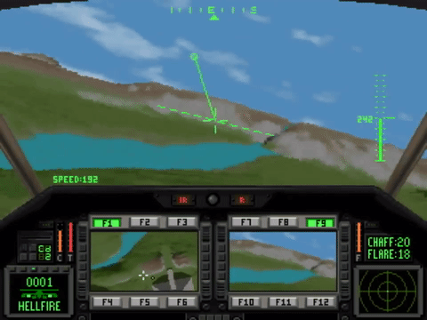
*Game Comanche published by NovaLogic in 1992*

The graphics were breathtaking for the time being and in my opinion 3 years ahead of its time. You see many more details such as textures on mountains and valleys, and for the first time a neat shading and even shadows. Sure, it's pixelated, but all games in those years were pixelated.

## Render algorithm

[Comanche](https://en.wikipedia.org/wiki/Comanche_(video_game_series)) uses a technique called [Voxel Space](https://en.wikipedia.org/wiki/Voxel_Space), which is based on the same ideas like [ray casting](https://en.wikipedia.org/wiki/Ray_casting). Hence the Voxel Space engine is a 2.5D engine, it doesn't have all the levels of freedom that a regular 3D engine offers.

### Height map and color map

The easiest way to represent a terrain is through a height map and color map. For the game Comanche a 1024 \* 1024 one byte height map and a 1024 \* 1024 one byte color map is used which you can download on this site. These maps are periodic:


Such maps limit the terrain to "one height per position on the map" - Complex geometries such as buildings or trees are not possible to represent. However, a great advantage of the colormap is, that it already contains the shading and shadows. The Voxel Space engine just takes the color and doesn't have to compute illumination during the render process.

### Basic algorithm
For a 3D engine the rendering algorithm is amazingly simple. The Voxel Space engine rasters the height and color map and draws vertical lines. The following figure demonstrate this technique.

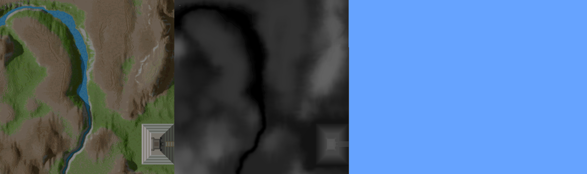

 * Clear Screen.
 * To guarantee occlusion start from the back and render to the front. This is called painter algorithm.
 * Determine the line on the map, which corresponds to the same optical distance from the observer. Consider the field of view and the [perspective projection](https://en.wikipedia.org/wiki/3D_projection) (Objects are smaller farther away)
 * Raster the line so that it matches the number of columns of the screen.
 * Retrieve the height and color from the 2D maps corresponding of the segment of the line.
 * Perform the [perspective projection](https://en.wikipedia.org/wiki/3D_projection) for the height coordinate.
 * Draw a vertical line with the corresponding color with the height retrieved from the perspective projection.

The core algorithm contains in its simplest form only a few lines of code (python syntax):

```python
def Render(p, height, horizon, scale_height, distance, screen_width, screen_height):
    # Draw from back to the front (high z coordinate to low z coordinate)
    for z in range(distance, 1, -1):
        # Find line on map. This calculation corresponds to a field of view of 90°
        pleft  = Point(-z + p.x, -z + p.y)
        pright = Point( z + p.x, -z + p.y)
        # segment the line
        dx = (pright.x - pleft.x) / screen_width
        # Raster line and draw a vertical line for each segment
        for i in range(0, screen_width):
            height_on_screen = (height - heightmap[pleft.x, pleft.y]) / z * scale_height. + horizon
            DrawVerticalLine(i, height_on_screen, screen_height, colormap[pleft.x, pleft.y])
            pleft.x += dx

# Call the render function with the camera parameters:
# position, height, horizon line position,
# scaling factor for the height, the largest distance, 
# screen width and the screen height parameter
Render( Point(0, 0), 50, 120, 120, 300, 800, 600 )
```

### Add rotation

With the algorithm above we can only view to the north. A different angle needs a few more lines of code to rotate the coordinates.

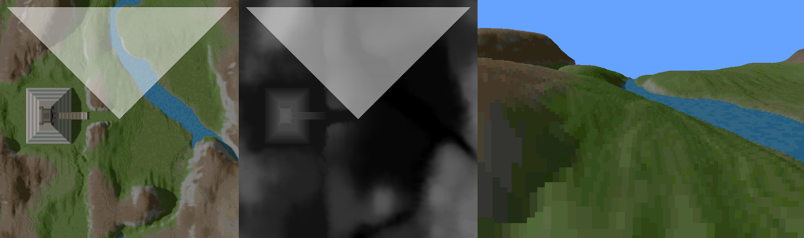

```python
def Render(p, phi, height, horizon, scale_height, distance, screen_width, screen_height):
    # precalculate viewing angle parameters
    var sinphi = math.sin(phi);
    var cosphi = math.cos(phi);

    # Draw from back to the front (high z coordinate to low z coordinate)
    for z in range(distance, 1, -1):

        # Find line on map. This calculation corresponds to a field of view of 90°
        pleft = Point(
            (-cosphi*z - sinphi*z) + p.x,
            ( sinphi*z - cosphi*z) + p.y)
        pright = Point(
            ( cosphi*z - sinphi*z) + p.x,
            (-sinphi*z - cosphi*z) + p.y)
        
        # segment the line
        dx = (pright.x - pleft.x) / screen_width
        dy = (pright.y - pleft.y) / screen_width

        # Raster line and draw a vertical line for each segment
        for i in range(0, screen_width):
            height_on_screen = (height - heightmap[pleft.x, pleft.y]) / z * scale_height. + horizon
            DrawVerticalLine(i, height_on_screen, screen_height, colormap[pleft.x, pleft.y])
            pleft.x += dx
            pleft.y += dy

# Call the render function with the camera parameters:
# position, viewing angle, height, horizon line position, 
# scaling factor for the height, the largest distance, 
# screen width and the screen height parameter
Render( Point(0, 0), 0, 50, 120, 120, 300, 800, 600 )
```

### More performance

There are of course a lot of tricks to achieve higher performance.

* Instead of drawing from back to the front we can draw from front to back. The advantage is, the we don't have to draw lines to the bottom of the screen every time because of occlusion. However, to guarantee occlusion we need an additional y-buffer. For every column, the highest y position is stored. Because we are drawing from the front to back, the visible part of the next line can only be larger then the highest line previously drawn.
* Level of Detail. Render more details in front but less details far away. 


```python
def Render(p, phi, height, horizon, scale_height, distance, screen_width, screen_height):
    # precalculate viewing angle parameters
    var sinphi = math.sin(phi);
    var cosphi = math.cos(phi);
    
    # initialize visibility array. Y position for each column on screen 
    ybuffer = np.zeros(screen_width)
    for i in range(0, screen_width):
        ybuffer[i] = screen_height

    # Draw from front to the back (low z coordinate to high z coordinate)
    dz = 1.
    z = 1.
    while z < distance
        # Find line on map. This calculation corresponds to a field of view of 90°
        pleft = Point(
            (-cosphi*z - sinphi*z) + p.x,
            ( sinphi*z - cosphi*z) + p.y)
        pright = Point(
            ( cosphi*z - sinphi*z) + p.x,
            (-sinphi*z - cosphi*z) + p.y)

        # segment the line
        dx = (pright.x - pleft.x) / screen_width
        dy = (pright.y - pleft.y) / screen_width

        # Raster line and draw a vertical line for each segment
        for i in range(0, screen_width):
            height_on_screen = (height - heightmap[pleft.x, pleft.y]) / z * scale_height. + horizon
            DrawVerticalLine(i, height_on_screen, ybuffer[i], colormap[pleft.x, pleft.y])
            if height_on_screen < ybuffer[i]:
                ybuffer[i] = height_on_screen
            pleft.x += dx
            pleft.y += dy

        # Go to next line and increase step size when you are far away
        z += dz
        dz += 0.2

# Call the render function with the camera parameters:
# position, viewing angle, height, horizon line position, 
# scaling factor for the height, the largest distance, 
# screen width and the screen height parameter
Render( Point(0, 0), 0, 50, 120, 120, 300, 800, 600 )
```

## Procedural clipmap terrain (`terrain-clipmap.js`)

The original engine needs a full 1024×1024 height/color array in memory. The
optional clipmap mode instead generates terrain on demand around the camera,
so an arbitrarily large procedural world never has to be materialized as one
array. `terrain-clipmap.js` is plain JavaScript with no dependencies; it works
both as a Node CommonJS module and as a classic browser script (the two
constructors become globals).

### Source and point-sampled levels of detail

`new TerrainSource(sampleBase)` wraps a deterministic callback. For every
integer world point `(x, y)` the callback returns `{height, color}`, where
`height` is a finite number and `color` is a `0xAABBGGRR` uint32 (the same
word layout the renderer already uses). The callback is only invoked for grid
points that actually have to fill a cache slot.

`new TerrainClipmap(source, {side, levels})` subscribes a view to a source.
Level `l` has grid spacing `s = 2^l` and stores exactly `side × side` resident
nodes in a fixed ring; the stored value is the source value at the exact world
point `(ix·s, iy·s)` — there is no regional averaging. `moveTo(cx, cy)`
positions every level so that its lower-left grid node is
`(floor(cx/s) − R, floor(cy/s) − R)` with `R = (side−1)/2`. All integer world
coordinates used by the source and the view are restricted to `[-2^30, 2^30]`;
a `moveTo` whose windows would leave that range throws `RangeError` before any
view state changes.

`sample(x, y)` reconstructs the terrain around the last camera center using
Chebyshev distance `r = max(|x−cx|, |y−cy|)`:

* `r ≤ b0/2` uses level 0 alone, with `b_l = (R−2)·2^l`.
* `b_l/2 < r < b_l` blends the bilinear value of level `l` with level `l+1`
  using `w = 2r/b_l − 1` (0 at the inner edge, 1 at the outer edge).
* `r = b_l` belongs to the coarser level, which keeps the transition
  continuous; the last level has no coarser neighbor and is used directly.
* `r > b_last` returns `null`, so the renderer simply skips that sample and
  leaves the background sky untouched.

Each level bilinearly interpolates `floor(x/s)`, `floor(y/s)` and their four
neighbors. Heights and all four RGBA channels are interpolated as floats;
channel rounding and clamping to `0..255` happens once, after any cross-level
blending. `sample` never calls the source and never moves the statistics.

### Sparse edits and override coordinates

`source.edit([{x, y, height, color}, ...])` validates the whole batch first and
commits only if every entry is legal (an illegal batch throws `RangeError` and
leaves the source and every view unchanged). Duplicate coordinates resolve to
the last entry; an empty batch does nothing. Edits are a sparse coverage over
the *unwrapped* integer world coordinates, not the periodic tile coordinates.
When the shipped image maps are used, the read-only base still samples with
periodic modulo, while an edit at `(x, y)` affects exactly that world point and
does not repeat across map tiles. A value read through the coverage still
counts as one source read. Any number of views may subscribe to one source;
after an edit, each live view re-reads only the edited points that land on one
of its level grids and are currently resident. Edits outside the windows cost
nothing, but the coverage persists, so traveling away and back shows the edit
again.

### Cache lifecycle and statistics

Each level owns one fixed ring of `(side+1)²` slots, of which exactly
`side²` hold the current window's nodes; the extra row/column lets a one-cell
move keep the departing edge so stepping straight back into the previous
window needs zero reads. Ring slots carry absolute grid coordinates and are
never copied or reallocated. A `moveTo` reads only the set difference between
the old and new windows: on a diagonal move the two incoming strips share one
corner, which is read a single time; if a window moves by `side` cells or more
on either axis the level is simply filled once. No departed history and no
whole-world pyramid are retained — apart from the sparse edits, memory is
`O(side²·levels)`.

`stats()` reports cumulative `reads`, `fillsByLevel`, the current `resident`
count, plus `lastReads` and `lastFillsByLevel` for the most recent `moveTo` or
edit notification. `source.subscriberCount()` is the number of live views, and
`view.destroy()` removes exactly that subscription; calling a destroyed view
afterwards throws while every other view keeps working.

### Renderer integration, controls and headless use

In `VoxelSpace.html` the **Clipmap LOD** checkbox switches between the original
periodic array path and the clipmap path. The depth stepping, screen
projection, `DrawVerticalLine` and `hiddeny` occlusion are unchanged — only the
terrain fetch is replaced, and samples outside the resident range are skipped.
The camera's ground clearance in `UpdateCamera` uses the same view. The
**Raise ground** button raises the grid point under the camera (through a
sparse source edit in clipmap mode). Switching maps destroys the old view
before building a fresh source, so no old source or subscription survives.
There is no triangle mesh and no separate ray intersector.

The headless production entry points used by the tests are
`SetTerrainMode('clipmap' | 'array')`, `AttachTerrainClipmap(source, view?)`,
`GetTerrainSource()`, `GetTerrainClipmap()` and
`RaiseTerrainUnderCamera(delta)`.

* Tests: `node task_support/run.js target` runs the three synchronous groups in
  `test/clipmap.js` (`windows`, `updates`, `render`) and the example.
* Example: `node examples/clipmap.js frame.ppm` renders a moved and an edited
  procedural frame through the real HTML `Render` and writes a binary P6 PPM.
* The original renderer check still runs via `node task_support/run.js baseline`.

## Links

[Web Project demo][project demo] page

[Voxel terrain engine - an introduction](https://web.archive.org/web/20131113094653/http://www.codermind.com/articles/Voxel-terrain-engine-building-the-terrain.html)

[Personal website](http://www.simulationcorner.net)


## Maps
[color](maps/C1W.png),
[height](maps/D1.png)


[color](maps/C2W.png),
[height](maps/D2.png)

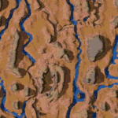
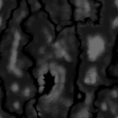

[color](maps/C3.png),
[height](maps/D3.png)

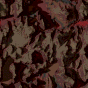
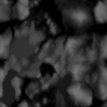

[color](maps/C4.png),
[height](maps/D4.png)


[color](maps/C5W.png),
[height](maps/D5.png)

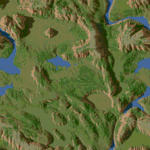
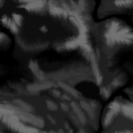

[color](maps/C6W.png),
[height](maps/D6.png)


[color](maps/C7W.png),
[height](maps/D7.png)

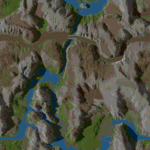
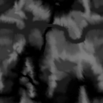

[color](maps/C8.png),
[height](maps/D6.png)

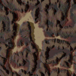


[color](maps/C9W.png),
[height](maps/D9.png)


[color](maps/C10W.png),
[height](maps/D10.png)

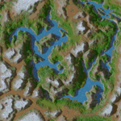


[color](maps/C11W.png),
[height](maps/D11.png)

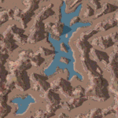


[color](maps/C12W.png),
[height](maps/D11.png)

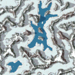


[color](maps/C13.png),
[height](maps/D13.png)


[color](maps/C14.png),
[height](maps/D14.png)


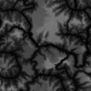

[color](maps/C14W.png),
[height](maps/D14.png)


[color](maps/C15.png),
[height](maps/D15.png)


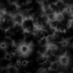

[color](maps/C16W.png),
[height](maps/D16.png)


[color](maps/C17W.png),
[height](maps/D17.png)


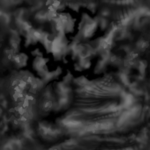

[color](maps/C18W.png),
[height](maps/D18.png)


[color](maps/C19W.png),
[height](maps/D19.png)

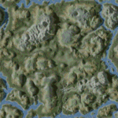


[color](maps/C20W.png),
[height](maps/D20.png)


[color](maps/C21.png),
[height](maps/D21.png)

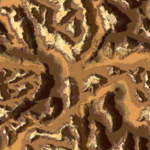


[color](maps/C22W.png),
[height](maps/D22.png)


[color](maps/C23W.png),
[height](maps/D21.png)

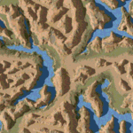


[color](maps/C24W.png),
[height](maps/D24.png)


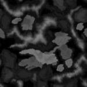

[color](maps/C25W.png),
[height](maps/D25.png)


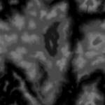

[color](maps/C26W.png),
[height](maps/D18.png)


[color](maps/C27W.png),
[height](maps/D15.png)


[color](maps/C28W.png),
[height](maps/D25.png)

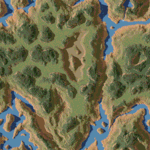


[color](maps/C29W.png),
[height](maps/D16.png)

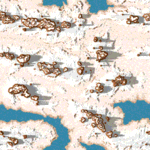


## License

The software part of the repository is under the MIT license. Please read the license file for more information. Please keep in mind, that the Voxel Space technology might be still [patented](https://patents.justia.com/assignee/novalogic-inc) in some countries. The color and height maps are reverse engineered from the game Comanche and are therefore excluded from the license.

[project demo]: https://s-macke.github.io/VoxelSpace/VoxelSpace.html
