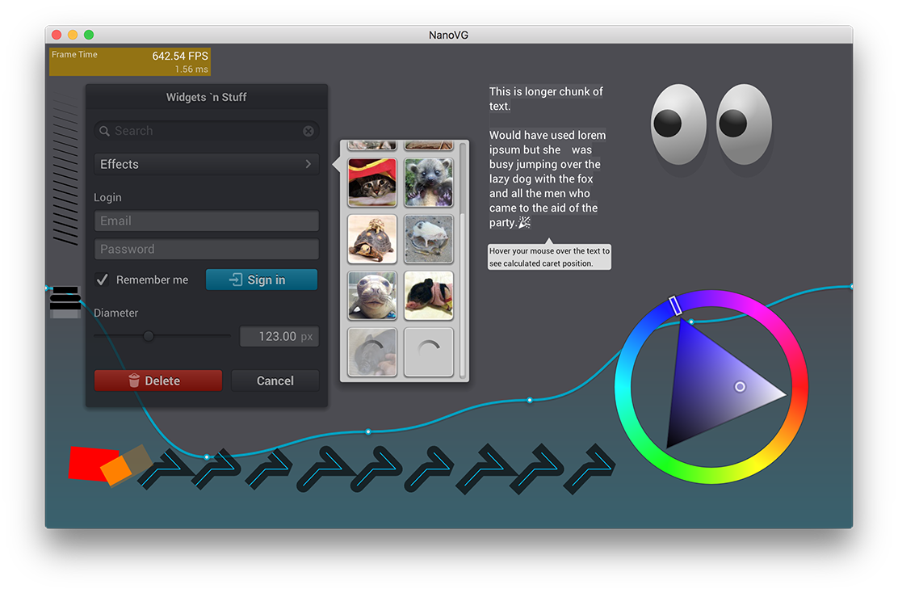

*This project is not actively maintained.*

NanoVG
==========

NanoVG is small antialiased vector graphics rendering library for OpenGL. It has lean API modeled after HTML5 canvas API. It is aimed to be a practical and fun toolset for building scalable user interfaces and visualizations.

## Screenshot



Usage
=====

The NanoVG API is modeled loosely on HTML5 canvas API. If you know canvas, you're up to speed with NanoVG in no time.

## Creating drawing context

The drawing context is created using platform specific constructor function. If you're using the OpenGL 2.0 back-end the context is created as follows:
```C
#define NANOVG_GL2_IMPLEMENTATION	// Use GL2 implementation.
#include "nanovg_gl.h"
...
struct NVGcontext* vg = nvgCreateGL2(NVG_ANTIALIAS | NVG_STENCIL_STROKES);
```

The first parameter defines flags for creating the renderer.

- `NVG_ANTIALIAS` means that the renderer adjusts the geometry to include anti-aliasing. If you're using MSAA, you can omit this flags. 
- `NVG_STENCIL_STROKES` means that the render uses better quality rendering for (overlapping) strokes. The quality is mostly visible on wider strokes. If you want speed, you can omit this flag.

Currently there is an OpenGL back-end for NanoVG: [nanovg_gl.h](/src/nanovg_gl.h) for OpenGL 2.0, OpenGL ES 2.0, OpenGL 3.2 core profile and OpenGL ES 3. The implementation can be chosen using a define as in above example. See the header file and examples for further info. 

*NOTE:* The render target you're rendering to must have stencil buffer.

## CPU (off-screen) back-end

For builds without a window or GPU (for example headless preview generation on a build machine) [nanovg_cpu.h](/src/nanovg_cpu.h) provides a pure C99 software rasterizer. It plugs in through the same `NVGparams` interface as the GL back-end, links against no window system or GPU libraries, and renders the exact same tessellated geometry — scenes are not translated into another drawing API.

The destination is a buffer you own and lend to the context. It uses a top-left origin, premultiplied `RGBA8`, and a row stride of at least `4 * width`; the back-end never writes padding bytes or memory outside the target. The logical size passed to `nvgBeginFrame()` multiplied by the device pixel ratio must match the target dimensions (the caller guarantees this). Coordinates, paints and scissors arriving in the callbacks are already in physical pixels, so the DPR is never applied a second time in the back-end.

```C
#include "nanovg_cpu.h"

int width = 320, height = 240, stride = width * 4;
unsigned char* rgba = malloc((size_t)stride * height);
memset(rgba, 0, (size_t)stride * height);

NVGcontext* vg = nvgCreateCPU(rgba, width, height, stride); // NULL on bad args
nvgBeginFrame(vg, width, height, 1.0f);
// ... ordinary NanoVG calls, identical to the GL back-end ...
nvgEndFrame(vg);   // results are published to rgba only here
nvgDeleteCPU(vg);  // does not free the borrowed buffer
```

### Edge and coverage rules

The back-end sets `edgeAntiAlias = 0` and consumes the geometry NanoVG already expanded, evaluating coverage on a regular **4×4 sub-pixel grid** whose centers lie inside each physical pixel. A pixel's coverage is the fraction of the 16 centers covered by the geometry.

- **Fills** use the **non-zero winding rule over all sub-paths together**. Concave shapes, holes, multiple contours and self-intersecting paths are handled by signed edge crossings rather than by treating each triangle fan as an independent solid face.
- **Strokes** render the per-path triangle strips. Within one `renderStroke`, overlapping joins and self-intersections form a **coverage union**: a sub-pixel is painted at most once, so overlaps never darken. Separate `nvgStroke()` calls still blend in call order. When the stroke width is below one pixel the alpha scaling already applied by the core is reused, not applied again.
- **Triangle lists** (`renderTriangles`, used for glyphs) are processed in vertex order with **half-open shared edges**, so the diagonal shared by the two triangles of a glyph quad is never covered twice. UVs are barycentric-interpolated per sub-pixel.
- **Scissors** are tested as hard rectangles in their own (inverse-transformed) space; there is no GL-style fringe smoothing.
- Colors follow the GL fragment shader: the box-distance gradient, premultiplied inner/outer colors, and texture tint. RGBA textures support both straight alpha and `NVG_IMAGE_PREMULTIPLIED`; alpha textures become four-channel coverage. Sampling is nearest or texel-center bilinear, with `REPEATX/Y`, `FLIPY` and arbitrary (non-power-of-two) sizes. `NVG_IMAGE_GENERATE_MIPMAPS` is accepted but **ignored** — mipmapping is not implemented.
- All `NVGcompositeOperationState` blend factors are supported, with RGB and alpha evaluated separately; channels are clamped to `[0,1]` and rounded to bytes only when a frame ends.

### Frames, cancellation and textures

The borrowed target keeps its previous bytes while a frame is being recorded. `nvgEndFrame()` evaluates every recorded draw and publishes the result in order; `nvgCancelFrame()` discards the frame's draws without touching the target, and the next frame starts from its latest content. Image data is copied on creation (`NULL` data means an all-zero texture); rectangle updates and deletes never alter draws already recorded, and no back-end reference outlives the core's reused vertex buffers. Two CPU contexts keep fully independent frame and texture state.

A complete C program that renders a scene and writes a binary PPM image lives in [example/ppm_cpu.c](/example/ppm_cpu.c); build and run it with:

```
cc -std=c99 -O1 -Isrc example/ppm_cpu.c src/nanovg.c src/nanovg_cpu.c -lm -o ppm_cpu
./ppm_cpu preview.ppm
```


## Drawing shapes with NanoVG

Drawing a simple shape using NanoVG consists of four steps: 1) begin a new shape, 2) define the path to draw, 3) set fill or stroke, 4) and finally fill or stroke the path.

```C
nvgBeginPath(vg);
nvgRect(vg, 100,100, 120,30);
nvgFillColor(vg, nvgRGBA(255,192,0,255));
nvgFill(vg);
```

Calling `nvgBeginPath()` will clear any existing paths and start drawing from blank slate. There are number of number of functions to define the path to draw, such as rectangle, rounded rectangle and ellipse, or you can use the common moveTo, lineTo, bezierTo and arcTo API to compose the paths step by step.

## Understanding Composite Paths

Because of the way the rendering backend is build in NanoVG, drawing a composite path, that is path consisting from multiple paths defining holes and fills, is a bit more involved. NanoVG uses even-odd filling rule and by default the paths are wound in counter clockwise order. Keep that in mind when drawing using the low level draw API. In order to wind one of the predefined shapes as a hole, you should call `nvgPathWinding(vg, NVG_HOLE)`, or `nvgPathWinding(vg, NVG_CW)` _after_ defining the path.

``` C
nvgBeginPath(vg);
nvgRect(vg, 100,100, 120,30);
nvgCircle(vg, 120,120, 5);
nvgPathWinding(vg, NVG_HOLE);	// Mark circle as a hole.
nvgFillColor(vg, nvgRGBA(255,192,0,255));
nvgFill(vg);
```

## Rendering is wrong, what to do?

- make sure you have created NanoVG context using one of the `nvgCreatexxx()` calls
- make sure you have initialised OpenGL with *stencil buffer*
- make sure you have cleared stencil buffer
- make sure all rendering calls happen between `nvgBeginFrame()` and `nvgEndFrame()`
- to enable more checks for OpenGL errors, add `NVG_DEBUG` flag to `nvgCreatexxx()`
- if the problem still persists, please report an issue!

## OpenGL state touched by the backend

The OpenGL back-end touches following states:

When textures are uploaded or updated, the following pixel store is set to defaults: `GL_UNPACK_ALIGNMENT`, `GL_UNPACK_ROW_LENGTH`, `GL_UNPACK_SKIP_PIXELS`, `GL_UNPACK_SKIP_ROWS`. Texture binding is also affected. Texture updates can happen when the user loads images, or when new font glyphs are added. Glyphs are added as needed between calls to  `nvgBeginFrame()` and `nvgEndFrame()`.

The data for the whole frame is buffered and flushed in `nvgEndFrame()`. The following code illustrates the OpenGL state touched by the rendering code:
```C
	glUseProgram(prog);
	glBlendFunc(GL_SRC_ALPHA, GL_ONE_MINUS_SRC_ALPHA);
	glEnable(GL_CULL_FACE);
	glCullFace(GL_BACK);
	glFrontFace(GL_CCW);
	glEnable(GL_BLEND);
	glDisable(GL_DEPTH_TEST);
	glDisable(GL_SCISSOR_TEST);
	glColorMask(GL_TRUE, GL_TRUE, GL_TRUE, GL_TRUE);
	glStencilMask(0xffffffff);
	glStencilOp(GL_KEEP, GL_KEEP, GL_KEEP);
	glStencilFunc(GL_ALWAYS, 0, 0xffffffff);
	glActiveTexture(GL_TEXTURE0);
	glBindBuffer(GL_UNIFORM_BUFFER, buf);
	glBindVertexArray(arr);
	glBindBuffer(GL_ARRAY_BUFFER, buf);
	glBindTexture(GL_TEXTURE_2D, tex);
	glUniformBlockBinding(... , GLNVG_FRAG_BINDING);
```

## API Reference

See the header file [nanovg.h](/src/nanovg.h) for API reference.

## Ports

- [DX11 port](https://github.com/cmaughan/nanovg) by [Chris Maughan](https://github.com/cmaughan)
- [Metal port](https://github.com/ollix/MetalNanoVG) by [Olli Wang](https://github.com/olliwang)
- [bgfx port](https://github.com/bkaradzic/bgfx/tree/master/examples/20-nanovg) by [Branimir Karadžić](https://github.com/bkaradzic)

## Projects using NanoVG

- [Processing API simulation by vinjn](https://github.com/island-org/island/blob/master/include/sketch2d.h)
- [NanoVG for .NET, C# P/Invoke binding](https://github.com/sbarisic/nanovg_dotnet)

## License
The library is licensed under [zlib license](LICENSE.txt)
Fonts used in examples:
- Roboto licensed under [Apache license](http://www.apache.org/licenses/LICENSE-2.0)
- Entypo licensed under CC BY-SA 4.0.
- Noto Emoji licensed under [SIL Open Font License, Version 1.1](http://scripts.sil.org/cms/scripts/page.php?site_id=nrsi&id=OFL)

## Discussions
[NanoVG mailing list](https://groups.google.com/forum/#!forum/nanovg)

## Links
Uses [stb_truetype](http://nothings.org) (or, optionally, [freetype](http://freetype.org)) for font rendering.
Uses [stb_image](http://nothings.org) for image loading.
