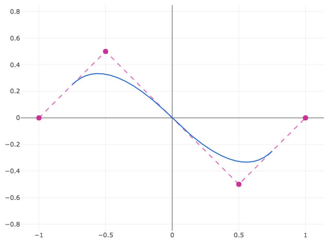
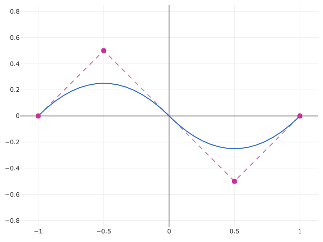
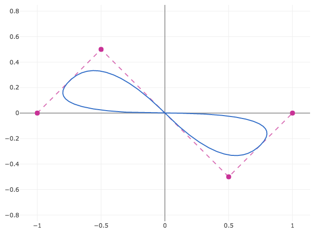
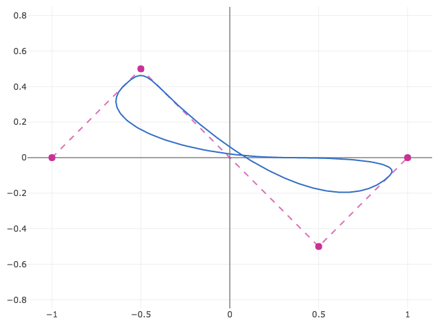
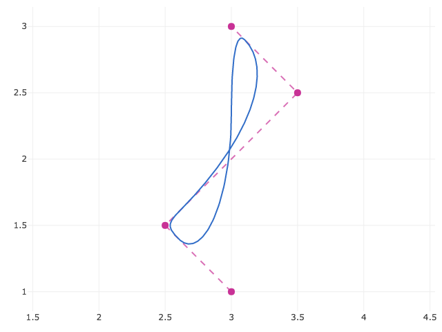
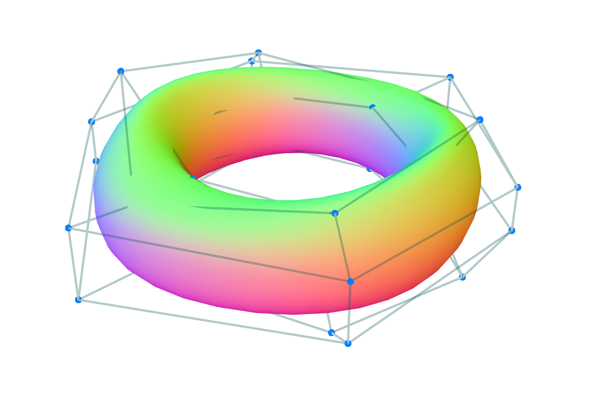

# nurbs

[![Build Status][travis-badge]][travis-link]

> [Non-Uniform Rational B-Splines][nurbs] (NURBS) of any dimensionality

This library implements n-dimensional [Non-Uniform Rational B-Splines][nurbs] (NURBS). It has no dependencies and uses code generation to unroll loops, optimize for various cases (uniform and non-uniform; rational and non-rational; clamped, open, and periodic) and allow compatibility with multiple input types (arrays of arrays, [ndarrays][ndarray]). It's mainly concerned with evaluation as opposed to operations *on* the splines.

## Installation

```bash
$ npm install nurbs
```

## Overview

- [Examples](#examples)
  - [Open B-Spline](#open-b-spline)
  - [Clamped B-Spline](#clamped-b-spline)
  - [Closed B-spline](#closed-b-spline)
  - [Closed NURBS](#closed-nurbs)
  - [Basis Functions](#basis-functions)
  - [Derivatives](#derivatives)
  - [Transforms](#transforms)
  - [Curves, Surfaces, Volumes, etc.](#curves-surfaces-volumes-etc)
  - [ndarrays](#ndarrays)
- [API](#api)
  - [`nurbs`](#nurbspoints-degree-weights-knots-boundary-options)
  - [Properties](#properties)
    - [`domain`](#splinedomain)
    - [`splineDimension`](#splinesplinedimension)
    - [`dimension`](#splinedimension)
    - [`size`](#splinesize)
  - [Methods](#methods)
    - [`evaluate`](#splineevaluateout-t0-t1--tn_1)
    - [`evaluator`](#splineevaluatorderivativeorders-isbasis)
    - [`support`](#splinesupportout-t0-t1--tn_1)
    - [`transform`](#splinetransformm)


## Examples

### Open B-Spline

To construct an open quadratic B-Spline in two dimensions:
<!--The following example, instead of creating a new spline, this example updates the existing spline by calling the existing spline as a constructor, which re-runs the validations while preserving the same instance. (This feature may be removed. It's simple but weird and since the splines have very little internal state, it really doens't save much speed or allocation.) In general, references to the input data are retained so that you may mutate the data (including the number of points) after instantiation. If you change the degree or dimensionality of the curve though, you must either create a new curve or invoke the existing curve as a constructor and pass new data.-->

```javascript
var nurbs = require('nurbs');

var curve = nurbs({
  points: [[-1, 0], [-0.5, 0.5], [0.5, -0.5], [1, 0]],
  degree: 2
});

curve.domain;
// => [[2, 4]]

curve.size;
// => [4]

curve.splineDimension;
// => 1

curve.dimension;
// => 2

curve.evaluate([], 3.0);
// => [0, 0]
```

If you don't provide a knot vector, a uniform knot vector with integer values will be provided implicitly. In this case the knots would be `[0, 1, 2, 3, 4, 5, 6]`. The above example queries the valid domain using `curve.domain`, which returns a nested array since each dimension is parameterized separately. In this case that's just one dimension, from `t = 2` to `t = 4`. Plotting shows the open (unclamped) spline:

<p align="center">

</p>

### Clamped B-Spline

To construct a clamped spline, that is, a spline which passes through its endpoints, you may specify boundary conditions with the `boundary` property:

```javascript
var curve = nurbs({
  points: [[-1, 0], [-0.5, 0.5], [0.5, -0.5], [1, 0]],
  degree: 2,
  boundary: 'clamped'
});

curve.domain;
// => [[2, 4]]
```

In this case the knots would be `[2, 2, 2, 3, 4, 4, 4]`, where the particular range is a result of clamping of the open knot vector by repeating the first and last knots `degree + 1` times. As a result, the domain `[2, 4]` is unchanged from the previous example.

To change the data of an existing spline instance, you could also call `curve` as a constructor, which will then reset and sanitize all of the data, as in `curve({points: ..., degree: ..., ...})`.

<p align="center">

</p>

### Closed B-Spline

A B-Spline can be made periodic by wrapping around and duplicating the first or last points a number of times equal to the degree. This library includes a `'closed'` boundary condition so that a spline can be closed without explicit repitition. If knots are not provided, that start of a closed spline's domain becomes `t = 0`. The result contains the open spline from the first example with the same parameterization (`[2, 4]`) as well as a segment that closes the spline (`[0, 2]`).


```javascript
var curve = nurbs({
  points: [[-1, 0], [-0.5, 0.5], [0.5, -0.5], [1, 0]],
  degree: 2,
  boundary: 'closed'
});

curve.domain;
// => [[0, 4]]
```

Plotting shows the closed spline:

<p align="center">

</p>

### Closed NURBS

Going from B-Splines to NURBS means the addition of weights and non-uniform knots. Weights are straightforward since they correspond directly to points. As for knots, an unclosed NURBS spline requires `n + degree + 1` knots, where `n` is the number of points. A closed NURBS curve requires only `n + 1` knots. The periodicity is defined by equivalence of the first and last knot, i.e. `k_0 := k_n`. The knots then define `n` unique, periodic knot intervals. For example,

```javascript
var curve = nurbs({
  points: [[-1, 0], [-0.5, 0.5], [0.5, -0.5], [1, 0]],
  weights: [0.5, 4, 1, 0.5],
  knots: [[0, 1, 3, 7, 15]],
  boundary: 'closed',
  degree: 2
});

curve.domain;
// => [[0, 15]]
```

<p align="center">

</p>

### Basis functions

A b-spline does not pass through its control points. If you want to do more advanced analysis such as constructing a spline that passes through a set of points, you may evaluate the basis functions directly. If you don't yet have a set of points defining the spline, you may initialize a spline with a `size` instead of a `points`. Then to determine the contribution at `(u, v) = [1.3, 2.4]` of the very first point, indexed by `points[0][0]`:

```javascript
var curve = nurbs({size: [10, 15]});
var basis = curve.evaluator(null, true);
basis(1.3, 2.4, 0, 0);
```

You may also query which points contribute to a given parameter value with `support`:

```javascript
curve.support([], 1.3, 2.4)
```

### Derivatives

To evaluate a derivative, you may create an evaluator using the same method as for basis functions above. Derivatives are specified by order and per-dimension, so that the third derivative in the second dimension would be specified as:

```javascript
var curve = nurbs({points: [[[...], ...], ...]});
var derivative = curve.evaluator([0, 3]);
derivative([], 1.3, 2.4);
```

**Note that currently only first derivatives are implemented for non-uniform rational b-splines. Non-uniform (*non-rational*) b-splines support higher orders.**

For simple curves, a non-array-wrapped derivative order is permitted so that the first derivative of a curve is simply:

```javascript
var curve = nurbs({points: [...]});
var derivative = curve.evaluator(1);
derivative([], 1.3);
```

### Transforms

Each `nurbs` object has a `transform` method that accepts a matrix using gl-matrix style matrices. See [gl-mat2](https://github.com/gl-modules/gl-mat2), [gl-mat3](https://github.com/gl-modules/gl-mat3), and [gl-mat4](https://github.com/gl-modules/gl-mat4). For example, to apply a transformation in-place to the previous example:

```javascript
var mat3 = require('gl-mat3');
var m = mat3.identity([]);
mat3.translate(m, m, [3, 2, 0]);
mat3.rotate(m, m, Math.PI / 2);
curve.transform(m);
```

<p align="center">

</p>

### Curves, Surfaces, Volumes, etc.

The above concepts generalize to any dimensionality of spline surface and space dimensions. You can create a surface patch in three dimensions using the code below. In this case, each property is specified per-dimension.

```javascript
var curve = nurbs({
  points: [
    [[0, 2, 3], [4, 5, 6], [7, 8, 9]],
    [[1, 2, 2], [1, 2, 3], [4, 5, 6]],
    [[1, 2, 2], [1, 2, 3], [4, 5, 6]],
    [[1, 2, 2], [1, 2, 3], [4, 5, 6]],
  ],
  weights: [
    [2, 1, 1],
    [2, 2, 1],
    [2, 3, 1],
    [2, 2, 1]
  ],
  knots: [
    [0, 0, 0, 0, 0.5, 1, 1, 1, 1],
    [0, 0, 0, 1, 1, 1]
  ],
  boundary: ['closed', 'clamped'],
  degree: [3, 2],
});

curve.evaluate([], 0.5, 0.5);
```

[examples/3d.js](./example/3d.js) shows a 3D surface created in this way using the [regl][regl] library. See the live version [here][demo].

<p align="center">

</p>

### ndarrays

Arrays of arrays are easy to work with for dynamically inserting and removing points, but may be problematic due to access and the allocation of many small arrays. `points` and `weights` also accept ndarrays (either array or typed array backed or generic get/set ndarrays). The object does not need to be an actual ndarray. Any object is acceptable as long as it has ndarray-style `data`, `shape`, `stride`, and `offset` properties. This also means that if you have packed vertex data, you can trivially wrap it in an ndarray-style object.

The [ndarray-pack][ndarray-pack] module is a simple way to see the correspondence between array of arrays and ndarrays:

```javascript
var pack = require('ndarray-pack');

var points = [
  [[0, 2, 3], [4, 5, 6], [7, 8, 9]],
  [[1, 2, 2], [1, 2, 3], [4, 5, 6]],
  [[1, 2, 2], [1, 2, 3], [4, 5, 6]],
];

// These two are equivalent:
var curve1 = nurbs(pack(points));
var curve2 = nurbs(points);
```

## API

### `nurbs(points, degree, weights, knots, boundary, options)`
### `nurbs(options)`

Construct a NURBS object. Options are:
- **`points` (optional)**: An array of arrays or [ndarray][ndarray]-style object containing control points.
 
  If an array of arrays, the length of `points` corresponds to the number of points in the first spline dimension, the lenth of `points[0]` to the number of points in the second spline dimension, and so on. The number of components in the innermost array corresponds to the spatial dimension of the spline. For example, `[[[1, 2, 3], [4, 5, 6]], [[7, 8, 9], [10, 11, 12]]]` corresponds to a surface in three dimensions.

  If an ndarray, three variants are permitted.
    - Regular [ndarrays][ndarray] backed by an array or typed array of data.
    - Generic [ndarrays][ndarray] backed by `get` and `set` methods.
    - ndarray-like object containing `data`, `shape`, `stride`, and `offset` properties.

  Note that providing data as an ndarray is equivalent to running [ndarray-pack][ndarray-pack] on array-of-arrays-style data.

  If points is ommitted, then a `size` must be provided instead.

- **`weights` (optional)**: An array of arrays or [ndarray][ndarray]-style object containing control point weights. If not provided, the weight computation is omitted, which is equivalent to all weights equal to 1.
- **`degree` (optional, default `2`)**: Either an integer degree or an array of integer degrees for each spline dimension. Must be less than the number of points. If a degree is specified and insufficient points are provided, an error will be thrown. If the degree is unspecified and insufficient points are provided (i.e. two points), the degree will be downgraded to 1.
- **`knots` (optional)**: An array of knot vector arrays for each respective spline dimension. Each knot vector is presumed to be strictly nondecreasing.
- **`boundary` (optional, default `'open'`)**: An array of boundary conditions for each spline dimension or single non-array-wrapped boundary condition to be applied to all dimensions. Options are:
  - **`'clamped'`**: a spline that meets the control points at each end.
  - **`'open'`**: an evenly spaced knot vector such that the spline does not meet the control points
  - **`'closed'`**: equal to an open spline wherever the open spline is defined, with an additional section closing the gap to create a closed loop.

  Note that clamped on one end and open on the other is perfectly possible but requires specifying your own knot vector.

- **`options` (optional)**: An object containing additional configuration options. Permitted options are:
  - **`debug` (boolean, default `false`)**: When true, writes the generated code to the console.
  - **`checkBounds` (boolean, default `false`)**: When true, checks each parameter against the dimension's domain and throws an error if a point outside the defined domain is evaluated. Behavior is undefined otherwise.
  - **`size` (array)**: if you only wish to evaluate the basis functions, you may omit points and provide an array containing the number of points in the control hull in each respective spline dimension. For example, a <em>5 &times; 3</em> control hull would be `size: [5, 3]`.

## Properties

### `spline.domain`

An array of arrays containing the minimum and maximum spline parameters for each respective spline dimension.

--- 

### `spline.splineDimension`

Dimensionality of the spline surface, e.g. curve = 1, surface = 2, etc.

--- 

### `spline.dimension`

Spatial dimension of the spline. One-dimensional = 1, 2D plane = 2, etc.

--- 

### `spline.size`

Size of the control point data.

## Methods

### `spline.evaluate(out, t0, t1, ..., tn_1)`

Evaluate the spline at the parameters <em>t<sub>0</sub></em>, ..., <em>t<sub>n - 1</sub></em> where <em>n</em> is the dimensionality of the surface (i.e. curve = 1, surface = 2, etc), and write the result to `out`. Returns a reference to `out`.

---

### `spline.evaluator(derivativeOrders, isBasis)`

Returns a function which evaluates the spline according to the specified arguments. `spline.evaluate` is just the special case `spline.evaluator(null, false)`.

Arguments are:
- `derivativeOrders` (Number or Array of Numbers, default: `undefined`): If provided, evaluates the corresponding partial derivative. For example, to evaluate the third derivative in the second dimension of a spline, you would call `spline.evaluator([0, 3])`. See \[1\] for more details.

  **Currently only first derivatives are implemented for rational b-splines of one parameter. Rational surfaces support mixed derivatives up to total order two (including `[1, 1]`), evaluated through the exact quotient rule. Non-uniform (*non-rational*) b-splines support higher orders.**
- `isBasis` (boolean, default: `false`): If true, creates a basis function evaluator instead of a direct spline evaluator. Returns a function `function basis(t0, t1, ..., tn_1, i0, i1, ..., in_1)` (no `out` argument is necessary since the answer is always a scalar) which evaluates the value of the spline basis functions for a given parameter location and control hull indices. The inputs `t0, ..., tn_1` are the spline parameters <em>(t<sub>0</sub>, t<sub>1</sub>, ..., t<sub>n - 1</sub>)</em> and the indices `i0, ..., in_1` are the integer indices of a control point <em>(i<sub>0</sub>, i<sub>1</sub>, ..., i<sub>n - 1</sub>)</em>. The output is a real number between <em>0</em> and <em>1</em> by which the correpsonding control point is multiplied. Summing across all points in the `spline.support` gives the computed spline position. When possible, evaluating the spline directly is much faster.

---

### `spline.support(out, t0, t1, ..., tn_1)`

Compute the [support][support] of a point on the spline. That is, the integer indices of all control points that influence the spline at the given position. To avoid allocation of many small arrays, the result is written in-place to array `out` as a packed array of index tuples, e.g. indices `[0, 5, 3]` and `[1, 5, 3]` are returned as `[0, 5, 3, 1, 5, 3]`. Returns a reference to `out`.

---

### `spline.transform(m)`

Transform a spline in-place using gl-matrix-style matrices (e.g. [gl-mat3](https://github.com/stackgl/gl-mat3) or [gl-mat4](https://github.com/stackgl/gl-mat4)). Modifies spline data and returns a reference to the spline.

## Surface fairing (`extras/fairing`)

`extras/fairing.js` drags a handful of parameter samples on a surface and lets
the rest of the surface follow smoothly. It builds a fixed discrete bending
energy from a reference surface, then solves an equality constrained problem
for every new set of target positions.

```javascript
var nurbs = require('nurbs');
var createFairingPlan = require('nurbs/extras/fairing').createFairingPlan;

var surface = nurbs({ points: ..., weights: ..., degree: [2, 2], knots: ..., boundary: ['clamped', 'clamped'] });
var plan = createFairingPlan(surface, {
  anchors: [[u0, v0], [u1, v1]],   // 1 to 32 fixed parameter samples
  lambda: 1e-3                     // mass (membrane) weight in [1e-5, 1]
});

var result = plan.solve([
  [x0, y0, z0],                    // target position for the first anchor
  [x1, y1, z1]
]);
// result = { status, surface, energy, constraintResidual, stationarityResidual }
```

`solve(targets)` can be called any number of times on the same plan. It
returns one of:

- **`'ok'`**: `surface` is a new spline built with this library's `nurbs`
  constructor, with the same degree, knots, weights and boundary modes as the
  reference and only the control point positions changed.
- **`'inconsistent'`**: the requested targets cannot be reached exactly by any
  displacement field (`surface` is `null`).
- **`'numerical_failure'`**: a factorization failed (`surface` is `null`).

### Energy

Let `S(u, v)` be the reference surface and let the displacement field
`D(u, v) = sum R_ij(u, v) d_ij` use the same rational basis as the surface,
with control point displacements `d_ij`. With the reference metric
`g_ab = S_a . S_b`, its inverse `g^ab`, and the Christoffel symbols
`Gamma^c_ab = sum_d g^cd (S_d . S_ab)`, define the covariant Hessian of each
ambient coordinate of the displacement independently:

```
H_ab(D) = D_ab - sum_c Gamma^c_ab D_c
```

The minimized quantity is

```
E = integral  [ sum_{a,b,c,d} g^ac g^bd H_ab(D) . H_cd(D) + lambda D . D ]
              sqrt(det g) du dv
```

This is the scalar covariant Hessian energy, not a shell mechanics model. The
integral is evaluated exactly as stated with a 6x6 Gauss-Legendre product rule
on every non-empty knot rectangle, and that discrete value is what
`result.energy` reports. The same quadrature and reference metric assemble the
fixed energy matrix `A` at construction time.

Rational values and first/second partials (including mixed partials when both
axes are weighted) are evaluated analytically; no finite differences are used
for assembly. `src/variational/surface-operator.js` owns the reference metric
and operator assembly, and `src/variational/fairing-plan.js` owns constraint
handling and the result lifecycle.

### Snapshot semantics

Creation deep copies the reference control points, weights, knots, degree and
boundary modes. Every `solve` is computed relative to that snapshot, so
mutating the source surface (or transforming a previously returned result)
never changes the plan or later results. `assemblyCount` and
`factorizationCount` remain `1`: the metric matrix and the fixed constraint
factorization are built once, and `solve` only updates the target right hand
side.

### Constraints and accuracy

Each anchor contributes three exact rows
`sum R_ij(anchor) d_ij = target - S(anchor)`: one per ambient coordinate. No
penalty term is used. Duplicate and linearly dependent rows are handled, and
the unique minimum energy solution is returned when the constraints are
consistent. On success, `constraintResidual` is the maximum absolute
coordinate residual of the point constraints. `stationarityResidual` is

```
|| A d + B^T mu ||_inf / max(1, ||A d||_inf, ||B^T mu||_inf)
```

with `A` the displacement energy matrix, `B` the constraint matrix and `mu` the
corresponding multipliers. At normal scales both are at or below `1e-8`.

Rigid motions of the reference and targets, positive affine
reparameterizations of either axis, and a uniform positive scaling of all
weights produce the correspondingly transformed (or identical) geometry.

### Restrictions

This entry point accepts exactly three dimensional, two parameter surfaces with
nested array control points, polynomial degree 2 or 3 per axis, explicit open
clamped knots, single interior knots and positive weights. At most 128 control
points and 1 to 32 anchors are supported. Knot spacing must be at least `1e-3`,
weights must lie in `[0.1, 10]`, and absolute coordinates and parameters must
not exceed `10`. The reference surface must be regular: the sine of the angle
between the two tangents at every integration point is at least `1e-6`.
Invalid knot structure, out-of-range parameters, non-finite values, an invalid
`lambda` or a degenerate integration point raise `RangeError` before any input
is modified. Periodic axes, poles and ndarray editing input are not supported.

### Example

`examples/fairing_obj.cjs` drags three samples on a non-planar, positively
weighted surface and writes the result as a Wavefront OBJ file with `v`, `vn`
and `f` records:

```bash
node examples/fairing_obj.cjs out.obj
```

Tests live in `task_tests/fairing.cjs`; `bash task_support/run.sh target` runs
them together with the example and the normal baseline.

## References

- \[1\] Floater, M. S. [Evaluation and Properties of the Derivative of a NURBS Curve][floater]. Mathematical Methods in Computer Aided Geometric Design II 261–274 (1992). doi:10.1016/b978-0-12-460510-7.50023-9

## Credits


Development supported by [Standard Cyborg][sc].

## License

&copy; 2018 Standard Cyborg, Inc. MIT License.

[nurbs]: https://en.wikipedia.org/wiki/Non-uniform_rational_B-spline
[ndarray]: https://github.com/scijs/ndarray
[ndarray-pack]: https://github.com/scijs/ndarray-pack
[regl]: https://github.com/regl-project/regl
[support]: https://en.wikipedia.org/wiki/Support_\(mathematics\)
[sc]: http://www.standardcyborg.com
[floater]: https://pdfs.semanticscholar.org/23cf/5b46ea38dd321c525bf952bde459dbf1be33.pdf
[travis-badge]: https://travis-ci.org/StandardCyborg/nurbs.svg?branch=master
[travis-link]: https://travis-ci.org/StandardCyborg/nurbs
[demo]: https://standardcyborg.github.io/nurbs/
