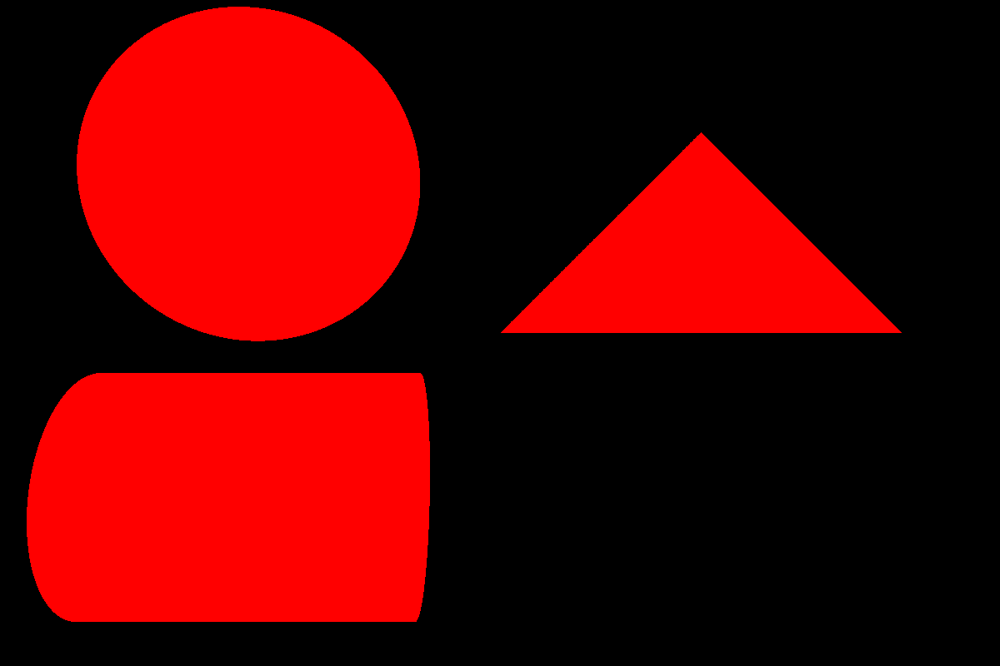
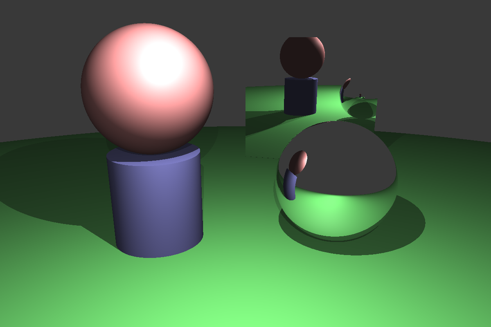
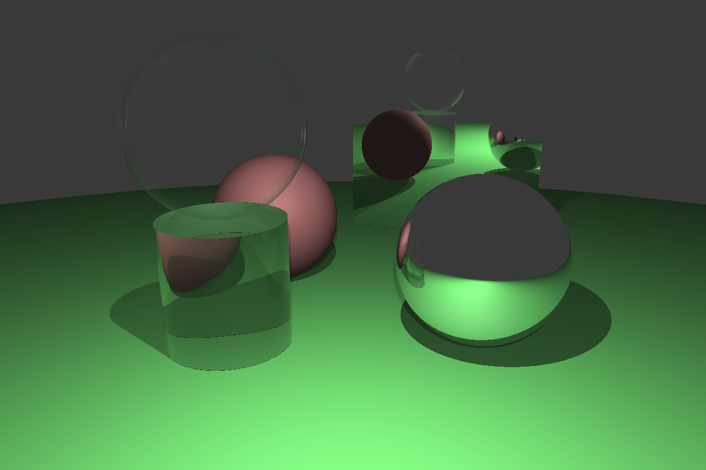

# C++ CPU Path Tracer -- Parallel Rendering with BVH Acceleration

A C++17 CPU renderer built as a systems and performance engineering project. Implements a tile-based parallel renderer with SAH BVH acceleration, reaching 15.7x speedup across 32 threads. Parses JSON scene descriptions and writes PPM output with support for PBR materials via GGX microfacet BRDFs, Monte Carlo path tracing, and multiple tone mappers.

[](https://isocpp.org/std/the-standard)
[](https://cmake.org/)
[](LICENSE)

## Sample Renders

| Binary | Phong | Reflection |
|:---:|:---:|:---:|
|  |  |  |

| Refraction | Path Tracing | Texture | BVH |
|:---:|:---:|:---:|:---:|
|  |  |  |  |

## Performance Engineering

Tile-based parallel rendering scales to 15.7x across 32 threads on a hybrid P-core/E-core CPU. The sweet spot is 8 threads (98% parallel efficiency), where the working set fits in cache and all P-cores are saturated without contention.

| Threads | Median Time (s) | Speedup | Parallel Efficiency |
|--------:|----------------:|--------:|--------------------:|
| 1       | 37.35           | 1.00x    | --                  |
| 2       | 20.16           | 1.85x    | 92%                 |
| 4       | 8.96            | 4.16x    | 104%                |
| 8       | 4.74            | 7.87x    | 98%                 |
| 16      | 3.28            | 11.38x   | 71%                 |
| 32      | 2.38            | 15.69x   | 49%                 |

Measured on path_scene.json (1200x800, 20 SPP, BVH enabled). Full methodology, hardware spec, and reproduction steps in [PERFORMANCE.md](PERFORMANCE.md).

```bash
# Run the built-in benchmark (3 runs, median timing per thread count)
cd build
./ray_tracer ../data/jsons/path_scene.json --benchmark
```

## Architecture

The render pipeline has a clear data flow with a single synchronization point between the tile scheduler and the PPM writer:

```
Parser -> Scene Graph -> BVH Build -> Tile Scheduler -> Worker Pool -> Framebuffer -> PPM
```

Key components:

- **Tile Scheduler**: Divides the framebuffer into 32x32 pixel blocks and dispatches them to the worker pool. Pre-allocates the output vector once, avoiding per-pixel allocations in the hot path.
- **Worker Pool**: Fixed-size thread pool (`std::thread` + task queue). Thread count configurable via `--threads N`. Each worker pulls tiles and renders them independently.
- **SAH BVH**: Surface Area Heuristic bounding volume hierarchy. Reduces ray-scene intersection from O(n) to O(log n) for typical scenes. Built once, shared immutably across all worker threads.
- **FancyBRDF**: PBR material system combining Lambert diffuse with GGX microfacet specular. Configurable roughness and metalness per material.
- **Per-thread RNG**: `thread_local std::mt19937` avoids contention on the random number generator during Monte Carlo sampling.

### Concurrency Design

The parallel renderer is designed around zero-contention writes and immutable shared state:

- **Fixed worker pool**: N `std::thread` instances, configurable via `--threads N` (default: 1, single-threaded). Workers are created once and joined on shutdown.
- **32x32 pixel tiles**: Each tile is an independent unit of work. Tiles are assigned to workers through a shared queue. The coarse granularity keeps scheduling overhead negligible.
- **Zero synchronization on framebuffer**: Tiles write to non-overlapping regions of a pre-allocated `std::vector`. No locks, no atomics on the output path.
- **Immutable scene graph + BVH**: The scene graph, BVH nodes, and material data are built once before rendering starts. All threads read from the same structures with no mutation.
- **Per-thread RNG**: Each worker has its own `thread_local std::mt19937` instance. No atomic contention on the random state during path tracing.
- **Per-thread counters**: Ray counts and intersection test counts are accumulated per-thread and summed after rendering completes, avoiding atomic operations in the hot intersection path.

### Design Decisions

| Decision | Rationale |
|----------|-----------|
| Tile-based scheduling | Cache locality within each 32x32 block. Minimal synchronization between workers. Natural load balancing since tiles vary in cost (BVH depth, material complexity). |
| Fixed worker pool | Lifecycle control (create once, join once). Clean shutdown without dangling threads. Simpler than `std::async` per-tile, which would spawn and join thousands of threads. |
| No external dependencies | Portability. The renderer compiles with CMake + a C++17 compiler. The only non-standard header is the vendored nlohmann/json. |
| Per-thread counters | Accumulating stats in thread-local storage avoids atomic contention in the intersection hot path. A single reduction at the end is cheaper than millions of `fetch_add` calls. |
| SAH BVH splitting | Surface Area Heuristic produces better trees than naive midpoint or equal-count splits, especially for scenes with uneven geometry distribution. The build cost is amortized over all rays. |

## Build & Run

Requirements: CMake 3.10+ and a C++17 compiler (g++ or clang++).

```bash
git clone https://github.com/JinBa1/cpp-path-tracer.git
cd cpp-path-tracer
mkdir build && cd build
cmake .. && make
```

Run a scene (you must run from the `build/` directory since paths in JSON files are relative):

```bash
cd build

# Single-threaded render
./ray_tracer ../data/jsons/scene.json ../output/ my_render

# Multi-threaded render (8 threads)
./ray_tracer ../data/jsons/path_scene.json ../output/ path_8t --threads 8

# Run benchmark (3 runs per thread count, reports median times)
./ray_tracer ../data/jsons/path_scene.json --benchmark
```

The first argument is the JSON scene file. The second and third are the output directory and filename (optional, defaults to `rendered` in the current directory). Output is written as a `.ppm` file.

## Features

### Ray Tracer

- **Three render modes**: binary (hit/miss), Blinn-Phong shading, and Monte Carlo path tracing
- **Geometry primitives**: sphere, triangle, cylinder with analytic intersection tests
- **Blinn-Phong shading**: ambient, diffuse, and specular components with configurable light intensity
- **Shadows**: hard shadow rays from point lights
- **Reflection**: recursive mirror reflections with configurable bounce depth
- **Refraction**: Snell's law refraction with Schlick's approximation for Fresnel terms
- **Textures**: PPM texture mapping on all primitive types, with UV coordinates and tile factors
- **BVH acceleration**: AABB bounding volume hierarchy with Surface Area Heuristic (SAH) splitting. Toggleable via scene JSON
- **Tone mapping**: four methods: linear, Reinhard, filmic, and luminance-based scaling. Configurable exposure
- **Image output**: PPM P3 format

### Path Tracer

- **Multi-bounce path tracing**: recursive Monte Carlo integration with configurable bounce depth
- **PBR materials**: Lambert diffuse combined with GGX microfacet specular (FancyBRDF), with roughness and metalness parameters
- **Anti-aliasing**: per-pixel multi-sampling with three strategies: random, jittered grid, and Poisson disk
- **Depth of field**: finite aperture camera with defocus blur, configurable aperture size and focus distance
- **Soft shadows**: rectangular area lights sampled with configurable sample count
- **Russian Roulette**: stochastic path termination (configurable probability) to cap computation at higher bounce depths

## Scene Format

Scenes are described in JSON. Here is a minimal example:

```json
{
    "rendermode": "phong",
    "useBVH": true,
    "camera": {
        "width": 800,
        "height": 800,
        "position": [0, 1, 3],
        "lookAt": [0, 0, -1],
        "upVector": [0, 1, 0],
        "fov": 60,
        "toneMapper": "reinhard",
        "exposure": 0.1,
        "samples_per_pixel": 4,
        "aperture": 0.02,
        "focus_dist": 1.5
    },
    "scene": {
        "ambient_light": [0.25, 0.25, 0.25],
        "background": [0.2, 0.3, 0.5],
        "lightsources": [
            { "type": "pointlight", "position": [5, 5, 5], "intensity": [1, 1, 1] }
        ],
        "shapes": [
            {
                "type": "sphere",
                "centre": [0, 0, -1],
                "radius": 1.0,
                "material": {
                    "diffuse_color": [0.8, 0.3, 0.3],
                    "specular_color": [1, 1, 1],
                    "shininess": 32,
                    "reflectivity": 0.0,
                    "transmittance": 0.0,
                    "ior": 1.5
                }
            }
        ]
    }
}
```

Key fields:

| Field | Values | Default | Notes |
|-------|--------|---------|-------|
| `rendermode` | `binary`, `phong`, `path` | `path` | Selects the rendering algorithm |
| `useBVH` | `true`, `false` | `true` | Toggles BVH acceleration |
| `toneMapper` | `linear`, `reinhard`, `filmic`, `luminance` | `luminance` | HDR to LDR conversion method |
| `samples_per_pixel` | integer | `1` | Anti-aliasing sample count (path mode) |
| `sampling_method` | `random`, `jittered`, `poisson_disk` | `poisson_disk` | Pixel sampling strategy |
| `allowBRDF` | `true`, `false` | `false` | Enables PBR microfacet shading (path mode) |
| `RR_PROB` | 0.0 to 1.0 | `0.8` | Russian Roulette termination probability |
| `aperture` | float | `0.02` | Lens aperture for depth of field |
| `focus_dist` | float | `1.5` | Focal plane distance |

Shape materials support an optional `texture` field pointing to a PPM file, plus `has_brdf`, `roughness`, `metalness`, and `base_color` for PBR rendering.

Rectangular area lights use `type: "rectlight"` with `u`, `v`, `width`, `height`, and `num_samples` fields.

## Render Modes

| Mode | Description | Output |
|------|-------------|--------|
| `binary` | Casts a single ray per pixel. White if the ray hits geometry, black otherwise. Fast diagnostic mode. | Black and white silhouette |
| `phong` | Blinn-Phong shading with shadow rays, recursive reflection, and refraction via Schlick's approximation. Configurable bounce depth. | Lit scene with highlights, shadows, mirrors, and glass |
| `path` | Monte Carlo path tracing. Each pixel sends multiple samples, bouncing through the scene with BRDF importance sampling. Russian Roulette terminates paths stochastically. | Physically-based global illumination with soft shadows and indirect lighting |

## Inverse Lighting (Emission Fitting)

A small inverse-lighting entry point lives on top of the regular scene
graph: given a triangle mesh, per-face diffuse reflectance, a set of
candidate emitting faces, and target brightness values on some faces, it
solves for the non-negative RGB emission of each candidate face and renders
the multi-bounce result through the original camera.

### PatchMesh

`include/object/PatchMesh.h` — an `Object` built from a vertex array,
triangle indices, and one `Material*` per face:

```cpp
std::vector<Point3> verts = {Point3(0,0,0), Point3(1,0,0), Point3(0,1,0)};
std::vector<std::array<int,3>> tris = {{{0, 1, 2}}};   // CCW = front face
std::vector<Material*> mats = {&mat};                  // borrowed, not owned
auto mesh = std::make_shared<PatchMesh>(verts, tris, mats);
```

- Vertices and indices are **owned** by the mesh (copied); materials follow
  the usual external-lifetime convention (the mesh never deletes them).
- Each triangle keeps its **source face number** (its position in the index
  array); the internal BVH may reorder faces but never changes their ids.
- The mesh is a regular `Object`: add it to the same `ObjectList` as
  spheres, cylinders and triangles, call `world.build()`, and everything
  occludes everything else. There is no separate fit-only world.
- `IntersectionRecord` gained two fields: `patch_mesh` and `patch_face`.
  Hits on a `PatchMesh` report the source mesh and source face number;
  hits on regular primitives report `nullptr` / `-1`.
- Only static, finite, non-degenerate triangles are accepted; construction
  throws `std::invalid_argument` otherwise.

### PatchTransport

`include/PatchTransport.h` — discrete patch-to-patch transport over the
faces of a list of meshes, embedded in the real (already built) world:

```cpp
ObjectList world;
world.add(mesh);          // each mesh added exactly once
world.add(occluders...);  // spheres, triangles, ... any Object
world.build();

PatchTransport transport({meshA, meshB}, world, /*eps=*/1e-6);
```

- Faces are numbered globally in mesh input order, then by source face
  number; at most 128 faces.
- Each face contributes three equal-weight area sample points at the cyclic
  permutations of barycentric `(2/3, 1/6, 1/6)`. For every pair of distinct
  faces the nine connecting segments are tested with the world's own
  `intersect` on the open interval `(eps, dist - eps)`; every primitive
  occludes double-sided, back faces do not transmit, and sample-point pairs
  within `100*eps` contribute zero.
- `H_ij = Ai*Aj/(9*pi) * sum_9 max(0, ni.d) * max(0, -nj.d) * V / dist^2`,
  stored symmetrically, `H_ii = 0`. The whole `H` is divided by the single
  global scale `max(1, s)` with `s = max_i sum_j H_ij/Ai` (never per-row
  normalized, preserving area reciprocity), and `F_ij = H_ij/Ai`.
- Materials must be flat diffuse: no textures, reflection or refraction,
  and `rho = kd * diffusecolor` within `[0, 0.95]` per channel
  (`std::invalid_argument` otherwise).
- The transport keeps an owning snapshot of geometry and reflectance and no
  reference to the world; rebuild it when geometry or occlusion changes.
- Read-only queries: `face_count()`, `area(i)`, `form_factor(i, j)`,
  `reflectance(i)`, `face_mesh(i)`, `face_source_index(i)`.

### Fitting emission: PatchTransport::fit

```cpp
std::vector<int> candidates = {0, 1};                 // 1..16 distinct faces
std::vector<FitObservation> observations = {          // 1..256 entries
    {2, Radiance(0.55, 0.48, 0.40), 1.0},             // face, target, weight
    {3, Radiance(0.40, 0.40, 0.45), 1.0},
};
std::optional<EmissionFit> fit =
    transport.fit(candidates, observations, /*lambda=*/1e-4, /*budget=*/2000);
if (!fit) { /* invalid input or iteration budget exhausted */ }
```

- Solves, per RGB channel, `min sum_o w_o |B_face(o) - target_o|^2 +
  lambda * sum_k |x_k|^2` over candidate emissions `x >= 0`, where `B`
  satisfies the full multi-reflection equation `B = E + rho * F * B`
  (never a one-bounce approximation). Targets may be negative and are used
  as-is; repeated observations accumulate as independent terms.
- Succeeds only when every channel meets
  `||x - max(0, x - grad)||_inf <= 1e-8 * max(1, ||grad_at_zero||_inf)`
  with the true objective gradient; rank-deficient, fully occluded and
  boundary (`x = 0`) optima are handled by an active-set solver.
- Returns `std::nullopt` on invalid input or when the positive iteration
  budget is exhausted; previously returned results are never modified and
  no state leaks between fits.
- `EmissionFit` owns mesh references plus per-face `emission(face)` (E) and
  `exitance(face)` (B) values, `objective()`, and
  `projected_gradient_norm()`; it stays valid after the transport is
  destroyed.

### Rendering a fit: Camera::render_fitted

```cpp
Camera cam;                       // configure exactly like a normal render
cam.filename = "fitted.ppm";
cam.render_fitted(world, *fit);   // world: the same ObjectList
```

Reuses the camera projection, pixel sampling and tone mapping. Front-face
hits on the fit's meshes show that source face's `B/pi`; back faces and all
other occluders are black; misses show the camera background. No point
light or ambient terms are added, shared `Material`s are never modified,
and any number of fit results can be rendered interleaved.

### Example

`examples/fit_emission.cpp` builds a small room (ceiling emitters, floor
and wall targets, a sphere occluder), fits the ceiling emission to reach
target brightness after all bounces, and writes a PPM:

```bash
c++ -std=c++17 -O2 -pthread -Iinclude -I. \
    examples/fit_emission.cpp src/PatchMesh.cpp src/PatchTransport.cpp \
    src/Camera.cpp src/Node.cpp src/ObjectList.cpp src/ImageWriter.cpp \
    -o fit_emission
./fit_emission out.ppm
```

Regression tests for the whole entry point (geometry, inverse, render
groups) live in `task_tests/emission_fit.cpp`; `bash task_support/run.sh
target` builds everything, runs the example, the three test groups, and the
original triangle/BVH/camera baseline.

## Test Suite

A smoke test builds the project and renders all scenes in `TestSuite/`:

```bash
bash scripts/smoke_test.sh
```

This compiles the project, runs each JSON scene through the renderer, and checks that valid PPM output files are produced. Scenes that time out (120s limit) or produce missing/empty output are reported as failures.

## Code Map

The codebase uses a header-heavy architecture where most implementation lives in `.h` files. Six modules have separate `.cpp` files (Camera, Node, ObjectList, ImageWriter, PatchMesh, PatchTransport).

```
include/
  Camera.h          -- Ray generation, render dispatch, tone mapping, all trace functions
  Parser.h          -- Header-only JSON scene parser (nlohmann/json)
  Material.h        -- Material data struct, texture loading, GGX helpers
  ImageWriter.h     -- PPM P3 file writer
  PatchTransport.h  -- Inverse lighting: discrete patch transport, emission fit
  object/
    Object.h        -- Abstract base class (intersect, bounding_box), patch identity in hit records
    Sphere.h        -- Analytic sphere intersection
    Triangle.h      -- Moller-Trumbore ray-triangle test
    Cylinder.h      -- Finite cylinder intersection
    PatchMesh.h     -- Owned triangle mesh with per-face materials and source face ids
    ObjectList.h    -- Scene geometry collection, BVH entry point
  bvh/
    BoundingBox.h   -- AABB with ray-axis slab test
    Node.h          -- BVH node, 3 split strategies (SAH active)
  brdf/
    BRDF.h          -- Abstract BRDF (Evaluate, Sample)
    Lambert.h       -- Lambertian diffuse
    Microfacet.h    -- GGX NDF, Smith G, Fresnel-Schlick
    FancyBRDF.h     -- Combined Lambert + Microfacet PBR material
  light/
    Light.h         -- Abstract light (phong_shading, brdf_shading)
    PointLight.h    -- Point light with shadow rays
    RectangularLight.h -- Area light with stratified sampling
    LightList.h     -- Light collection
  util/
    Vector3.h       -- Core math: Vector3, Point3, Radiance aliases
    Ray.h           -- Ray origin + direction
    Radiance.h      -- Tone mapping functions
    Interval.h      -- Min/max interval for ray parameter bounds
    Utilities.h     -- Enums, constants, RNG, math helpers
src/
  PatchMesh.cpp     -- PatchMesh validation, internal BVH, intersection
  PatchTransport.cpp -- Form factors, response inverse, NNLS emission solver
examples/
  fit_emission.cpp  -- Inverse-lighting example: fit ceiling emission, render B/pi
task_tests/
  emission_fit.cpp  -- geometry / inverse / render regression groups
```

## Performance

Single-threaded baseline timings on an 800x800 image, compiled with `-O1`:

| Scene | Mode | Samples | BVH | Time |
|-------|------|---------|-----|------|
| `binary_primitives` | Binary | 1 | On | 0.19s |
| `phong_scene` | Phong | 1 | On | 0.33s |
| `path_scene` | Path | 20 | On | 37.31s |

Timed with `std::chrono::high_resolution_clock` on the render phase only (excludes scene parsing and BVH construction). Hardware: single-threaded, GCC 13.3, Linux x86_64.

For multi-threaded scaling results and full benchmark methodology, see [PERFORMANCE.md](PERFORMANCE.md).

## Dependencies

| Dependency | Version | Notes |
|------------|---------|-------|
| CMake | 3.10+ | Build system |
| C++ compiler | C++17 | g++ or clang++ |
| nlohmann/json | 3.11.3 | Vendored in `include/json.hpp` |

No external libraries need to be installed. The JSON parser header is included in the repository.

## License

This project is licensed under the [MIT License](LICENSE).
