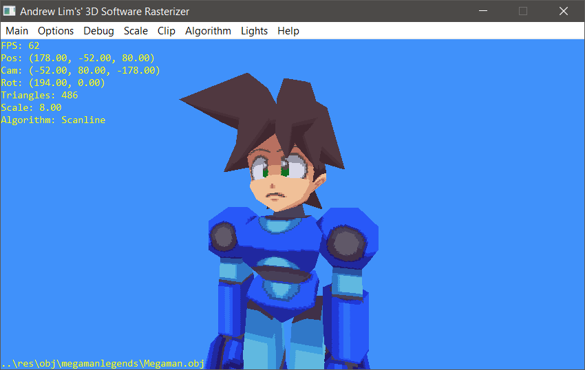
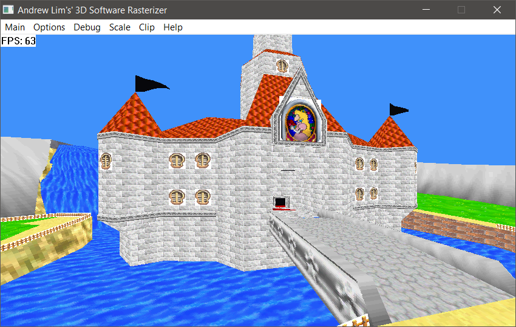
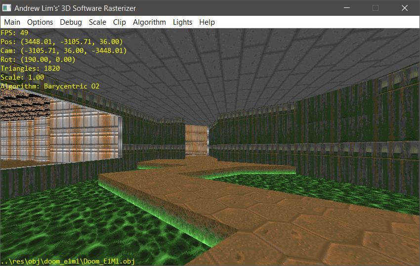

# Andrew Lim's C++ 3D Software Rasterizer

Personal 3D playground program for me to test and learn 3D rendering. Source code made public in case somebody finds it helpful.
Though it is a still a very much work in progress.

You will need a C++ 11 compiler. Currently I'm developing with [Embarcadero Dev-C++](https://github.com/Embarcadero/Dev-Cpp)

All rendering is done first on a custom [ImageData](src/ImageData.h) object which holds a one-dimensional array of bytes (of type uint8_t).
Then the bytes are transferred/blitted to the native screen format. In this case, I'm testing with Win32 GDI where the bytes are
displayed with [SetDIBitsToDevice](https://learn.microsoft.com/en-us/windows/win32/api/wingdi/nf-wingdi-setdibitstodevice).

[Download Latest Release Here](https://github.com/andrew-lim/sw3dcpp/releases/).

## Screenshots
<table style="padding:10px">
  <tr>
    <td width="50%"></td>
    <td width="50%"></td>
  </tr>
  <tr>
    <td width="50%"></td>
    <td width="50%"></td>
  </tr>
</table>

## Videos

[YouTube Playlist](https://www.youtube.com/watch?v=YPubnjG4eH8&list=PL4Pn9mFG1hxREHDD_Zxq7BTCi5jRkjrjr&ab_channel=AndrewLim)

## Features

- 4 triangle rendering algorithms: standard scanline, barycentric, and 2 optimized barycentric variants
- Displays a simple textured cube at the start
- Loading .OBJ and .MTL files with BMP/PNG support. Sample models can be loaded from the Debug menu
- Solid, Affine and Nearest Neighbour Perspective-Correct Texture Mapping
- Clipping by near plane only, or clipping by all 6 planes
- Z Buffer
- Flat and Smooth/Gourand Lighting

## Depth impostor

`al::graphics::DepthImpostor` ([src/Impostor.h](src/Impostor.h)) is a
multi-view depth proxy that can be drawn without the original mesh. Capture a
model with `captureImpostor` from a few orthographic views, and it records the
winning surface's color, local position, unit face normal and validity at every
grid point. Those records are rebuilt into small perspective-correct micro
triangles, and `drawImpostor` renders them with an arbitrary perspective
camera. The resource owns only its own data: after capture you can destroy the
source triangles, textures and callbacks and still draw. See
[examples/impostor_preview.cpp](examples/impostor_preview.cpp) for a two-view
preview that renders `view0.ppm` and `view1.ppm`.

### Sampling approximation

Capture samples the surface at the pixel centers of each orthographic view
(`x+0.5, y+0.5`). Reconstruction uses one micro triangle per 2x2 cell
(always split `(00,10,11)` and `(00,11,01)`) whose corner records are all
valid and whose local-space edges are no longer than the caller's `maxEdge`.
This is a piecewise-linear approximation of the captured surface: sub-pixel
detail and any curvature between grid points are lost, and colors are stored as
8-bit RGB then kept as floats thereafter, so a reprojection can be very slightly
softer than the original.

### Holes at depth discontinuities

Edges that jump between two depth layers are longer than a smooth surface edge,
so `maxEdge` drops them. Holes are never patched: there is no zippering and no
triangle is allowed to bridge a depth discontinuity. As a result, reprojected
silhouettes and foreground/background seams can show small holes or cracks.
Choose a capture resolution and `maxEdge` that fit the target preview distance;
a larger `maxEdge` closes more of the surface but starts to bridge layers, while
a smaller one is more faithful but leaves larger holes.

### Drawing semantics

`drawImpostor` resolves each source view's own nearest surface independently
before merging, so views never share a depth map or overwrite one another. It
weights each view's surviving candidate by `max(dot(N, V), 0)^4` (with `N` the
inverse-transpose normal and `V` the direction to the camera), drops zero-weight
candidates, keeps only candidates within `mergeDistance` of the nearest one,
blends colors by those weights, and takes the final depth from the nearest
positive-weight candidate (not the blended point or a proxy plane). The color
and depth targets are written only where the fragment is strictly nearer than
the current value, so an existing foreground depth buffer acts as an occluder.

## Libraries Used

- [lodepng](https://github.com/lvandeve/lodepng) for PNG loading
- [tinyobjloader](https://github.com/tinyobjloader/tinyobjloader) for .OBJ parsing
- [glm](https://github.com/g-truc/glm) was previously used for matrix math but has been replaced by custom Matrix and Vector classes. However it is still distributed together with the source code.

MIT Licensed
