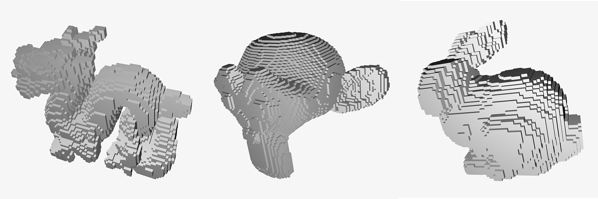

# Mesh voxelizer
_Header only mesh voxelizer in ANSI C_



**About**

Converts meshes and performs triangle-cube intersection to output a voxelized mesh.

**How to use**

Include the header only file as following once:
```c
#define VOXELIZER_IMPLEMENTATION
#include "voxelizer.h"
```

To generate a voxelized mesh, create an instance of `vx_mesh_t` and initialize its
vertices and indices like this:

```c
vx_mesh_t* mesh;
vx_mesh_t* result;

mesh = vx_mesh_alloc(nvertices, nindices);

// Add vertices and indices from the original mesh you want to voxelize
// [...]

// Precision factor to reduce "holes" artifact
float precision = 0.01;

// Run voxelization
result = vx_voxelize(mesh, 0.025, 0.025, 0.025, precision);

vx_mesh_free(result);
vx_mesh_free(mesh);
```

## Incremental voxel scene (`voxel_scene.hpp`)

`voxel_scene::VoxelScene` keeps its own copy of a fixed-topology mesh and
updates the voxel preview locally when vertices move or change color, instead
of re-running the voxelizer over the whole model.

### Grid keys

* Every cell is identified by a signed integer key `(x, y, z)`; negative
  coordinates are first-class keys.
* A cell center is `key * step` per axis, so the three axes may use different
  step sizes.
* The candidate range, degeneracy threshold, precision-inflated triangle/box
  test and barycentric color weights are exactly those of `vx__voxelize`.
  Both the public voxelizers and the scene call the same shared
  `vx__tri_enumerate_cells` entry, so snapshots and exports match
  `vx_voxelize_pc` / `vx_voxelize` bit for bit.

### First-wins contributions

* Each cell stores every triangle that still covers it. The covering triangle
  with the smallest id (triangle ids are the original `indices` triplet
  numbering) owns the cell: its interpolated color is the cell color and it is
  reported as `winnerTriangle`.
* When that triangle moves away or becomes degenerate, the next-smallest
  covering triangle takes over without any re-scan of unrelated triangles;
  the cell is deleted only when its last contributor leaves.
* Storage grows with the vertex/index counts and the actual number of
  triangle/cell contributions. No dense bounding-box array is allocated, so
  sparse or far-apart components stay cheap.

### Update cost

* A **position change** re-rasterizes only the triangles incident to the
  moved vertices; shared vertices and several vertices moving in one batch
  are merged first, so each triangle is rasterized at most once. The reported
  `candidateTests` is the exact number of triangle/box calls the batch made.
* A **pure color change** performs zero triangle/box tests: the scene reuses
  the interpolation weights persisted with each triangle/cell contribution
  and only re-evaluates the colors of that triangle's cells. Its cost is
  proportional to the number of cells the recolored triangle already covers,
  independent of model size or grid extent.
* `apply()` returns sorted, de-duplicated `upsert`/`remove` cell arrays
  relative to the state before the call; replaying the patch reproduces
  `snapshot()`, and intermediate states inside a batch are never visible.
* `pointCloud()` and `cubeMesh()` return independent allocations released by
  `vx_point_cloud_free` / `vx_mesh_free`, with the same cube geometry,
  indices, normals and colored/uncolored conventions as the public exports.

