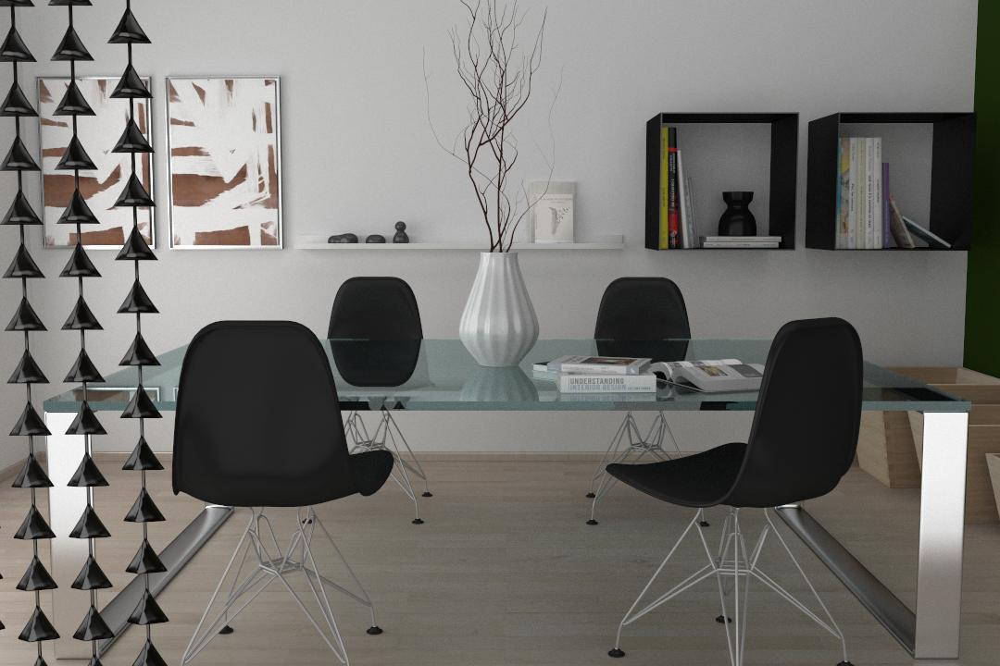
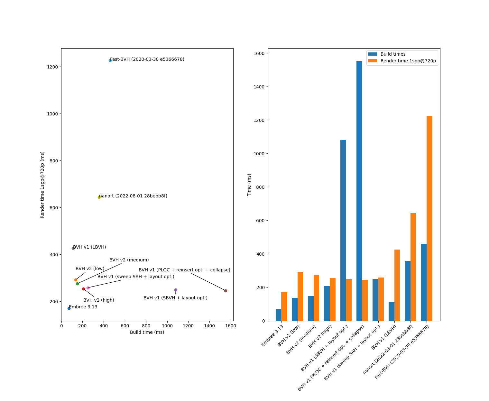

# BVH Construction and Traversal Library

> Note: This is the 2nd version of this library. Check the `v1` branch for the older, first version
> of this library.

This library is a small, standalone library for BVH construction and traversal. It is licensed
under the MIT license.

(Scene by Blend Swap user MaTTeSr, available [here](https://www.blendswap.com/blend/18762),
distributed under CC-BY 3.0)

## Performance

Here is a comparison of this library with other alternatives
([Embree](https://github.com/embree/embree),
[Fast-BVH](https://github.com/brandonpelfrey/Fast-BVH), and
[nanort](https://github.com/lighttransport/nanort)):

## Features

Here is a list of features supported by this library (changes from `v1` are indicated with [NEW]):

- [NEW] C++20 interface using `std::span` instead of raw pointers,
- Low-level API with direct access to various builders,
- [NEW] High-level `DefaultBuilder` API which selects the best builder depending on the desired
  BVH quality level.
- High-quality, single-threaded sweeping SAH builder,
- Fast, medium-quality, single-threaded binned SAH builder inspired by
  "On Fast Construction of SAH-based Bounding Volume Hierarchies", by I. Wald,
- Fast, high-quality, multithreaded mini-tree BVH builder inspired by
  "Rapid Bounding Volume Hierarchy Generation using Mini Trees", by P. Ganestam et al.,
- Reinsertion optimizer based on "Parallel Reinsertion for Bounding Volume Hierarchy
  Optimization", by D. Meister and J. Bittner,
- Fast and robust traversal algorithm using "Robust BVH Ray Traversal", by T. Ize.
- Fast ray-triangle intersection algorithm based on
  "Fast, Minimum Storage Ray/Triangle Intersection", by T. Möller and B. Trumbore,
- [NEW] Surface area traversal order heuristic for shadow rays based on
  "SATO: Surface Area Traversal Order for Shadow Ray Tracing", by J. Nah and D. Manocha,
- Fast ray-sphere intersection routine,
- [NEW] Serialization/deserialization interface,
- [NEW] Variable amount of dimensions (e.g. 2D, 3D, 4D BVHs are supported) and different scalar types
  (e.g. `float` or `double`),
- [NEW] Only depends on the standard library (parallelization uses a custom thread pool based on
  `std::thread`),
- [NEW] C API for the high-level parts of the library is available.
- [NEW] Stackless, allocation-free ray traversal driven by a per-node parent table
  (`Bvh::intersect_stackless`), supporting closest-hit and any-hit queries, fast and robust
  ray-box tests, and traversal restricted to an arbitrary subtree.

## Stackless traversal and the parent table

Each `Bvh` stores a `std::vector<size_t> parent_ids` that parallels `nodes`: entry `i` is the
index of the parent of node `i`, the parent of the root is `0`, and an empty BVH has an empty
parent table. The table is what allows `intersect_stackless<IsAnyHit, IsRobust>(ray,
root_node_id, leaf_fn)` to walk back up the tree without a per-ray stack. A query uses only
scalar state, never allocates, is not recursive, and does not depend on the tree depth or on the
number of nodes; many queries can therefore run concurrently on a BVH that is no longer being
modified. Starting from a non-root node only visits that subtree.

The parent table is maintained automatically and requires no extra work from the caller after:

- the Sweep/Binned SAH, mini-tree and default builders (including the thread-pool entry point),
- `ReinsertionOptimizer::optimize`,
- `Bvh::extract_bvh`,
- `Bvh::deserialize` (the table is rebuilt on load and is not part of the archive format),
- `Bvh::refit` (the topology, and therefore the parent table, is unchanged).

If the public `nodes` array is modified directly, call `bvh.rebuild_parent_ids()` afterwards to
recompute the table; external raw writes are otherwise not detected. The on-disk format produced
by `serialize` is unchanged: the node, index and primitive-id byte layout is preserved and the
parent table is simply reconstructed after loading.

The legacy stack-based `Bvh::intersect` and the C API remain available and unchanged.

## Running the regression suite

The stackless traversal regression cases live in `checks/stackless_cases.cpp` and are registered
in the `ordering`, `topology`, `storage` and `render` groups. Run them together with the
production baseline (which also compiles every non-`c_api` production source under
`src/bvh/v2`) with:

    bash task_support/run.sh target

The `render` group additionally writes a small P3 PPM image to `.task-build/stackless_render.ppm`.

## Building

This library is header-only, and can be added as a CMake subproject by cloning or adding as this
repository as submodule, for instance in `<your-project>/contrib/bvh`, and then adding this to
`<your-project>/CMakeLists.txt`:

    add_subdirectory(contrib/bvh)
    target_link_library(my_project PUBLIC bvh)

If you want to build the examples, use:

    mkdir build
    cd build
    cmake .. -DCMAKE_BUILD_TYPE=<Debug|Release> -DENABLE_TESTING=ON
    cmake --build .

## C API

The library can be used via a small set of high-level C bindings. These bindings are not enabled by
default, but can be built by configuring CMake with `-DBVH_BUILD_C_API=ON`. Additionally, if the
intent is to use the library in a pure C environment which does not have the C++ standard library as
a dependency, it might be a good idea to statically the C++ standard library. That can be done by
adding the flag `-DBVH_STATIC_LINK_STDLIB_C_API=ON` to the CMake command line.

## Usage

The library contains several examples that are kept up-to-date with the API:

- A [basic example](test/simple_example.cpp) that traces one ray on a scene made of a couple of triangles,
- A [benchmarking utility](test/benchmark.cpp) that showcases what the library can do.
- A [serialization test](test/serialize.cpp) that shows how to save and load a BVH from a file.
- A [C API example](test/c_api_example.c) that shows how to use the C bindings to this library.
