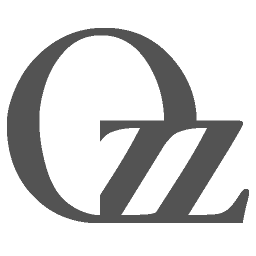

[](http://guillaumeblanc.github.io/ozz-animation/)

ozz-animation
=============

open source c++ 3d skeletal animation library and toolset
---------------------------------------------------------

ozz-animation provides runtime character animation playback functionalities (loading, sampling, blending...). It proposes a low-level renderer agnostic and game-engine agnostic implementation, focusing on performance and memory constraints with a data-oriented design.

ozz-animation comes with the toolchain to convert from major Digital Content Creation formats (gltf, Fbx, Collada, Obj, 3ds, dxf) to ozz optimized runtime structures. Offline libraries are also provided to implement the conversion from any other animation and skeleton format.

Follow [this link](https://github.com/guillaumeblanc/ozz-animation/issues/175) for a list of projects using ozz-animation.

Documentation
-------------

Documentation and samples are available from [ozz-animation website](http://guillaumeblanc.github.io/ozz-animation/).

Pose palette cache
------------------

`ozz::animation::PosePaletteCache` (include/ozz/animation/runtime/pose_palette_cache.h) caches local and model space joint matrices of a skeleton pose, so that partial joint palettes can be built without re-evaluating the whole skeleton. It targets characters whose body, equipment and low-detail skins share one skeleton but use different joint palettes: local pose updates are partial, model matrices are evaluated lazily along the ancestor chain of the requested joints only, and the cache is reused across queries and across skins. `Prepare()` allocates all the memory up-front, every later update or query is allocation free.

The example below applies a partial pose update (only the listed joints are touched), then serves two skins that share the same cache with their own joint subsets and inverse-bind matrices:

```cpp
#include "ozz/animation/runtime/pose_palette_cache.h"
#include "ozz/animation/runtime/skeleton.h"
#include "ozz/base/maths/simd_math.h"
#include "ozz/base/maths/soa_transform.h"
#include "ozz/base/span.h"

using namespace ozz;

// Binds the cache to the skeleton once. Rest pose is copied, root matrix is
// identity, and nothing is evaluated yet. The skeleton must outlive the
// cache and stay unchanged.
animation::PosePaletteCache cache;
cache.Prepare(&skeleton);

// Partial local-space pose update: copies only the listed lanes of the
// complete SoA pose. Indices are ascending and unique; the input can be
// released as soon as the call returns.
const int touched_joints[] = {3, 7, 11};
cache.UpdateLocals(sampled_pose, touched_joints);

// Optional character-to-world affine transform, invalidated in constant
// time.
cache.SetRoot(character_to_world);

// First skin queries the joints of its body palette. Only the ancestors of
// the requested joints are evaluated, and the work is cached.
animation::PosePaletteCache::Stats stats;
cache.BuildPalette(body_joints, body_inverse_binds, body_palette, &stats);

// Second skin reuses the same cache with its own joints and inverse-bind
// matrices. Model matrices computed for the body are shared, binds are read
// per slot and never mixed into the cache, so the second query only pays
// for the model * inverse-bind multiplications of its own slots.
cache.BuildPalette(equipment_joints, equipment_inverse_binds,
                   equipment_palette, &stats);

// body_palette and equipment_palette can be fed to
// ozz::geometry::SkinningJob::joint_matrices.
```

In this snippet `sampled_pose` is a `span<const math::SoaTransform>` covering the whole skeleton, `body_joints` / `equipment_joints` are `span<const int>` (any order, duplicates allowed), `body_inverse_binds` / `equipment_inverse_binds` are `span<const math::Float4x4>` and `body_palette` / `equipment_palette` are `span<math::Float4x4>` outputs, one matrix per slot.

Supported platforms
-------------------

ozz-animation is tested on WebAssembly, Linux, macOS and Windows, for x86, x86-64 and ARM architectures. The run-time code (ozz_base, ozz_animation, ozz_geometry) depends only on c++17, on the C and the C++ standard libraries, and has no OS specific code. Portability to any other platform shouldn't be an issue.

Samples, tools and tests depend on external libraries (glfw, tinygltf, Fbx SDK, jsoncpp, gtest, ...), which aren't need to ship with ozz-animation runtime.

Build status
------------

|         | Linux  | macOS | Windows | WebAssembly |
| ------- | ------ | ------ | ------- | ------- |
| master  | [](https://github.com/guillaumeblanc/ozz-animation/actions/workflows/linux.yml) | [](https://github.com/guillaumeblanc/ozz-animation/actions/workflows/macos.yml) | [](https://github.com/guillaumeblanc/ozz-animation/actions/workflows/windows.yml) | [](https://github.com/guillaumeblanc/ozz-animation/actions/workflows/wasm.yml) |
| develop | [](https://github.com/guillaumeblanc/ozz-animation/actions/workflows/linux.yml) | [](https://github.com/guillaumeblanc/ozz-animation/actions/workflows/macos.yml) | [](https://github.com/guillaumeblanc/ozz-animation/actions/workflows/windows.yml) | [](https://github.com/guillaumeblanc/ozz-animation/actions/workflows/wasm.yml) |

The dashboard for all branches is available [here](http://guillaumeblanc.github.io/ozz-animation/documentation/dashboard/).

Contributing
------------

All contributions are welcome: code reviews, bug reports, bug fixes, samples, features, platforms, testing, documentation, optimizations...

Please read [CONTRIBUTING](CONTRIBUTING.md) file for more details about how to submit bugs or contribute to the code.

License
-------

ozz-animation is hosted on [github](http://github.com/guillaumeblanc/ozz-animation/) and distributed under the **MIT License** (MIT).
