[](https://goreportcard.com/report/github.com/deadsy/sdfx)
[](https://godoc.org/github.com/deadsy/sdfx/sdf)

# sdfx

A simple CAD package written in Go (https://golang.org/)

 * Objects are modelled with 2d and 3d signed distance functions (SDFs).
 * Objects are defined with Go code.
 * Objects are rendered to an STL/3MF file to be viewed and/or 3d printed.

## How To
 1. See the examples.
 2. Write some Go code to define your own object.
 3. Build and run the Go code.
 4. Preview the output in an 3d file viewer (e.g. http://www.meshlab.net/)
 5. Print the STL/3MF file if you like it enough.

[SDF Viewer Go](https://github.com/Yeicor/sdf-viewer-go) or [SDFX-UI](https://github.com/Yeicor/sdfx-ui) allow faster development iterations, replacing steps 3 and 4 until the final build.

## Out-of-process field evaluation

`render.RenderProcess` renders an octree mesh while the scalar field is
evaluated by a separate process. This suits fields that are expensive to
evaluate or must run behind an existing binary.

```go
stats, err := render.RenderProcess(ctx, render.ProcessConfig{
	Command:     []string{"./field-worker", "--flag"},
	Bounds:      bounds,   // encloses the surface to extract
	MeshCells:   32,       // cells on the longest axis
	BatchSize:   64,       // maximum points per request
	MaxInFlight: 4,        // maximum outstanding requests
	Window:      16,       // maximum finished-but-unwritten leaf batches
}, writer)
```

### Process protocol

The process is started once and communicates over stdin/stdout using one
JSON object per line.

Request (written to the child's stdin):

```json
{"id": 7, "points": [[x, y, z], ...]}
```

Response (read from the child's stdout):

```json
{"id": 7, "values": [d, ...]}
```

* `id` is unique for the lifetime of the session.
* `values` are in the same order as the request `points`.
* Responses may arrive out of order; unknown or duplicate ids, mismatched
  value counts, invalid JSON, non-finite values and a truncated final line
  are all errors.
* The field function is assumed to be finite and 1-Lipschitz over `Bounds`
  and constant for the lifetime of the call.
* Nothing but responses may be written to stdout. stderr is drained
  continuously; the last 4 KiB are kept for error messages.

### Writer ownership

`RenderProcess` never calls `Close` on the supplied `sdf.Triangle3Writer`.
On success the caller decides when and how to close it. If the call fails
part way through, triangles already delivered to the writer remain valid;
nothing is rolled back. Every call starts a fresh process session with its
own id table and sample cache.

See `cmd/processmesh` for a complete example, including a self-hosted
worker mode:

```
go run ./cmd/processmesh -output mesh.stl
```

## Why?
 * SDFs make CSG easy.
 * As a language Golang > OpenSCAD.
 * SDFs can easily do filleting and chamfering (hard to do with OpenSCAD).
 * SDFs are hackable to try out oddball ideas.

## Development
 * [Roadmap](docs/ROADMAP.md)

## Gallery

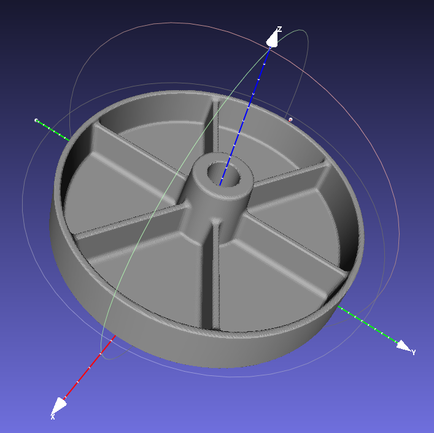
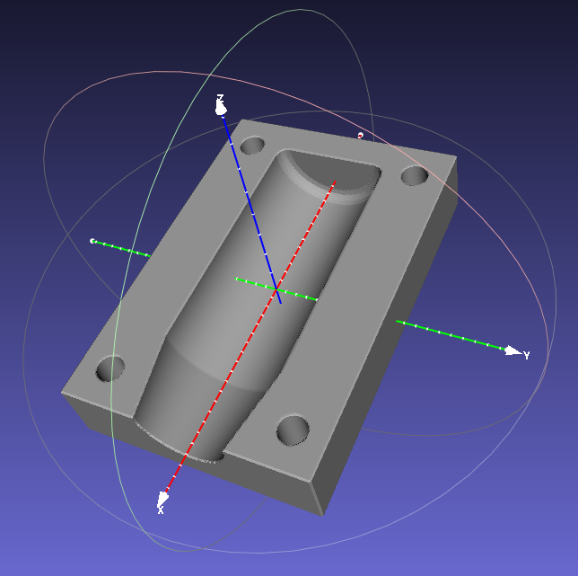
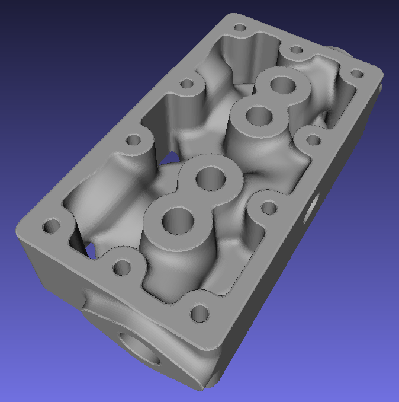
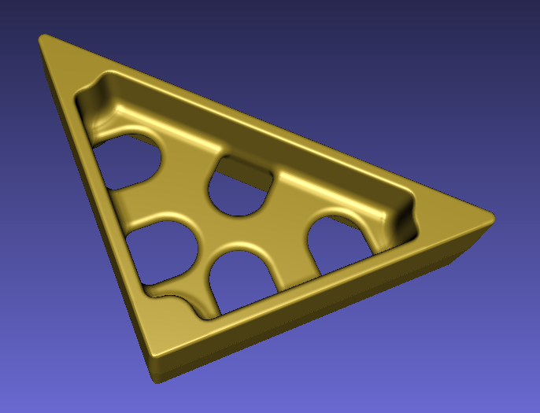
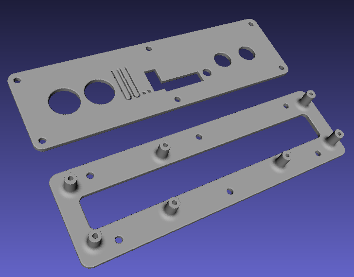

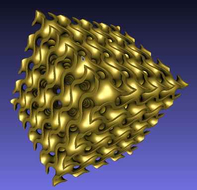
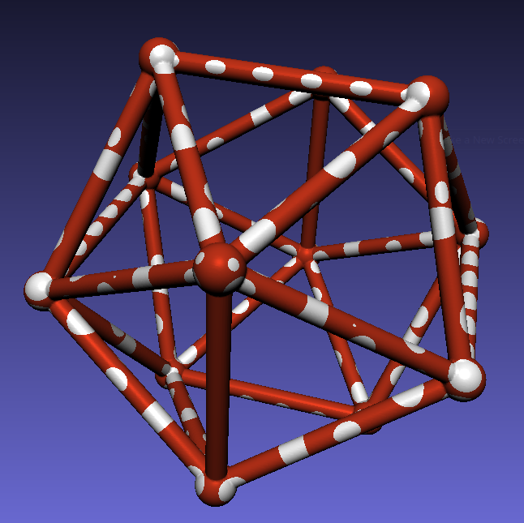
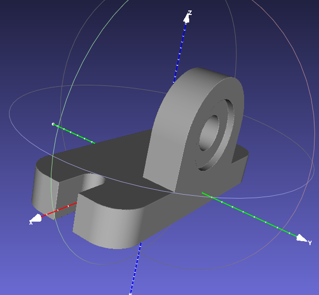
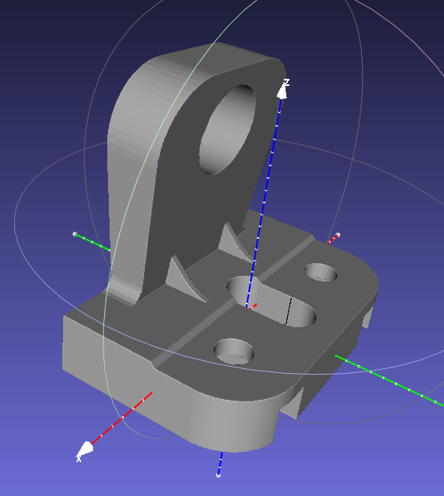
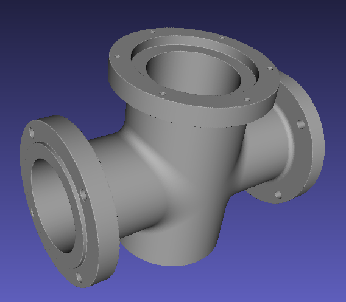
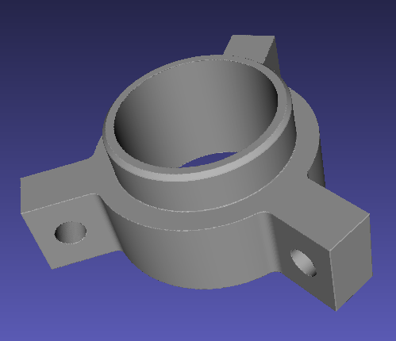
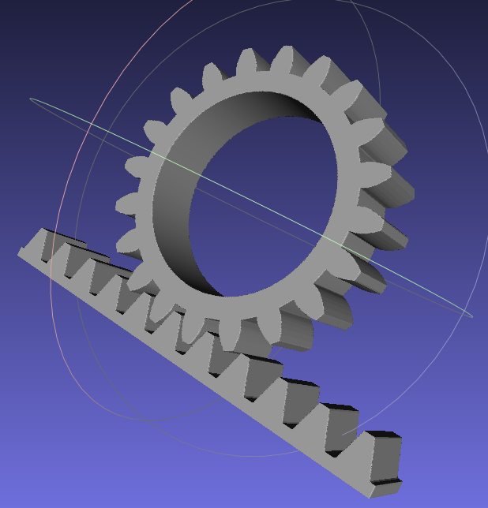
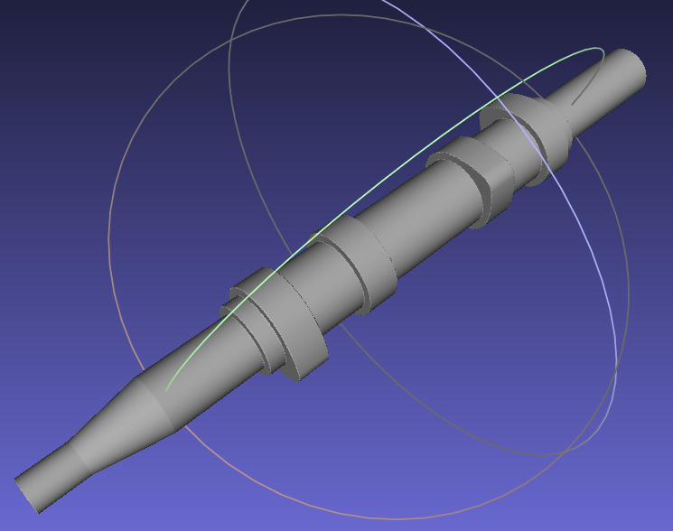
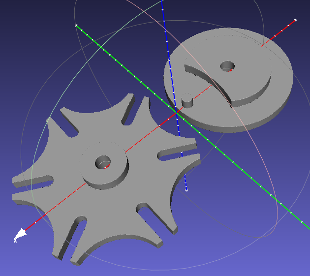
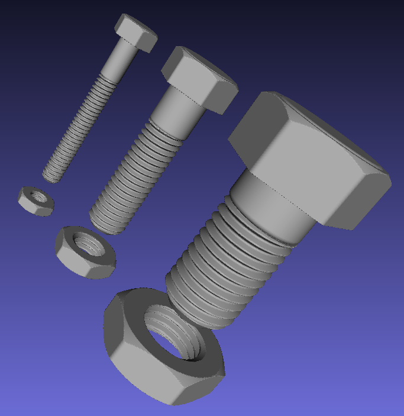
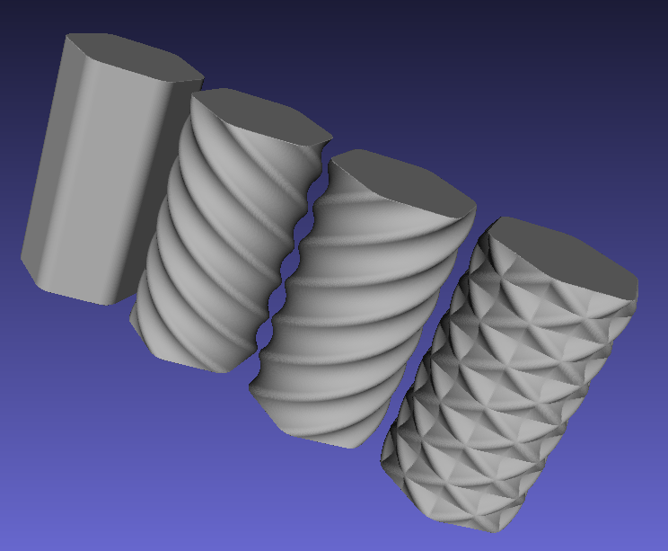
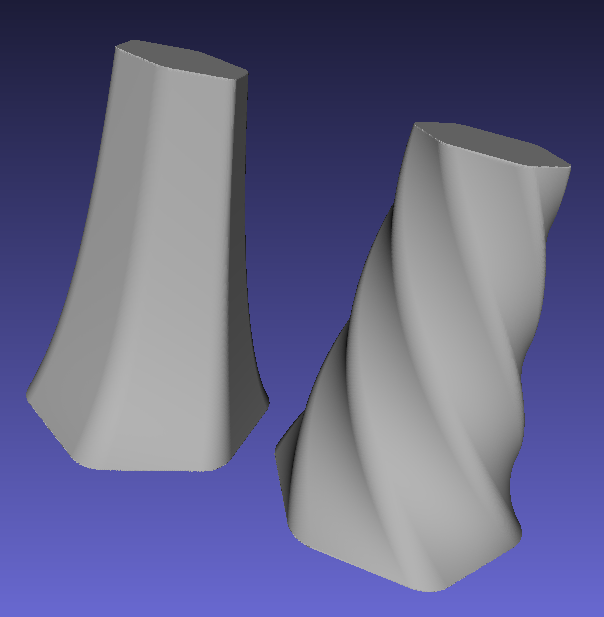
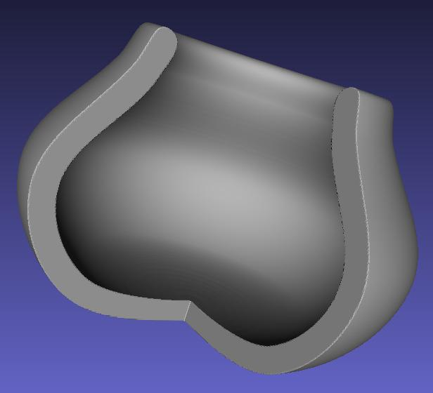
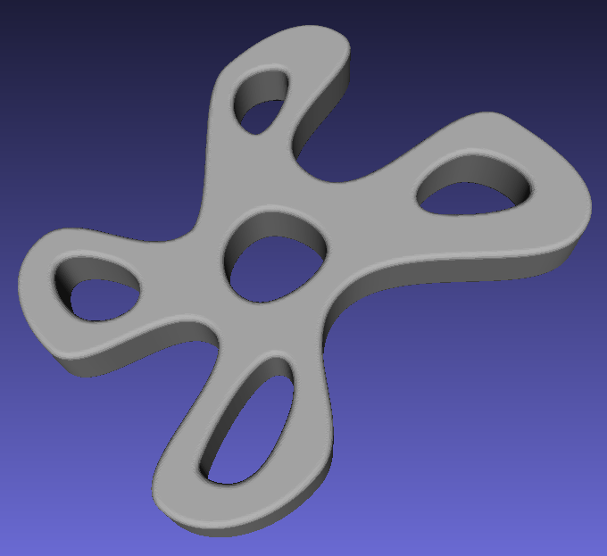
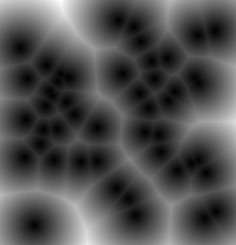
