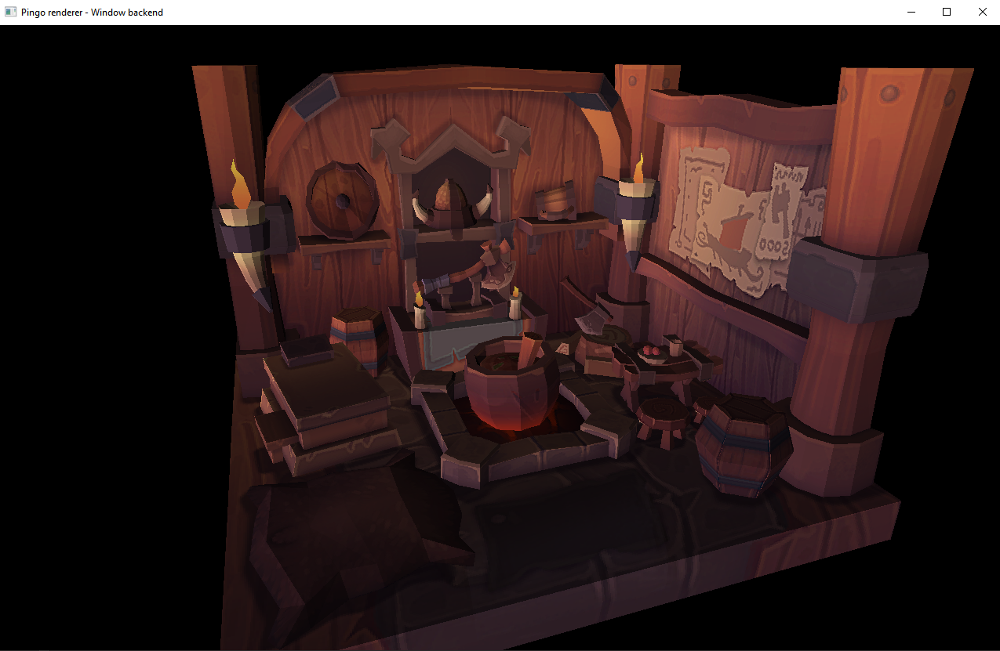

# Pingo

[](https://github.com/fededevi/pingo/actions)

A small software 3D renderer in C. No GPU, no dynamic allocation and no
dependencies beyond `libm`, so it runs anywhere from a desktop window to a
microcontroller or a terminal. The libraries claim no memory of their own —
all of it is the buffers and meshes you hand them.



## How it works

Pingo rasterizes triangles into a plain pixel buffer. It never owns that buffer:
a **backend** supplies it, and Pingo only fills it in.

One frame of `renderer_render()`:

1. Clear the depth buffer (and the framebuffer, if `clear` is set).
2. Ask the backend for the framebuffer and depth buffer, and call `beforeRender`.
3. Walk the scene graph from `root_renderable` with an identity transform.
4. Call `afterRender`, which is where the backend presents the pixels.

The scene graph is built from one interface — a struct whose first member is a
render function pointer:

```c
typedef struct {
    int (*render)(void *this, Mat4 transform, Renderer *renderer);
} Renderable;
```

Anything embedding a `Renderable` as its first field is drawable, which is how C
gets polymorphism here:

- **`Entity`** — a transform, a visibility flag, and child entities. Composing
  these is what makes the graph a tree; each node concatenates its transform and
  recurses.
- **`Object`** — a `Mesh` plus a `Material`. This is what actually reaches the
  rasterizer.
- **`Sprite`** — a `Texture` drawn straight through the given transform,
  bypassing the camera.

The camera lives on the `Renderer` as `camera_projection` and `camera_view`.
Backface culling, frustum culling and early-Z are toggles on the same struct
(`renderer_enable_*`), all on by default.

## Libraries

Three libraries. Each is built by its own directory, which also holds that
library's tests:

| Library | Contents |
|---------|----------|
| `pingo_math` | `Vec2/3/4`, `Mat3/4`, fixed-size and allocation-free |
| `pingo_render` | Renderer, rasterizer, scene graph, texture, depth buffer |
| `pingo_assets` | Generated mesh tables (viking, cube, teapot) |

`pingo_render` links `pingo_math`, and `pingo_assets` uses the `Mesh` type from
`pingo_render`, so linking the renderer alone brings the maths with it.

The renderer's tests draw into memory at 64x48 and compare the result against
committed PPM references, so they run on every platform - including the
cross-compiled ones, where no window backend exists. Regenerate the references
after a deliberate change by running the test executable with
`--write-references`.

## Lightmapping

`render/lightmap.h` adds a small offline baker for static scenes plus a
render entry point that replays the result. The flow:

1. **Freeze** — `bake_scene_build()` walks an `Entity` subtree and snapshots
   every visible `Object` instance: world triangles, a constant linear-RGB
   reflectance/emission, and an independent set of per-corner lightmap UVs
   supplied through `BakeBinding`. Instances are addressed by entity path
   (child indices from the root; the empty path is the root itself), so the
   same `Object` mounted twice is two instances with two lightmaps. The
   scene owns deep copies of everything — the source entities, meshes,
   bindings and materials may be freed right after the build. A build that
   fails validation (unbound or doubly bound objects, out-of-range
   reflectance/emission/UVs, or two faces of one instance covering the same
   texel with positive area) leaves any previous scene untouched.
2. **Bake** — `bake_step(scene, rounds, S, epsilon, environment)` advances
   whole bounce rounds. Every covered texel shoots the same **fixed set of
   S cosine-weighted hemisphere directions** (stratified u with a base-2
   radical inverse in phi) from `P + epsilon*N` and gathers the previous
   round's radiance, giving
   `L = emission + reflectance * sum(L_hit) / S`. Because the directions are
   fixed rather than random, there is no Monte-Carlo noise and repeated
   calls compose exactly (`bake_step(2)` equals two `bake_step(1)` calls);
   the price is that the hemispheric integral is only *approximated* by
   those S directions, so small S can leave structured artifacts that more
   samples smooth out. Rays are double-sided for occlusion, back faces
   absorb, misses see the constant environment radiance, and a round never
   reads its own new values. `bake_reset()` returns every texel to its
   emission.
3. **View** — `renderer_render_lightmapped(renderer, scene, exposure)` draws
   the live tree through the normal transform/coverage/depth path, but
   shades each fragment as `base_color/255 * L * exposure` (clamped and
   truncated to bytes) instead of using the fixed directional light. The
   tree must still match the snapshot's paths, transforms and geometry; the
   camera and the material's base-colour texture may change freely without
   rebaking. The entry point requires `clear=true` and draws into private
   buffers first, publishing colour and depth to the backend only on
   success.

Both the baker and the viewer sample the secondary (lightmap) UV with
**nearest texel, clamp-to-edge**: the interpolated UV is scaled into texel
units, floored to the nearest texel centre and clamped to the map border.
Fragments and rays that land on texels no face covers read zero. Texel
coverage itself is decided at build time at the texel centres
`((x+0.5)/W, (y+0.5)/H)` with a half-open shared-edge rule, so adjacent
faces never double-cover and never leave gaps.

`examples/lightmap_preview.c` builds a tiny emissive-panel room and writes
`round0.ppm` (emission only), `round2.ppm` (two gather rounds) and
`camera.ppm` (same bake, moved camera).


## Backends

A backend is five function pointers — `init`, `beforeRender`, `afterRender`,
`getFrameBuffer`, `getZetaBuffer`. Port Pingo somewhere new by implementing
those and handing the struct to `renderer_init()`.

| Example | Output | Needs |
|---------|--------|-------|
| `linux_window` | X11 window | libX11 |
| `linux_framebuffer` | `/dev/fb0` directly | — |
| `terminal` | ASCII art in the terminal (any platform) | — |
| `render_to_image` | JPEG file | libjpeg |
| `win_window` | Win32 GDI window | Windows |

Every one of them links the same `main.c`; only the backend library differs.

## Build

Out-of-source builds only.

```bash
cmake --workflow --preset default   # configure, build, test
```

Binaries land together in the preset's build directory. The examples read their
texture relative to the working directory, so run them from there.

`--workflow` runs three steps in order — configure, build, then the test
suite — and stops at the first failure. There are three presets:

| Preset | Build type | What it produces |
|--------|-----------|------------------|
| `default` | `Release` | every library, example and test the host can build |
| `debug` | `Debug` | the same, unoptimized |
| `freestanding` | `Release` | the libraries alone, static, for a target with no OS |

`freestanding` is what a microcontroller build looks like, and takes its cross
compiler from `CC` and `CFLAGS`.

libX11 and libjpeg are probed at configure time and the examples needing them
skipped with a message, so any environment builds whatever it can without being
told what it has.

`cmake --install <build dir> --prefix <dir>` installs the libraries, headers and
a package config, so another project can `find_package(pingo)` and link
`pingo::pingo_render`.
