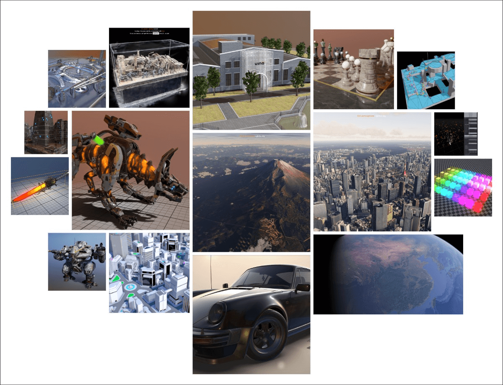

# ThingJS 3D Engine

[![NPM Package][npm]][npm-url]
![npm-size][npm-size-url]
[![Issues][issues-badge]][issues-badge-url]
[![DeepScan grade][deepscan]][deepscan-url]
[![Discord][discord]][discord-url]
[](https://deepwiki.com/uinosoft/t3d.js)



ThingJS 3D Engine (t3d) is a lightweight, web-first, and extendable 3D rendering library. It is used by ThingJS for web3d rendering, but can also be used as a standalone library.

t3d's API borrows the look and feel of three.js—familiar and easy to use—but it is not fully compatible or a drop-in replacement. It keeps a simple, flexible design while adding modern features and extra hooks for real‑time workflows, such as customizable rendering callbacks for finer control and post‑processing, clustered lighting for scalable many‑light scenes, light groups for organizing reusable lights, and other performance-minded optimizations.

[Examples](https://uinosoft.github.io/t3d.js/examples/) &mdash;
[Docs](https://uinosoft.github.io/t3d.js/docs/) &mdash;
[Discord](https://discord.gg/urB54PPXc4)

## Import

Use `t3d.js` or `t3d.min.js` in your page:

````html
<script src="t3d.min.js"></script>
````

or import as es6 module:

````javascript
import * as t3d from 't3d.module.js';
````

## Npm

t3d is published on npm. To install, use:

````
npm install t3d --save
````

This will allow you to import t3d entirely using:

````javascript
import * as t3d from 't3d';
````

or individual classes using:

````javascript
import { Scene, Renderer } from 't3d';
````

Since v0.2.0, the JavaScript files in `examples/jsm` can be imported like this:

````javascript
import { OrbitControls } from 't3d/addons/controls/OrbitControls.js';
````

## CDN

* https://unpkg.com/t3d@latest/build/t3d.min.js
* https://unpkg.com/t3d@latest/build/t3d.module.js

* https://cdn.jsdelivr.net/npm/t3d@latest/build/t3d.min.js
* https://cdn.jsdelivr.net/npm/t3d@latest/build/t3d.module.min.js

## Quick Start

Create a simple rotating cube with PBR materials:

````javascript
// Initialize renderer with WebGL2
const width = window.innerWidth || 2;
const height = window.innerHeight || 2;

const canvas = document.createElement('canvas');
canvas.width = width;
canvas.height = height;
document.body.appendChild(canvas);

// Create WebGL2 context and renderer
const gl = canvas.getContext('webgl2', {
  antialias: true,
  alpha: false
});
const renderer = new t3d.WebGLRenderer(gl);
const screenRenderTarget = new t3d.ScreenRenderTarget(canvas);
screenRenderTarget.setColorClearValue(0.1, 0.1, 0.1, 1);

// Create scene
const scene = new t3d.Scene();

// Create mesh with PBR material
const geometry = new t3d.BoxGeometry(8, 8, 8);
const material = new t3d.PBRMaterial();
const mesh = new t3d.Mesh(geometry, material);
scene.add(mesh);

// Add lighting
const ambientLight = new t3d.AmbientLight(0xffffff);
scene.add(ambientLight);

const directionalLight = new t3d.DirectionalLight(0xffffff);
directionalLight.position.set(-5, 5, 5);
directionalLight.lookAt(new t3d.Vector3(), new t3d.Vector3(0, 1, 0));
scene.add(directionalLight);

// Set up camera
const camera = new t3d.Camera();
camera.position.set(0, 10, 30);
camera.lookAt(new t3d.Vector3(0, 0, 0), new t3d.Vector3(0, 1, 0));
camera.setPerspective(45 / 180 * Math.PI, width / height, 1, 1000);
scene.add(camera);

// Animation loop
function loop(count) {
  requestAnimationFrame(loop);

  // Rotate cube
  mesh.euler.y = count / 1000 * .5;

  scene.updateMatrix();
  scene.updateRenderStates(camera);
  scene.updateRenderQueue(camera);

  renderer.renderScene(scene, camera, screenRenderTarget);
}
requestAnimationFrame(loop);
````

## Scene instance batching

`SceneInstanceCollector` automatically merges compatible opaque meshes into
instanced draw batches while the render queue is collected. Meshes keep their
own identity, parent hierarchy, geometry and material — no proxy mesh is
created and no source geometry or material is copied, replaced or mutated.

```javascript
import { Scene, SceneInstanceCollector } from 't3d';

const scene = new Scene();
scene.collector = new SceneInstanceCollector();
```

The call order does not change:

```javascript
scene.updateMatrix();
camera.updateMatrix();

scene.updateRenderStates(camera);
const queue = scene.updateRenderQueue(camera); // batched queue
renderer.renderScene(scene, camera, screenRenderTarget);
```

Callers keep using native `BasicMaterial` / `PBRMaterial`; the instance
materials in `t3d/addons/materials/InstancedMaterial.js` are not required and
are themselves excluded from batching.

### What is merged

Only ordinary opaque triangle `Mesh` objects with a native `BasicMaterial` or
`PBRMaterial` are considered. Objects with a `skeleton`, morph targets,
pre-existing instancing, a custom `onBeforeRender` / `onAfterRender`, a
`normalMap` or an `a_Tangent` attribute are left on their original path, as are
transparent entries (which keep their per-object depth ordering).

Two entries are merged only when they share the source `Geometry` instance, the
source `Material` instance, the group slot (`start` / `count`), `renderLayer`,
`renderOrder`, `receiveShadow` / `shadowType`, and the sign of the determinant
of their world matrix. A group needs at least two members. Members are ordered
by ascending `Mesh.id`.

### The `instanceBatch` descriptor

Each queue entry exposes `renderable.instanceBatch`, which is `null` for
ordinary entries and otherwise:

```javascript
{
  objects,        // member meshes, ordered by ascending id
  worldMatrices,  // Float32Array, 16 column-major floats per member
  count,          // number of members
  frontFaceCW     // true when the captured matrices have a negative determinant
}
```

The renderable keeps its original `geometry`, `material` and `group`; its
`object` is the smallest-id member. World matrices are captured at collection
time, so collecting another camera does not disturb a previous camera's queue.
Each collection reflects the current scene state (objects added/removed,
ancestry, visibility, geometry groups, material transparency), so no collector
re-installation is required. Reused queue entries have any stale descriptor
cleared.

### Drawing and resource ownership

`WebGLRenderer` draws a batch from the normal `renderRenderableItem` entry with
a single `drawElementsInstanced` or `drawArraysInstanced` call (WebGL2 only;
WebGL1 throws). The native material program gains a separate
`USE_INSTANCE_BATCH` variant, so one material can alternate between batch and
ordinary draws without touching the caller's `defines`, `uniforms` or shader
text. Each batch uses its own vertex array, so leaving it restores ordinary
attribute divisors and index bindings, and empty batches issue no draw.

Batch GPU resources (instance buffers and vertex arrays) belong to the
renderer. Two renderers can draw the same batch descriptor without sharing
buffers, and:

```javascript
renderer.releaseSceneInstanceResources();
```

releases only this renderer's batch buffers and bindings. It is safe to call
repeatedly; the next draw recreates them. Source geometries and materials are
never released.

See [`examples/headless-scene-batches.mjs`](./examples/headless-scene-batches.mjs)
for a headless example and [`tests/scene-instance-batches.test.mjs`](./tests/scene-instance-batches.test.mjs)
for the membership, submission and integration coverage.

## Extensions

* [t3d-effect-composer](https://github.com/uinosoft/t3d-effect-composer) - Post Effects extension for t3d.js.
* [t3d-particle](https://github.com/uinosoft/t3d-particle) - This is a particle system developed based on t3d.js.
* [t3d-pano](https://github.com/uinosoft/t3d-pano) - Panorama extension for t3d.
* [t3d-3dtiles](https://github.com/uinosoft/t3d-3dtiles) - A 3dtile extension based on t3d.js.
* [t3d-dynamic-sky](https://github.com/uinosoft/t3d-dynamic-sky) - Dynamic sky addon for t3d.
* [t3d-gaussian-splatting](https://github.com/uinosoft/t3d-gaussian-splatting) - A t3d-based implementation of 3D Gaussian Splatting.

## Tools

* [t3d-model-viewer](https://uinosoft.github.io/t3d-model-viewer/) - A Model Viewer based on t3d.js and t3d-effect-composer.
* [t3d-particle-editor](https://uinosoft.github.io/t3d-particle/editor) - A particle editor based on t3d.js and t3d-particle.
* [t3d-ibl-baker](https://uinosoft.github.io/t3d-ibl-baker/) - This is a simple tool to bake IBL maps for t3d.

## Contributing

Please make sure to read the [Contributing Guide](./.github/contributing.md) before making a pull request.

[npm]: https://img.shields.io/npm/v/t3d
[npm-url]: https://www.npmjs.com/package/t3d
[npm-size-url]: https://img.shields.io/bundlephobia/minzip/t3d
[issues-badge]: https://img.shields.io/github/issues/uinosoft/t3d.js.svg
[issues-badge-url]: https://github.com/uinosoft/t3d.js/issues
[deepscan]: https://deepscan.io/api/teams/20241/projects/25542/branches/800776/badge/grade.svg
[deepscan-url]: https://deepscan.io/dashboard#view=project&tid=20241&pid=25542&bid=800776
[discord]: https://img.shields.io/discord/1069800954494464043
[discord-url]: https://discord.gg/urB54PPXc4