[](https://goreportcard.com/report/github.com/deadsy/sdfx)
[](https://godoc.org/github.com/deadsy/sdfx/sdf)

# sdfx

A simple CAD package written in Go (https://golang.org/)

 * Objects are modelled with 2d and 3d signed distance functions (SDFs).
 * Objects are defined with Go code.
 * Objects are rendered to an STL/3MF file to be viewed and/or 3d printed.

## How To
 1. See the examples.
 2. Write some Go code to define your own object.
 3. Build and run the Go code.
 4. Preview the output in an 3d file viewer (e.g. http://www.meshlab.net/)
 5. Print the STL/3MF file if you like it enough.

[SDF Viewer Go](https://github.com/Yeicor/sdf-viewer-go) or [SDFX-UI](https://github.com/Yeicor/sdfx-ui) allow faster development iterations, replacing steps 3 and 4 until the final build.

## Why?
 * SDFs make CSG easy.
 * As a language Golang > OpenSCAD.
 * SDFs can easily do filleting and chamfering (hard to do with OpenSCAD).
 * SDFs are hackable to try out oddball ideas.

## Rendering meshes

Most parts render straight to STL with a marching cubes renderer
(`render.NewMarchingCubesUniform`, `render.NewMarchingCubesOctree`). Parts
with flat faces and sharp edges are better served by dual contouring, which
places one vertex per surface-crossing voxel from the Hermite intersection
points and normals of the crossing edges. Three dual contouring renderers live
in `render/dc`:

| Renderer | Constructor | When to use it |
| --- | --- | --- |
| V1 (octree) | `dc.NewDualContouringV1(simplify, rCond, lockVertices)` | Octree subdivision with optional mesh simplification; legacy path with its own channel-based API (`Render(sdf, meshCells, ch)`). |
| V2 (uniform grid) | `dc.NewDualContouringV2(...)` / `dc.NewDualContouringDefault(meshCells)` | Fast uniform voxel grid. Adds a weak push toward the voxel center for conditioning and clamps the solved vertex back into the voxel, so flat regions are slightly biased and clamped rather than truly optimized. |
| Bounded (uniform grid) | `dc.NewDualContouringBounded(meshCells)` | Modeling meshes with planes and sharp edges. Solves the true minimum of the Hermite quadratic error function **inside the closed voxel box** — no center bias, no diagonal regularization, no post-hoc clamping. Rank-deficient data (a single plane, parallel or repeated normals) keeps the minimum-residual point closest to the mean Hermite position; the voxel center is only used when the data carries no constraint at all. It implements `render.Render3`, so it plugs into `render.CollectTriangles` and `render.ToSTL` like any other renderer. |

The bounded renderer is translation and scale invariant: the QEF is solved in
voxel-local coordinates, so moving the part far from the origin or scaling it
by 1e-3, 1 or 1e3 does not change the relative vertex positions.

```go
import (
    "github.com/deadsy/sdfx/render"
    "github.com/deadsy/sdfx/render/dc"
)

// collect triangles directly
tris := render.CollectTriangles(part, dc.NewDualContouringBounded(200))

// or write an STL through the same Render3 interface
render.ToSTL(part, "part.stl", dc.NewDualContouringBounded(200))
```

See `sanity/bounded_example.go` for a complete sharp-edged example.

## Development
 * [Roadmap](docs/ROADMAP.md)

## Gallery

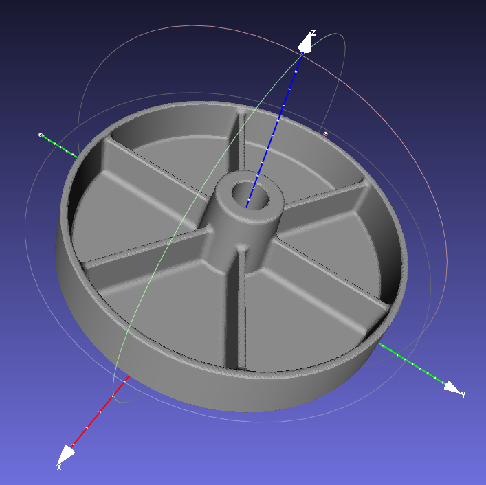
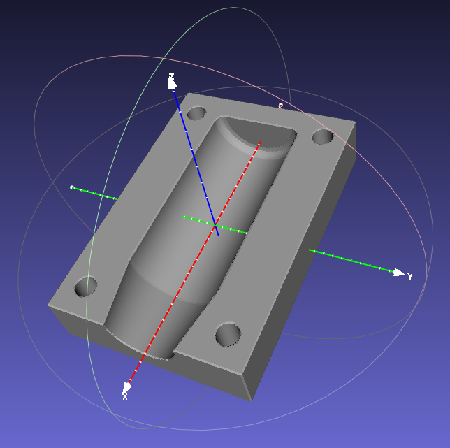
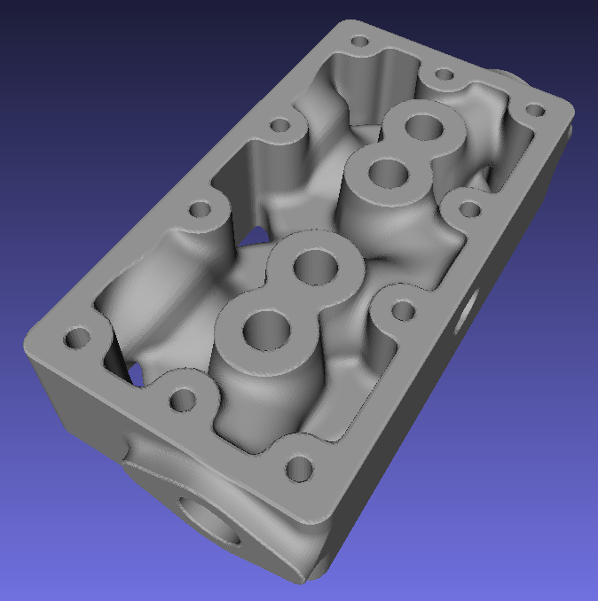
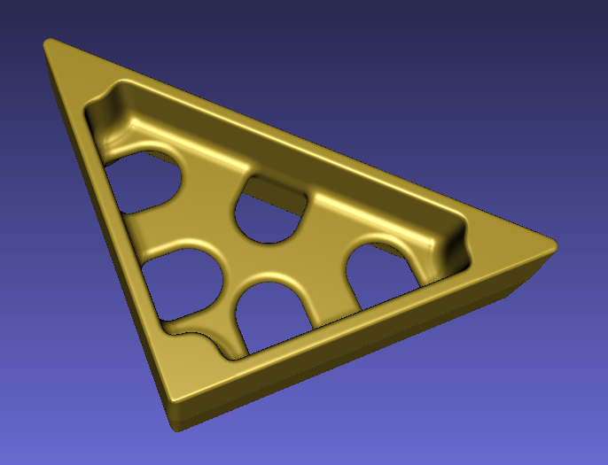
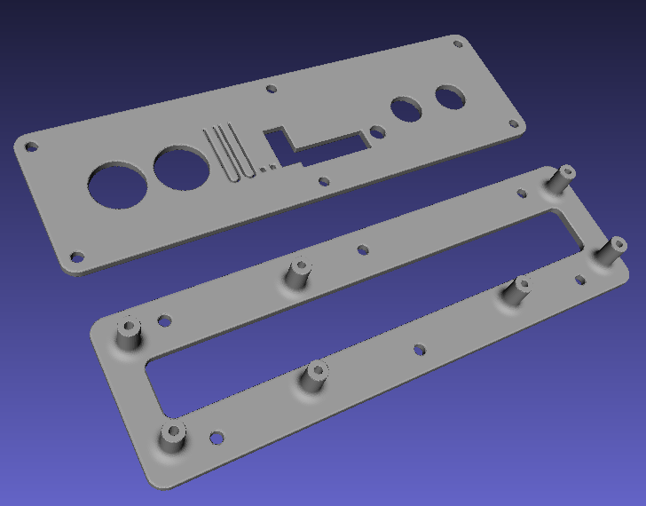

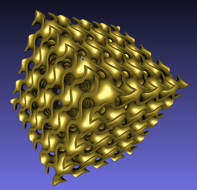
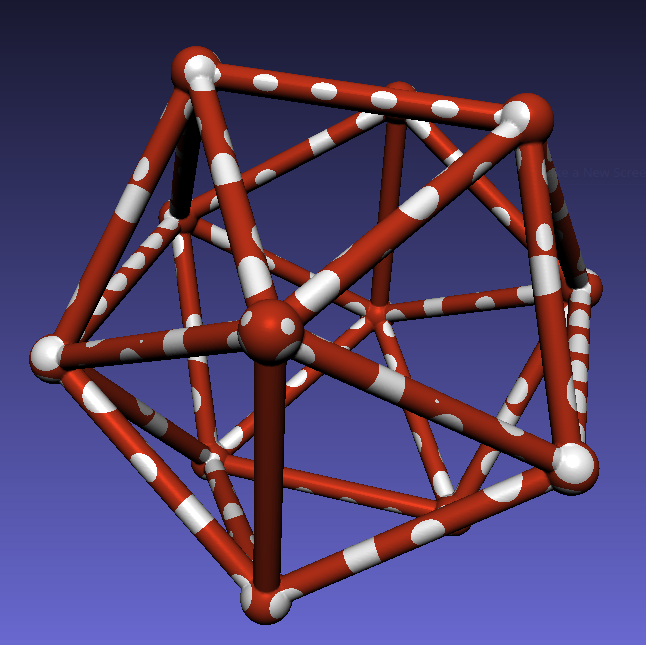
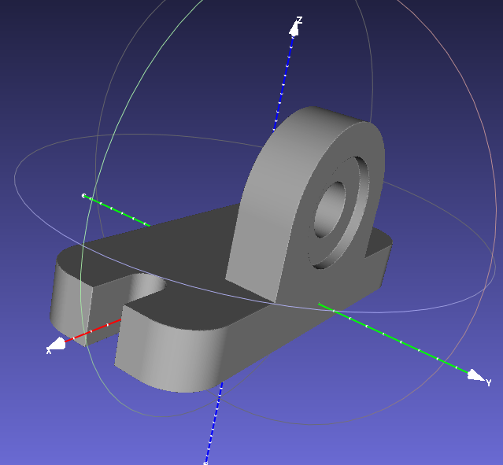
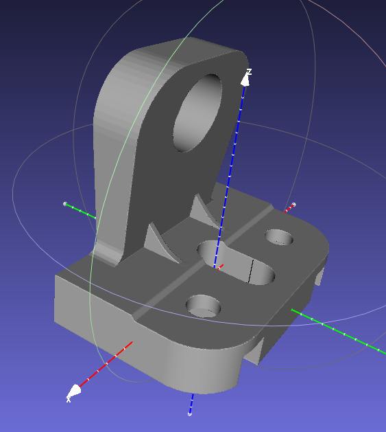
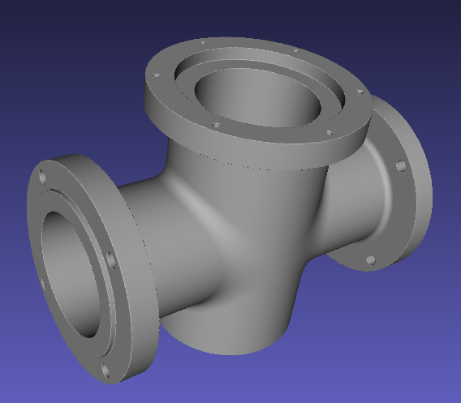
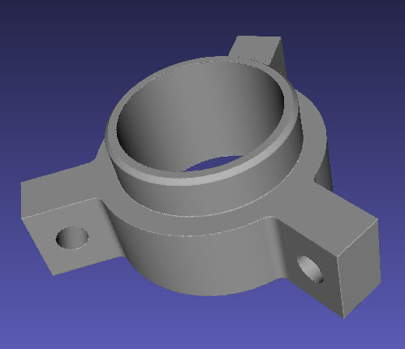
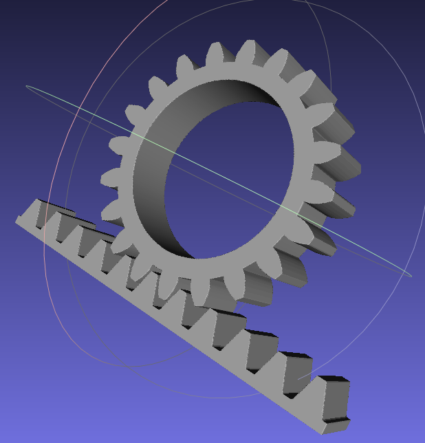
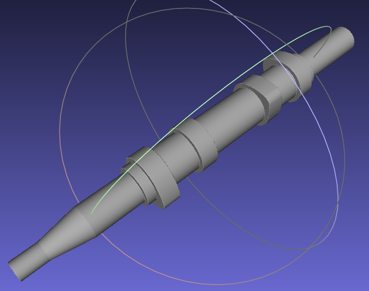
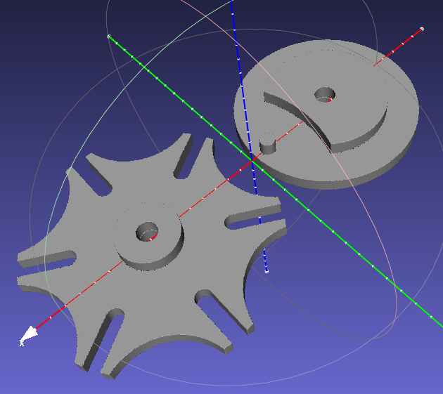
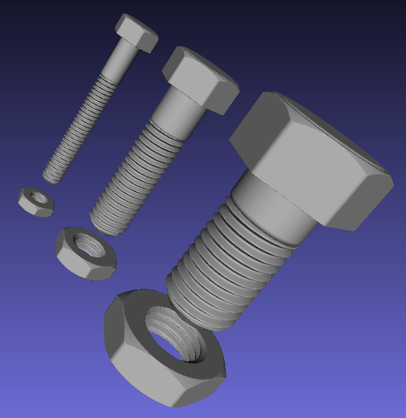
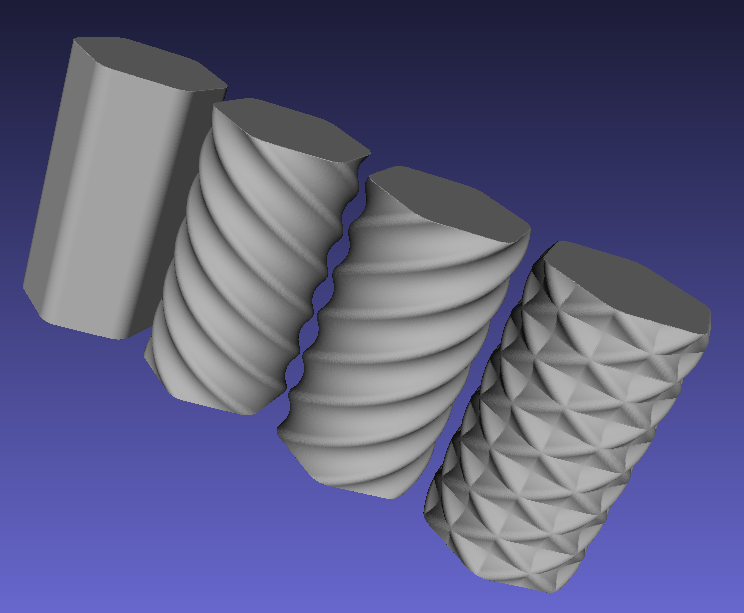
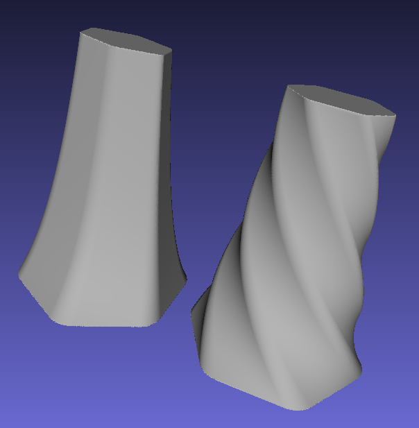
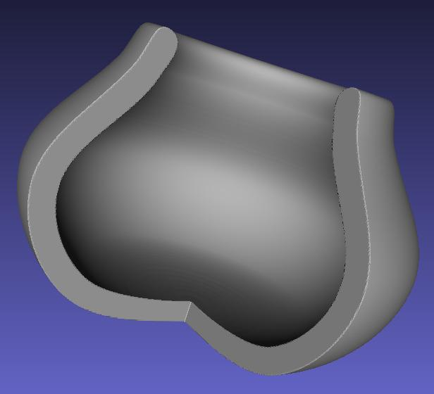
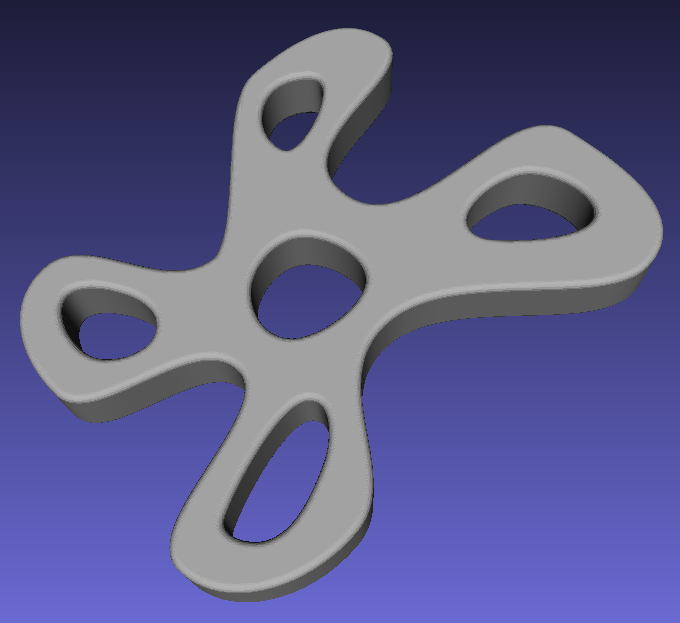
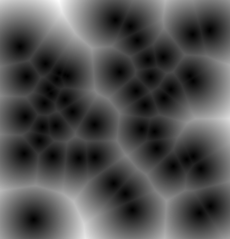
