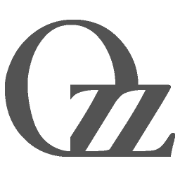

[](http://guillaumeblanc.github.io/ozz-animation/)

ozz-animation
=============

open source c++ 3d skeletal animation library and toolset
---------------------------------------------------------

ozz-animation provides runtime character animation playback functionalities (loading, sampling, blending...). It proposes a low-level renderer agnostic and game-engine agnostic implementation, focusing on performance and memory constraints with a data-oriented design.

ozz-animation comes with the toolchain to convert from major Digital Content Creation formats (gltf, Fbx, Collada, Obj, 3ds, dxf) to ozz optimized runtime structures. Offline libraries are also provided to implement the conversion from any other animation and skeleton format.

Follow [this link](https://github.com/guillaumeblanc/ozz-animation/issues/175) for a list of projects using ozz-animation.

Documentation
-------------

Documentation and samples are available from [ozz-animation website](http://guillaumeblanc.github.io/ozz-animation/).

Dual quaternion skinning
------------------------

`ozz::geometry::SkinningJob` supports two skinning algorithms, selected by its
`mode` member:

- `SkinningJob::kLinear` (default): the historical matrix palette (linear blend)
  skinning implementation. Callers that don't set `mode` keep the exact same
  numerical results and validation behavior as before.
- `SkinningJob::kDualQuaternion`: dual quaternion skinning. This mode avoids the
  "candy wrapper" cross-section collapse that linear blend skinning produces
  when a limb is twisted by a large angle.

The dual quaternion mode consumes the same inputs as the linear one:
`joint_matrices`, `joint_indices`, `joint_weights`, the position, normal and
tangent spans with their byte strides, and `influences_count` (1, 2, 4 or more
influences). It also reads the optional `joint_inverse_transpose_matrices`.

Matrix space
------------

The matrices in `joint_matrices` are the **final skinning matrices**, i.e. the
model space transform of the joint multiplied by the inverse of its bind pose:

```
skinning_matrix[joint] = model_space_matrix[joint] * inverse_bind_matrix[joint]
```

They are not joint local or model transforms. `joint_indices` indexes this
palette, which doesn't have to contain every skeleton joint: a compact palette
built with a remapping table is supported, as long as indices stay in range.
The `examples/dq_skinning.cc` example builds such a compact palette from a five
joint skeleton (`models[joint_remaps[palette]] * inverse_bind[joint]`).

The job is renderer agnostic. It expects the final skinning matrices, whatever
the space they map to (model, world...); `LocalToModelJob` output multiplied by
an inverse bind pose is the usual way to obtain them.

Per-vertex decision and mixed scaling
-------------------------------------

Dual quaternion skinning can only represent rigid transformations. The mode
therefore decides per vertex, never per mesh:

- If **all the matrices actually referenced by strictly positive weights** are
  rigid, the vertex is transformed with a dual quaternion. "Rigid" means the
  matrix is finite, its last row is `(0,0,0,1)`, its three linear columns have
  unit length, are pairwise orthogonal, and its linear part determinant is `+1`.
  Each test uses an absolute tolerance of `1e-4`.
- Otherwise (non-uniform scale, uniform scale, shear or reflection), **the whole
  vertex falls back to the legacy linear blend formula**: position, normal and
  tangent all use it. A non-rigid influence with a zero weight does not trigger
  the fallback, although its palette index must still be valid. A scaled joint
  therefore only affects the vertices it actually influences, never the whole
  mesh.

This means a mesh can mix rigid vertices (dual quaternion) and scaled vertices
(linear blend) within a single job and a single matrix palette. Vertices on the
seam between both kinds are still blended with different algorithms, which is
the documented and expected behavior.

For rigid influences, the rotation is extracted from the matrix, normalized into
a unit dual quaternion, aligned to a common hemisphere and blended by weight. The
reference influence used for the hemisphere (and for the sign convention) is the
strictly positive weight with the greatest value, ties being resolved by the
smallest palette index. When a selected rotation dot product is negative, both
the real and dual parts are negated; a null dot product is not flipped. After
blending, the real part is normalized and the dual part orthogonalized. If the
blended real part length is lower than `1e-6`, the vertex falls back to linear
blend skinning to avoid a division by zero.

Positions use the full rigid transform (rotation and translation); normals and
tangents are only rotated, without translation, and their length is preserved.
The fallback path uses `joint_inverse_transpose_matrices` for direction vectors
when provided, exactly like the legacy interface does.

Validation
----------

`kLinear` mode keeps the historical span capacity validation untouched. The
`kDualQuaternion` mode additionally validates, **before writing any output**,
every index, weight and matrix it reads:

- all palette indices are in range (including those of zero-weight influences),
- explicit and restored weights are finite and within `[0,1]`,
- the sum of explicit weights does not exceed `1`.

`Run()` returns `false` and leaves all outputs untouched when one of these
conditions fails.

Execution notes
---------------

- The dual quaternion path doesn't allocate heap memory.
- Attributes keep their historical layout: only three floats are written per
  attribute, so interleaved color, UV, tangent fourth component and padding are
  preserved.
- Each attribute's input and output may fully alias (in-place skinning),
  different attributes must not overlap; partial overlaps across attributes
  aren't supported.

Running the target
------------------

```
sh support/run.sh baseline   # builds and runs the historical linear baseline
sh support/run.sh target     # runs the baseline, then builds and runs the new
                             # tests and the example
```

`sh support/run.sh target` prints `OZZ_LBS_BASELINE_OK` for the original linear
path, `OZZ_DQ_TARGET_OK` when `tests/dual_quaternion_target.cc` succeeds, and
`OZZ_DQ_EXAMPLE_OK` when `examples/dq_skinning.cc` succeeds. Both programs exit
with a non-zero status on failure.

The example (`examples/dq_skinning.cc`) can also be built as a regular
`examples/dq_skinning` target of the main CMake project (it only links the
runtime and offline libraries, and doesn't open a window).

Supported platforms
-------------------

ozz-animation is tested on WebAssembly, Linux, macOS and Windows, for x86, x86-64 and ARM architectures. The run-time code (ozz_base, ozz_animation, ozz_geometry) depends only on c++17, on the C and the C++ standard libraries, and has no OS specific code. Portability to any other platform shouldn't be an issue.

Samples, tools and tests depend on external libraries (glfw, tinygltf, Fbx SDK, jsoncpp, gtest, ...), which aren't need to ship with ozz-animation runtime.

Build status
------------

|         | Linux  | macOS | Windows | WebAssembly |
| ------- | ------ | ------ | ------- | ------- |
| master  | [](https://github.com/guillaumeblanc/ozz-animation/actions/workflows/linux.yml) | [](https://github.com/guillaumeblanc/ozz-animation/actions/workflows/macos.yml) | [](https://github.com/guillaumeblanc/ozz-animation/actions/workflows/windows.yml) | [](https://github.com/guillaumeblanc/ozz-animation/actions/workflows/wasm.yml) |
| develop | [](https://github.com/guillaumeblanc/ozz-animation/actions/workflows/linux.yml) | [](https://github.com/guillaumeblanc/ozz-animation/actions/workflows/macos.yml) | [](https://github.com/guillaumeblanc/ozz-animation/actions/workflows/windows.yml) | [](https://github.com/guillaumeblanc/ozz-animation/actions/workflows/wasm.yml) |

The dashboard for all branches is available [here](http://guillaumeblanc.github.io/ozz-animation/documentation/dashboard/).

Contributing
------------

All contributions are welcome: code reviews, bug reports, bug fixes, samples, features, platforms, testing, documentation, optimizations...

Please read [CONTRIBUTING](CONTRIBUTING.md) file for more details about how to submit bugs or contribute to the code.

License
-------

ozz-animation is hosted on [github](http://github.com/guillaumeblanc/ozz-animation/) and distributed under the **MIT License** (MIT).
