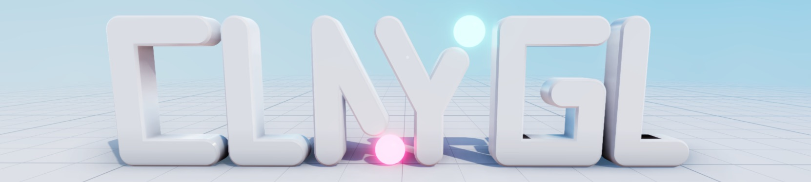
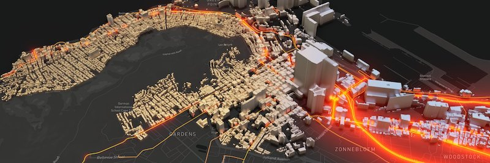
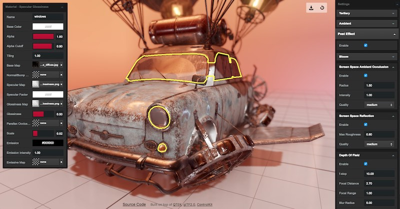
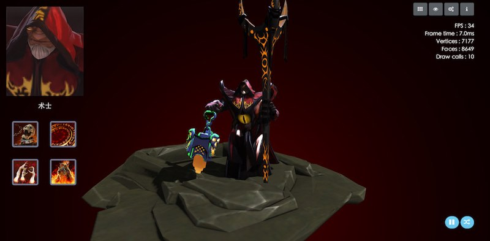

<h1>  ClayGL</h1>



[](https://github.com/pissang/claygl)
[](https://circleci.com/gh/pissang/claygl)

ClayGL is a WebGL graphic library for building scalable Web3D applications.

It's easy to use, configurable for high-quality graphics. Benefit from the modularity and tree shaking, it can be scaled down to 22k(gzipped) for a basic 3D application.

#### [Download](https://github.com/pissang/claygl/releases)

#### [API](http://docs.claygl.xyz/api)

#### [Examples](http://examples.claygl.xyz)

## Projects

[ECharts GL](https://github.com/ecomfe/echarts-gl)

<a href="https://github.com/ecomfe/echarts-gl" target="_blank">

</a>

[Clay Viewer](https://github.com/pissang/clay-viewer)

<a href="https://github.com/pissang/clay-viewer" target="_blank">

</a>


[DOTA2 Hero Viewer](https://github.com/pissang/dota2hero)

<a href="https://github.com/pissang/dota2hero" target="_blank">

</a>

[Paper Cut Art Generator](https://github.com/pissang/papercut-box-art)

<a href="https://github.com/pissang/papercut-box-art" target="_blank">

</a>


[Little Big City](https://github.com/pissang/little-big-city)

<a href="https://github.com/pissang/little-big-city" target="_blank">

</a>


## Quick Start

##### Create a rotating cube

```html
<!DOCTYPE html>
<html lang="en">
<head>
  <script src="lib/claygl.js"></script>
</head>
<body>
  <canvas id="main"></canvas>
  <script>
    clay.application.create('#main', {

      width: window.innerWidth,
      height: window.innerHeight,

      init(app) {
        // Create camera
        this._camera = app.createCamera([0, 2, 5], [0, 0, 0]);

        // Create a RED cube
        this._cube = app.createCube({
            color: '#f00'
        });

        // Create light
        this._mainLight = app.createDirectionalLight([-1, -1, -1]);
      },
      loop(app) {
        this._cube.rotation.rotateY(app.frameTime / 1000);
      }
    });
  </script>
</body>
</html>
```

#### Minimum bundle example

This example is about 22k(gzipped) after bundled by webpack 4.0. It draws a triangle on the screen.

```js
import { Renderer, GeometryBase, Shader, Material } from 'claygl';

const vsCode = `
attribute vec3 position: POSITION;
void main() {
    gl_Position = vec4(position, 1.0);
}
`;
const fsCode = `
void main() {
    gl_FragColor = vec4(0.0, 0.0, 1.0, 1.0);
}
`;

const renderer = new Renderer({
    canvas: document.getElementById('main')
});
renderer.resize(400, 400);

const geometry = new GeometryBase();
geometry.createAttribute('position', 'float', 3);
// Add triangle vertices to position attribute.
geometry.attributes.position.fromArray([
    [-0.5, -0.5, 0],
    [0.5, -0.5, 0],
    [0, 0.5, 0]
]);

const material = new Material({
    shader: new Shader(vsCode, fsCode)
});
renderer.renderPass([ { geometry, material } ]);
```

## CPU skinned world positions

For a skinned `Mesh` (one with a `skeleton` and a non-empty `joints` palette)
you can read back the current deformed vertices on the CPU, in world space.
This is the same deformation the draw path uses — the local joint palette
(bone world matrix × inverse bind matrix), the `weight`/`joint` attributes and
the per-instance `offsetMatrix` — so CPU frustum culling and ray picking agree
with what is rendered.

+ `mesh.getSkinnedWorldPositions()` returns a fresh `Float32Array` of world
  positions, three components per vertex in vertex order.
+ `mesh.getSkinnedWorldBoundingBox()` returns a new `BoundingBox` enclosing
  those points.

Both are recomputed on every call from the current `geometry`, `skeleton`,
`joints` and `offsetMatrix`; they never advance the animation. After you update
the node matrices and call `skeleton.update()`, changing the palette, the
offset or swapping the geometry is reflected on the next call immediately. The
shared geometry (its `position`, `boundingBox` and any `skinnedPosition`
attribute) is never written, so several meshes sharing one geometry keep
independent results.

The weighting follows the builtin shader: the first weight/joint term is always
applied, the other three only when their weight is strictly greater than
`1e-4`, and the fourth weight is `1 - w0 - w1 - w2`. The homogeneous positions
are weighted before the `offsetMatrix` is applied and before the perspective
divide; the mesh's own `worldTransform` is not applied to skinned vertices.

```js
// After scene.update() (node matrices) and skeleton.update().
const positions = mesh.getSkinnedWorldPositions(); // Float32Array, xyz per vertex
const box = mesh.getSkinnedWorldBoundingBox();     // clay.BoundingBox in world space

// Scene.updateRenderList and RayPicking now use these per-instance bounds and
// points automatically, so each skinned instance is culled and picked where it
// is actually drawn.
const hit = new clay.picking.RayPicking({scene, camera, renderer}).pick(x, y);
// hit.target, hit.triangleIndex, hit.pointWorld (offset applied) and
// hit.point (deformed point before the offset), hit.distance from the ray origin.
```

A complete runnable Node example (no browser or GPU) lives in
[`example/skinned-world-cpu.mjs`](./example/skinned-world-cpu.mjs).


<!--
## Current Features

+ Scene graph based management of lights, meshes, cameras, materials and shaders
+ Basic primitive geometry procedural generate
  + Cube, sphere, cylinder, cone, plane
+ Phong and lambert buildin shaders which support normal map and environment map
+ Point, directional, spot light
+ Orthographic, perspective camera
+ Graph based post processing
+ High quality shadow
  + PCF or VSM soft shadow
  + PSSM for sun light in large scene
  + Omni light shadow support
+ High performance geometry processing
+ GPU based skinning
  + Support 1D and 2D animation blending with blend tree
+ First person camera control, orbit camera control
+ Skybox, skydom
+ Particle System
+ Support both ray picking and GPU Picking
+ Loader
  + glTF loader
+ Timeline based animation, support spline interpolation between keyframes.
+ Full deferred pipeline.
+ Physically based rendering, Full HDR pipeline.
+ Stereo rendering, VR ready.
 -->

### FBX to glTF2.0 Converter

[Get it](https://github.com/pissang/claygl/blob/master/tools/fbx2gltf.py)

Needs [python3.3](https://www.python.org/download/releases/3.3.0/) and [FBX SDK 2018.1.1](http://usa.autodesk.com/adsk/servlet/pc/item?siteID=123112&id=26416130).

```
usage: fbx2gltf.py [-h] [-e EXCLUDE] [-t TIMERANGE] [-o OUTPUT]
          [-f FRAMERATE] [-p POSE] [-q] [-b]
          file

FBX to glTF converter

positional arguments:
  file

optional arguments:
  -h, --help            show this help message and exit
  -e EXCLUDE, --exclude EXCLUDE
            Data excluded. Can be: scene,animation
  -t TIMERANGE, --timerange TIMERANGE
            Export animation time, in format
            'startSecond,endSecond'
  -o OUTPUT, --output OUTPUT
            Ouput glTF file path
  -f FRAMERATE, --framerate FRAMERATE
            Animation frame per second
  -p POSE, --pose POSE  Start pose time
  -q, --quantize        Quantize accessors with WEB3D_quantized_attributes
            extension
  -b, --binary          Export glTF-binary
  --beautify            Beautify json output.
  --noflipv             If not flip v in texcoord.
```

Input:

+ FBX
+ COLLADA
+ OBJ

Output:

+ Scene hierarchy
+ Mesh and camera
+ PBR material
+ Texture
+ Skin
+ Animation


