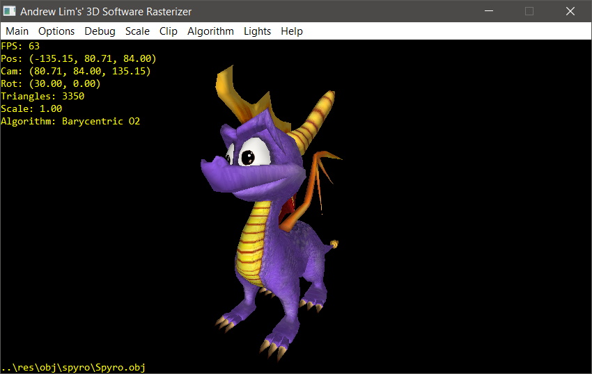

# Andrew Lim's C++ 3D Software Rasterizer

Personal 3D playground program for me to test and learn 3D rendering. Source code made public in case somebody finds it helpful.
Though it is a still a very much work in progress.

You will need a C++ 11 compiler. Currently I'm developing with [Embarcadero Dev-C++](https://github.com/Embarcadero/Dev-Cpp)

All rendering is done first on a custom [ImageData](src/ImageData.h) object which holds a one-dimensional array of bytes (of type uint8_t).
Then the bytes are transferred/blitted to the native screen format. In this case, I'm testing with Win32 GDI where the bytes are
displayed with [SetDIBitsToDevice](https://learn.microsoft.com/en-us/windows/win32/api/wingdi/nf-wingdi-setdibitstodevice).

[Download Latest Release Here](https://github.com/andrew-lim/sw3dcpp/releases/).

## Screenshots
<table style="padding:10px">
  <tr>
    <td width="50%"></td>
    <td width="50%"></td>
  </tr>
  <tr>
    <td width="50%"></td>
    <td width="50%"></td>
  </tr>
</table>

## Videos

[YouTube Playlist](https://www.youtube.com/watch?v=YPubnjG4eH8&list=PL4Pn9mFG1hxREHDD_Zxq7BTCi5jRkjrjr&ab_channel=AndrewLim)

## Features

- 4 triangle rendering algorithms: standard scanline, barycentric, and 2 optimized barycentric variants
- Displays a simple textured cube at the start
- Loading .OBJ and .MTL files with BMP/PNG support. Sample models can be loaded from the Debug menu
- Solid, Affine and Nearest Neighbour Perspective-Correct Texture Mapping
- Clipping by near plane only, or clipping by all 6 planes
- Z Buffer
- Flat and Smooth/Gourand Lighting

## Libraries Used

- [lodepng](https://github.com/lvandeve/lodepng) for PNG loading
- [tinyobjloader](https://github.com/tinyobjloader/tinyobjloader) for .OBJ parsing
- [glm](https://github.com/g-truc/glm) was previously used for matrix math but has been replaced by custom Matrix and Vector classes. However it is still distributed together with the source code.

## Coarse Material Preview (`CoarseRenderer`)

[src/CoarseShading.h](src/CoarseShading.h) / [src/CoarseShading.cpp](src/CoarseShading.cpp)
implement a coarse shading path for material previews: texture and lighting
work is reduced by sharing one shader invocation across an r×r block of
pixels, while silhouette and occlusion stay per pixel.

### How the frontier advances

1. Every submitted clip-space triangle goes through the existing six-plane
   `ClipSpace` clipping and the shared BARYCENTRIC coverage traversal
   exactly once. That traversal was extracted into
   `TriangleDrawer::forEachBarycentricCoverage`, so the coarse path collects
   its per-pixel candidates from the same production code as the normal
   barycentric algorithm — no second scanner and no scene redraw per round.
2. Each pixel keeps its candidates ordered near to far by reconstructed
   `w`, breaking ties by submission order. A candidate is only valid when
   its `w` is **strictly less** than the baseline depth; clipped fragments of
   the same original primitive merge into one candidate per pixel.
3. A resolve runs in rounds. Each round only looks at pixels that are not yet
   resolved, takes each pixel's current nearest candidate, and groups those
   candidates by original primitive and screen-aligned r×r shading block
   (r comes from the `ShadingRateMap`, one value of 1, 2 or 4 per 8×8 cell).
   Every group's coverage mask is frozen before any callback runs.
4. One shader call shades a whole group at the arithmetic mean of its covered
   pixel centres. If the shader accepts, every covered pixel receives that
   one colour together with its own candidate depth and is **permanently
   resolved** — it never enters another group or gets re-shaded.
5. If the shader rejects, only those pixels' current candidates are removed;
   the next round exposes the layer behind them with a different coverage
   mask and a different representative position. Rounds continue until every
   pixel is resolved, with no fixed layer limit and no transparency blending.
   Rate 1 goes through exactly the same frontier grouping flow.

### Colour/alpha semantics

A group is committed only when the callback returns `true` **and** the
returned colour has a non-zero alpha byte. Any non-zero alpha is treated as
fully opaque: the colour is written as-is, there is no alpha blending, and
the pixel's own depth replaces the baseline depth. Returning `false`, or
returning a colour whose alpha is zero, discards the current layer so deeper
surfaces can become visible in a later round. Pixels that never receive a
valid candidate keep their baseline colour and depth untouched.

The demo in [examples/coarse_material.cpp](examples/coarse_material.cpp)
builds a procedural texture and three overlapping triangle layers in memory,
drives real texturing/lighting/discard callbacks, and writes a P6 PPM
containing all three shading rates:

```
examples/coarse_material output.ppm
```

MIT Licensed
