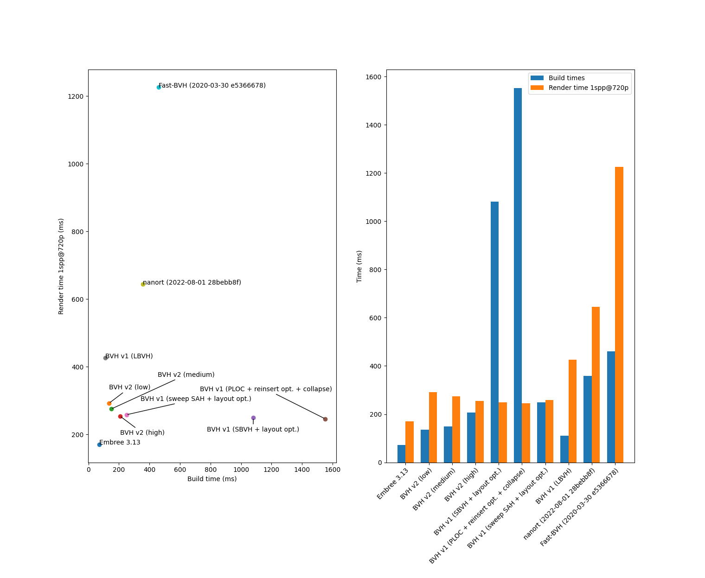

# BVH Construction and Traversal Library


> Note: This is the 2nd version of this library. Check the `v1` branch for the older, first version
> of this library.

This library is a small, standalone library for BVH construction and traversal. It is licensed
under the MIT license.


(Scene by Blend Swap user MaTTeSr, available [here](https://www.blendswap.com/blend/18762),
distributed under CC-BY 3.0)

## Performance

Here is a comparison of this library with other alternatives
([Embree](https://github.com/embree/embree),
[Fast-BVH](https://github.com/brandonpelfrey/Fast-BVH), and
[nanort](https://github.com/lighttransport/nanort)):



## Features

Here is a list of features supported by this library (changes from `v1` are indicated with [NEW]):

- [NEW] C++20 interface using `std::span` instead of raw pointers,
- Low-level API with direct access to various builders,
- [NEW] High-level `DefaultBuilder` API which selects the best builder depending on the desired
  BVH quality level.
- High-quality, single-threaded sweeping SAH builder,
- Fast, medium-quality, single-threaded binned SAH builder inspired by
  "On Fast Construction of SAH-based Bounding Volume Hierarchies", by I. Wald,
- Fast, high-quality, multithreaded mini-tree BVH builder inspired by
  "Rapid Bounding Volume Hierarchy Generation using Mini Trees", by P. Ganestam et al.,
- Reinsertion optimizer based on "Parallel Reinsertion for Bounding Volume Hierarchy
  Optimization", by D. Meister and J. Bittner,
- Fast and robust traversal algorithm using "Robust BVH Ray Traversal", by T. Ize.
- Fast ray-triangle intersection algorithm based on
  "Fast, Minimum Storage Ray/Triangle Intersection", by T. Möller and B. Trumbore,
- [NEW] Surface area traversal order heuristic for shadow rays based on
  "SATO: Surface Area Traversal Order for Shadow Ray Tracing", by J. Nah and D. Manocha,
- Fast ray-sphere intersection routine,
- [NEW] Serialization/deserialization interface,
- [NEW] Variable amount of dimensions (e.g. 2D, 3D, 4D BVHs are supported) and different scalar types
  (e.g. `float` or `double`),
- [NEW] Only depends on the standard library (parallelization uses a custom thread pool based on
  `std::thread`),
- [NEW] C API for the high-level parts of the library is available.

## Building

This library is header-only, and can be added as a CMake subproject by cloning or adding as this
repository as submodule, for instance in `<your-project>/contrib/bvh`, and then adding this to
`<your-project>/CMakeLists.txt`:

    add_subdirectory(contrib/bvh)
    target_link_library(my_project PUBLIC bvh)

If you want to build the examples, use:

    mkdir build
    cd build
    cmake .. -DCMAKE_BUILD_TYPE=<Debug|Release> -DENABLE_TESTING=ON
    cmake --build .

## C API

The library can be used via a small set of high-level C bindings. These bindings are not enabled by
default, but can be built by configuring CMake with `-DBVH_BUILD_C_API=ON`. Additionally, if the
intent is to use the library in a pure C environment which does not have the C++ standard library as
a dependency, it might be a good idea to statically the C++ standard library. That can be done by
adding the flag `-DBVH_STATIC_LINK_STDLIB_C_API=ON` to the CMake command line.

## Spatial SAH builder for triangles

Long, oblique triangles inflate the leaf boxes of an object-split BVH, so rays that miss the
surface still pay for many triangle tests. `bvh/v2/spatial_sah_builder.h` provides a triangle-only
spatial SAH builder that is allowed to split in *space*: one input triangle can be covered by
several tighter spatial references.

```cpp
using Node = bvh::v2::Node<float, 3>;
using Tri  = bvh::v2::Tri<float, 3>;

bvh::v2::SpatialSahBuilder<Node, 16>::Config config;
config.max_extra_references = 64; // shared, tree-wide budget
auto result = bvh::v2::SpatialSahBuilder<Node, 16>::build(triangles, config);
// result.bvh, result.reference_bounds, result.reference_cells,
// result.spatial_split_count
```

### Reference slots versus original face numbers

The builder never creates new drawable triangles and never modifies the input. The original
triangles keep their material, UVs and face number; the input array is read through a
`std::span<const Tri<Scalar, 3>>` and is left untouched.

- A **reference slot** is one entry in the built tree. `bvh.prim_ids[i]` stores the index of the
  original triangle that slot refers to. Because a triangle can be split spatially, the same
  original index may appear in several slots, so the number of reference slots can be larger than
  the number of input triangles.
- The **original face number** is the value stored in `bvh.prim_ids`, i.e. an index into the
  caller's triangle array. Traversal still reports this original index; it never reports a slot or
  a synthetic fragment id.
- `reference_bounds[i]` and `reference_cells[i]` are both laid out in reference-slot order, so
  slot `i` aligns with `bvh.prim_ids[i]`. `reference_bounds` is the tight (conservatively padded)
  bounds of the clipped fragment, while `reference_cells` is the closed cumulative clipping region
  obtained by intersecting all ancestor half-spaces. At the root, a cell is just the original
  triangle box.

Two query layouts work with the resulting `Bvh`, exactly as with the other builders:

1. Indirect: inside a leaf read `triangles[bvh.prim_ids[slot]]`.
2. Pre-permuted: build a `std::vector<PrecomputedTri>` of length equal to the number of reference
   slots, placing `triangles[bvh.prim_ids[slot]]` at `slot`, then index it directly.

Nearest-hit queries keep the original face number, distance and barycentric coordinates. Ray
directions are not normalized, the finite `[tmin, tmax]` window is respected, and any-hit shadow
queries keep their existing meaning. The same original triangle may be tested more than once; no
mailboxing or ordered multi-hit is performed. A tree built this way round-trips through the
existing `serialize`/`deserialize` interface and remains queryable afterwards; no extra cache
format is introduced.

### Reference budget

`Config` reuses the `sah`, `min_leaf_size` and `max_leaf_size` parameters of the other top-down
SAH builders and adds `max_extra_references` (default `0`). It caps how many references the whole
tree may add on top of the input triangle count.

- The budget is shared by the entire tree. Candidate splits are only *evaluated* and never consume
  budget; the extra references of a spatial split are deducted only when that split is committed.
- When the budget is exhausted, construction continues with object partitions. No primitive is
  dropped and the build never returns a partial tree.
- A value of `0` disables spatial splits entirely, leaving a pure object-split BVH with one
  reference per input triangle.
- Each build keeps its own budget state, so repeated calls are independent and deterministic.

At every node the builder considers object splits (binned on the current reference-box centers),
spatial splits (`BinCount - 1` equally spaced internal planes per axis, clipping the current
fragment polygons) and the option of not splitting. Spatial candidates are billed by their
duplicated reference counts, and ties are resolved in favor of the non-duplicating object split.
If no split is worthwhile and the node is within `max_leaf_size` it becomes a leaf; otherwise a
progress-making object partition is used.

### Scope and limitations

- Only three-dimensional `Node<float, 3>` and `Node<double, 3>` are supported.
- Re-splitting clips the current fragment polygon; it does not restart from the whole triangle, so
  bounds tighten on every axis rather than merely clamping an old AABB to the split plane.
- Fragment bounds are expanded by at most `32 * epsilon * max(1, max |input coordinate|)` on each
  side for conservative ray coverage. Vertices or edges lying on a split plane and zero-thickness
  face boxes remain covered, and adjacent fragments together still cover the original triangle.
- The existing refit routine, reinsertion optimizer and `DefaultBuilder` are not wired to this new
  algorithm. The `BinnedSahBuilder`, `SweepSahBuilder` and `DefaultBuilder` are unchanged.


## Usage

The library contains several examples that are kept up-to-date with the API:

- A [basic example](test/simple_example.cpp) that traces one ray on a scene made of a couple of triangles,
- A [benchmarking utility](test/benchmark.cpp) that showcases what the library can do.
- A [serialization test](test/serialize.cpp) that shows how to save and load a BVH from a file.
- A [C API example](test/c_api_example.c) that shows how to use the C bindings to this library.
