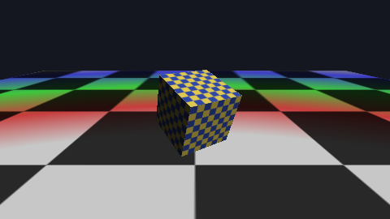
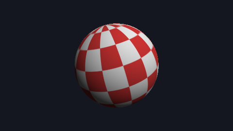
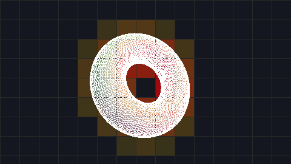
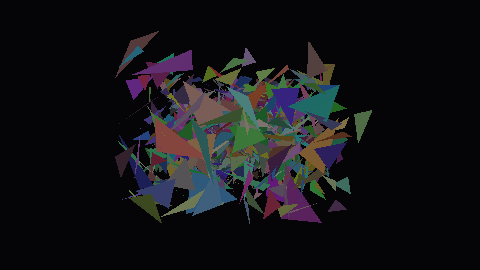
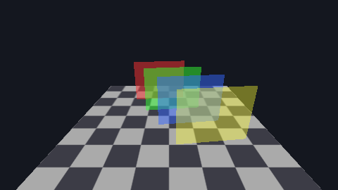
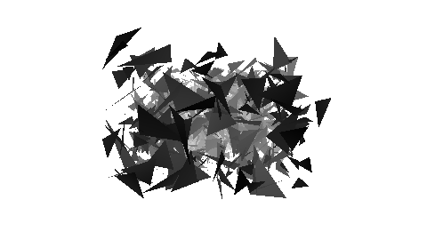

# softgpu

A C++17 software rasterizer that mirrors a modern tile-based GPU pipeline, headless and
dependency-free. Programmable vertex and fragment stages as functors, homogeneous clipping
against all six frustum planes, a 28.4 fixed-point edge-function rasterizer with the top-left
fill rule, early-Z, perspective-correct varyings with analytic screen-space derivatives,
mip-mapped texture sampling, alpha blending, and a tile binner that rasterizes 32x32 tiles in
parallel on a thread pool. The single-threaded immediate path is the golden reference: the
tiled path at any thread count must produce byte-identical color and depth buffers, and a
test checks that for every scene.

```
 vertices + indices
        |
        v
+---------------------------------------------------------------------------+
| vertex stage     VsOut<N> vs(const Vertex&)        parallel over chunks    |
+---------------------------------------------------------------------------+
        | clip-space positions + N varyings
        v
+---------------------------------------------------------------------------+
| primitive assembly -> Sutherland-Hodgman vs 6 planes (trivial accept/reject|
|   by outcode) -> fan -> perspective divide -> viewport -> triangle setup:  |
|   snap to 28.4, edge functions a*x+b*y+c, top-left bias, cull, bbox,      |
|   attr/w and 1/w gradients                     parallel over chunks        |
+---------------------------------------------------------------------------+
        | SetupTri per chunk
        v
+---------------------------------------------------------------------------+
| binning: count (chunk x tile) -> prefix sum per tile -> scatter refs       |
|   two parallel passes, submission order kept inside every tile             |
+---------------------------------------------------------------------------+
        | per-tile lists                                   (immediate mode:
        v                                                   skip bins, rasterize
+---------------------------------------------------------------------------+ each triangle now)
| tile pass: one thread owns one tile at a time              N threads       |
|   edge walk in exact int64 -> early-Z (z < depth) -> barycentrics ->       |
|   perspective-correct attrs + ddx/ddy -> fs(Fragment<N>&, Vec4&) ->        |
|   discard? -> src-over blend -> RGBA8 write, depth write                   |
+---------------------------------------------------------------------------+
        |
        v
  Framebuffer{ Image color, float depth[] }  -> PPM / PNG / depth PGM
```

 
 
 

The floor under the cube is a `Texture::mip_debug` checkerboard: every mip level is tinted a
different hue, so the bands show which level the lod computed from the uv derivatives picked.

## Run

```
make build            # cmake configure + build (Release)
make test             # doctest suite
make asan             # same suite under AddressSanitizer + UBSan
make bench            # 1080p: immediate vs tiled 1 thread vs tiled N threads
make render           # every demo scene into out/

./build/softgpu_render --scene cube --out cube.png --stats
./build/softgpu_render --scene torus --detail 4 --threads 8 --tile 16 --out torus.ppm
./build/softgpu_render --scene torus --wireframe --show-tiles --out tiles.png   # overlays
./build/softgpu_render --scene depth --count 20000 --dump-stage depth --out d.ppm # + d.depth.pgm
./build/softgpu_render --scene cube --frames 24 --out spin.png                   # spin_000.png ...
./build/softgpu_render --mode immediate --scene sphere --filter nearest --out s.ppm
./build/softgpu_bench --width 1920 --height 1080 --frames 5
```

Scenes: `cube` (textured, trilinear, over a mip-debug floor), `torus` (`--detail n` gives
9216 n^2 Lambert-lit triangles), `sphere` (textured), `depth` (`--count` random triangles at
random depths in random order), `blend` (translucent quads over a textured floor), `fill`
(full-screen textured layers with the depth test off).

`--stats` prints what a driver's pipeline statistics query would: vertices shaded, triangles
submitted / rejected / clipped / culled / degenerate / rasterized, (triangle, tile) bins,
fragments covered / early-Z rejected / shaded / discarded / blended, and per-stage time for
vertex, clip+setup, bin and raster.

## Numbers

`softgpu_bench` at 1920x1080, 32 px tiles, best of 5 frames, on an Apple M5 laptop
(10 cores: 4 performance + 6 efficiency), clang 17, `-O3`:

```
scene  mode       threads  ms/frame    Mtri/s   Mfrag/s   earlyZ%  speedup
torus  immediate        1     13.53     24.53      22.7      0.0%    1.00x
torus  tiled            1     16.76     19.79      18.3      0.0%    0.81x
torus  tiled           10      4.06     81.74      75.5      0.0%    3.33x
  triangles 331776, fragments shaded 306352/frame

fill   immediate        1    217.24      0.00      76.4      0.0%    1.00x
fill   tiled            1    220.38      0.00      75.3      0.0%    0.99x
fill   tiled           10     43.83      0.00     378.5      0.0%    4.96x
  triangles 16, fragments shaded 16588800/frame

depth  immediate        1     52.47      0.38      38.1     86.9%    1.00x
depth  tiled            1     57.76      0.35      34.6     86.9%    0.91x
depth  tiled           10      8.82      2.27     226.6     86.9%    5.95x
  triangles 20000, fragments shaded 1999308/frame
```

Mtri/s counts submitted triangles; Mfrag/s counts fragment-shader invocations (the fill
scene's shader does a bilinear texture fetch plus Lambert lighting per fragment; the depth
scene is 87% early-Z rejects, so its shaded count understates the rasterizer's work). Tiled
on one thread pays for binning and wins nothing, which is the honest baseline: tiling is a
parallelism and locality scheme, not a per-pixel speedup. Scaling is bounded by the 4 fast
cores plus 6 slow ones, and on the torus by the serial prefix-sum step of binning.

## Design

- **Exact coverage, so tiles are invisible.** Vertices snap to a 28.4 fixed-point grid and
  every edge function is evaluated in int64 from absolute pixel coordinates, never
  incrementally from a tile origin in floating point. A pixel therefore gets bit-identical
  barycentrics whether it is visited through a 16, 32 or 64 px tile or the immediate path,
  which is what makes `tiled == immediate` a hard equality test rather than a tolerance.
- **Top-left fill rule.** With the triangle oriented so the interior is `E > 0`, a sample
  exactly on an edge belongs to the triangle only if the edge is a top edge (horizontal,
  interior below) or a left edge (interior to its right); this is folded into a per-edge bias
  of 0 or -1 so the inner loop stays `(e0|e1|e2) >= 0`. Two triangles sharing an edge then
  draw each sample exactly once: no cracks, no double blending.
- **Clip in homogeneous space, before the divide.** Sutherland-Hodgman against `-w <= x,y,z
  <= w` keeps varyings affine and handles vertices behind the eye (w < 0) without special
  cases. The cut point is always interpolated from the inside vertex towards the outside one,
  so two triangles sharing a clipped edge produce bit-identical new vertices. Outcodes give
  trivial accept and trivial reject so the common case never enters the polygon loop.
- **Why tiles.** A mobile GPU like Adreno bins the whole render pass into tiles and shades a
  tile at a time from on-chip memory, because bandwidth is the budget. Here the same
  structure buys parallelism with no locks on the framebuffer: a tile is owned by one thread
  for the whole pass and walks its triangles in submission order, so depth tests and blending
  see the same fragment order as the reference. Binning itself is the count / prefix-sum /
  scatter pattern hardware uses: both heavy passes run per chunk in parallel and write disjoint
  ranges of pre-sized per-tile lists.
- **Early-Z, late write.** The depth test runs before the fragment shader and rejects are
  counted; the depth write happens after the shader so a discarded fragment leaves no depth
  behind. That is what a GPU does when the shader may discard and keeps the test correct in
  both cases. The `depth` scene shows 87% of covered samples never reaching the shader.
- **Perspective-correct attributes with exact derivatives.** `attr/w` and `1/w` are
  interpolated linearly in screen space and divided per pixel; their gradients are constant per
  triangle, so `d(attr)/dx` comes from the quotient rule for free. A GPU approximates the same
  thing by finite differences over a 2x2 quad. The derivatives feed `Texture::lod` for mip
  selection exactly the way `textureGrad` would.
- **Programmable stages are templates.** `draw<N>(...)` takes any callables with the right
  signatures; the fragment shader is inlined into the tile loop and `N` sizes every attribute
  array at compile time, so there is no per-fragment indirection. Draw calls are type-erased
  behind one virtual per (triangle, tile) so a render pass can mix shaders.

Tests (doctest, 16 cases): random jittered-grid meshes with vertices on pixel centres cover
every pixel exactly once through 20 random triangulations; the same for a fan and a diagonal
split; clipping checked at the polygon level and by rendering a view cropped in projection
against the same view rendered whole (interior colors equal to the LSB, depth to 1e-3);
near-plane clipping of a strip crossing the eye against the analytic visible region;
perspective-correct `u` against the ray/plane answer with the affine answer shown to be far
off; `ddx/ddy` against finite differences; depth ordering independent of draw order with
early-Z counts equal to the hidden fragments; depth-write-off, depth-test-off and src-over
blending pinned to exact bytes; texture fetch, bilinear weights, mip averages, lod from
derivatives and a 1:1 quad reproducing its texture; and every scene rendered immediate vs
tiled at 1/3/8 threads and 16/32/64 px tiles compared byte for byte. CI runs the suite on
gcc/Linux and clang/macOS, renders every scene with the overlays, runs a small bench, and
repeats the tests under ASan+UBSan.

## Next

- Guard-band clipping: only clip against near/far and let the fixed-point range absorb the
  side planes, which removes the fan triangles and the sub-pixel wobble at screen edges.
- Hierarchical-Z per tile (min/max depth) to reject whole triangles before the edge walk.
- 2x2 quad shading with SIMD across the quad, and coarse 8x8 block edge tests.
- Keep a tile's color and depth in a thread-local block during the tile pass and resolve it
  once at the end. Draw calls already accumulate into one tile pass per `finish()`; the
  bandwidth win a tiler exists for needs the on-tile memory too.
