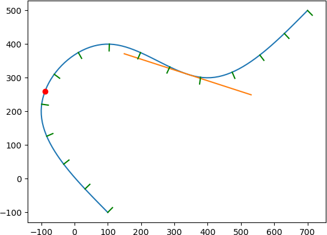

TinySpline
========


TinySpline is a small, yet powerful library for interpolating, transforming,
and querying arbitrary NURBS, B-Splines, and Bézier curves. The core of the
library is written in ANSI C (C89) with a C++ wrapper for an object-oriented
programming model. Based on the C++ wrapper, auto-generated bindings for C#, D,
Go, Java, Javascript, Lua, Octave, PHP, Python, R, and Ruby are provided.

### Table of Contents

- [License](#license)
- [Features](#features)
- [Installation](#installation)
  * [Pre-built Binaries](#pre-built-binaries)
  * [Compiling From Source](#compiling-from-source)
- [Getting Started](#getting-started)
- [Documentation](#documentation)
- [Publications](#publications)
- [Theoretical Backgrounds](#theoretical-backgrounds)

### License
MIT License - see the LICENSE file in the source distribution.

### Features

- Object-oriented programming model
- B-Splines of any degree and dimensionality
- Spline interpolation
  - Cubic natural
  - Centripetal Catmull–Rom
- Evaluation
  - Knots
  - Sampling (multiple knots at once)
  - Equidistant points
  - Components (find y for given x)
- Reparametrization by arc length
  - Mapping length <--> knot
- Knot insertion (refinement)
- Sub-spline extraction
- Bézier curve decomposition
  - (also known as subdivision)
- Derivative
- Degree elevation
- Curve/curve intersection (isolated points, coincident segments,
  unresolved boxes)
- Computation of rotation minimizing frames
- Morphing
- Serialization (JSON)
- Vector math

### Installation

#### Pre-built Binaries

Releases can be downloaded from the
[releases](https://github.com/msteinbeck/tinyspline/releases) page. In
addition, the following package manager are supported:

Conan (C/C++):  
https://conan.io/center/tinyspline

NuGet (C#):
```xml
<PackageReference Include="tinyspline" Version="0.6.0.1" />
```

Go:
```bash
go get github.com/tinyspline/go@v0.6.0
```

Luarocks (Lua):
```bash
luarocks install --server=https://tinyspline.github.io/lua tinyspline
```

Maven (Java):
```xml
<dependency>
   <groupId>org.tinyspline</groupId>
   <artifactId>tinyspline</artifactId>
   <version>0.6.0-1</version>
</dependency>
```

PyPI (Python):
```bash
python -m pip install tinyspline
```

RubyGems (Ruby):
```bash
gem install tinyspline
```

#### Compiling From Source

See [BUILD.md](BUILD.md).

### Getting Started

A variety of examples (tests) can be found in the [test](test)
subdirectory.

The following listing shows a Python example:

```python
from tinyspline import *
import matplotlib.pyplot as plt

spline = BSpline.interpolate_cubic_natural(
  [
     100, -100, # P1
    -100,  200, # P2
     100,  400, # P3
     400,  300, # P4
     700,  500  # P5
  ], 2) # <- dimensionality of the points

# Draw spline as polyline.
points = spline.sample(100)
x = points[0::2]
y = points[1::2]
plt.plot(x, y)

# Draw point at knot 0.3.
vec2 = spline.eval(0.3).result_vec2()
plt.plot(vec2.x, vec2.y, 'ro')

# Draw tangent at knot 0.7.
pos = spline(0.7).result_vec2() # operator () -> eval
der = spline.derive()(0.7).result_vec2().normalize() * 200
s = pos - der
t = pos + der
plt.plot([s.x, t.x], [s.y, t.y])

# Draw 15 normals with equidistant distribution.
knots = spline.equidistant_knot_seq(15)
frames = spline.compute_rmf(knots)
for i in range(frames.size()):
    pos = frames.at(i).position
    nor = pos + frames.at(i).normal * 20
    # You can also fetch the tangent and binormal:
    #     frames.at(i).tangent
    #     frames.at(i).binormal
    plt.plot([pos.x, nor.x], [pos.y, nor.y], 'g')

plt.show()
```
Result:



### Documentation

The latest Doxygen documentation can be found at:
https://msteinbeck.github.io/tinyspline/

The documentation of the C interface
(https://msteinbeck.github.io/tinyspline/tinyspline_8h.html) is quite
extensive and also serves as an entry point for the C++ interface
documentation (as well as the documentation for the bindings created
from the C++ interface).

### Curve/Curve Intersection

`ts_bspline_intersect` (C) and `BSpline::intersect` (C++) compute where
two non-rational, clamped B-spline curves of degree 1..3 meet. Both
curves must be 2D or 3D and share their dimensionality. Every result is
reported on the original knot domains of the input splines; the local
`[0,1]` parameter of an intermediate Bézier segment is never leaked to
the caller. A query returns three independent lists:

- **isolated points** with a representative parameter pair, a
  parameter interval on each axis no wider than the requested parameter
  tolerance, the 3D position (the third component is zero for 2D
  splines), and the lower index of the originating non-zero knot
  interval on each spline;
- **coincident segments**, each described by the maximal parameter
  range and the affine map `v = alpha * u + beta` (alpha may be
  negative, so reversed arcs are supported);
- **unresolved parameter boxes** with a reason code, used when the box
  budget is exhausted or floating point precision blocks further
  subdivision.

How the query works:

1. **Conservative exclusion.** Each spline is split into its Bézier
   pieces. A box of the joint parameter domain is bounded by the axis
   aligned bounding boxes of the two Bernstein control polygons and,
   more tightly, by the tensor-product Bernstein coefficients of the
   difference system `p(v) - q(u)`. When every coefficient of one
   component lies strictly beyond the spatial tolerance with a common
   sign, the whole box is provably free of intersections. A local
   distance minimum that never reaches zero is excluded this way, so
   closeness alone is never accepted as an intersection.
2. **Root existence.** Surviving boxes are subdivided (no fixed grid
   sampling and no endpoint-only Newton seeding). Tangencies, which
   produce no sign change, and fold-backs, which map several
   parameters to one point, are both handled because a coefficient that
   touches zero keeps its box alive. A leaf is accepted only after a
   damped Levenberg-Marquardt refinement, whose normal equations are
   regularized so an isolated zero-velocity point never divides by
   zero, back-substitutes to a position within the spatial tolerance.
3. **Coincidence.** Two arcs are reported as overlapping only when the
   restricted polynomials are algebraically identical under an affine
   reparameterization. The map is recovered by inverting a monotone
   coordinate component (bisection, again without dividing by a zero
   derivative) and then certified by exact polynomial composition on
   every component plus a dense independent sample check; endpoint,
   midpoint, or tangent comparisons alone are never sufficient.
   Reparameterization, reversal, knot insertion, and exact degree
   elevation all reduce to this case.
4. **Stopping conditions.** `complete` is true only when the entire
   parameter domain was excluded or assigned to a result. Otherwise the
   remaining candidate boxes are returned with a reason (budget or
   precision) and `complete` is false. An incomplete result is a normal,
   partial answer, never an empty intersection: retrying with a larger
   budget continues the search.

Duplicate isolated reports are merged by parameter pair, so the same
spatial point reached through two distinct parameter pairs is still
reported twice. Swapping the two input splines exchanges the two
parameter axes while keeping the same result set. See
`examples/cxx/intersections.cpp` for a complete 3D example including the
pending-box handling.

### Publications

If you use TinySpline in your research, please cite it as below.

```
@INPROCEEDINGS{Steinbeck:SANER:21,
  author =       {Steinbeck, Marcel and Koschke, Rainer},
  booktitle =    {2021 IEEE International Conference on Software
                  Analysis, Evolution and Reengineering (SANER)},
  title =        {TinySpline: A Small, yet Powerful Library for
                  Interpolating, Transforming, and Querying NURBS,
                  B-Splines, and Bézier Curves},
  year =         {2021},
  pages =        {572-576},
  doi =          {10.1109/SANER50967.2021.00068}
}
```

Other publications:

```
@INPROCEEDINGS{Steinbeck:VISSOFT:22,
  author =       {Steinbeck, Marcel and Koschke, Rainer},
  booktitle =    {2022 Working Conference on Software Visualization
                  (VISSOFT)},
  title =        {Edge Animation in Software Visualization},
  year =         {2022},
  pages =        {63-74},
  doi =          {10.1109/VISSOFT55257.2022.00015}
}
```

### Theoretical Backgrounds
[[1]](http://www.cs.mtu.edu/~shene/COURSES/cs3621/NOTES/spline/B-spline/bspline-curve.html)
is a very good starting point for B-Splines.

[[2]](http://www.cs.mtu.edu/~shene/COURSES/cs3621/NOTES/spline/B-spline/de-Boor.html)
explains De Boor's Algorithm and gives some pseudo code.

[[3]](http://www.codeproject.com/Articles/996281/NURBS-curve-made-easy)
provides a good overview of NURBS with some mathematical background.

[[4]](http://www.cs.mtu.edu/~shene/COURSES/cs3621/NOTES/spline/NURBS/NURBS-def.html)
is useful if you want to use NURBS in TinySpline.

