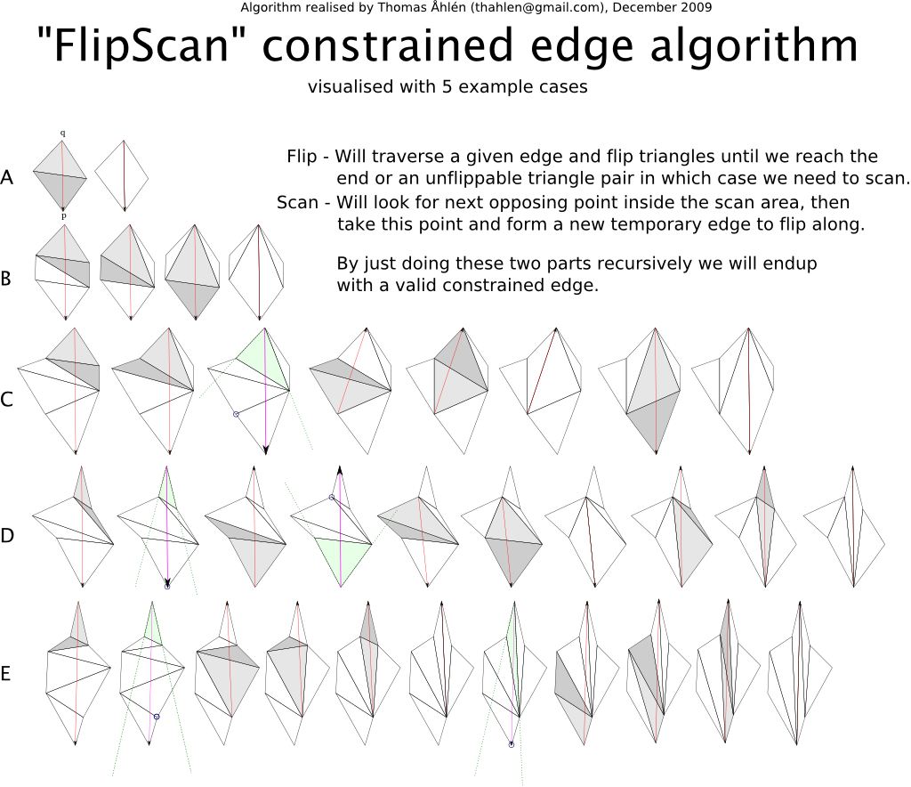

Since there are no Input validation of the data given for triangulation you need
to think about this. Poly2Tri does not support repeat points within epsilon.

* If you have a cyclic function that generates random points make sure you don't
  add the same coordinate twice.
* If you are given input and aren't sure same point exist twice you need to
  check for this yourself.
* Only simple polygons are supported. You may add holes or interior Steiner points
* Interior holes must not touch other holes, nor touch the polyline boundary
* Use the library in this order:
  1. Initialize CDT with a simple polyline (this defines the constrained edges)
  2. Add holes if necessary (also simple polylines)
  3. Add Steiner points
  4. Triangulate

Make sure you understand the preceding notice before posting an issue. If you have
an issue not covered by the above, include your data-set with the problem.
The only easy day was yesterday; have a nice day. <Mason Green>

Point ownership and lifetime
----------------------------

Poly2Tri never copies the `p2t::Point` objects you pass in: `CDT`'s constructor,
`AddHole` and `AddPoint` store the pointers, and every triangle that comes out of
`Triangulate()` refers to those same objects.  The caller owns every `Point` and
must keep it alive, at its original address, until the `CDT` (and any triangles
obtained from it) is destroyed.  Constraint editing keeps that contract: the
inserted line is identified by the two `Point*` you pass, so those objects must
be the very instances the finished mesh uses.  Neither `InsertConstraint` nor
`RemoveConstraint` allocates or destroys vertices; the vertex set, coordinates
and triangle objects stay fixed for the whole edit session.

Dynamic constraints after Triangulate
-------------------------------------

After the one-shot `Triangulate()` call, the free function `CDT::InsertConstraint`
forbids further point/hole changes but allows crease lines to be added and
removed:

```cpp
p2t::CDT cdt(outer);
cdt.AddHole(hole);
for (auto* p : steiner) cdt.AddPoint(p);
cdt.Triangulate();

p2t::CDT::ConstraintId id = cdt.InsertConstraint(a, b); // 0 => rejected
bool removed = cdt.RemoveConstraint(id);               // false => unknown id
```

`ConstraintId` is `std::uint64_t`.  A successful call returns a non-zero id that
is never reused for the lifetime of that `CDT`; the same line inserted twice, or
inserted in the opposite direction, gets its own independent id.
`RemoveConstraint` retires exactly one id: a sub-edge shared by several ids stays
protected until the last of them is removed.

Both endpoints must be distinct `Point` objects that the completed mesh actually
uses.  Null pointers, foreign objects, equal endpoints, and calls made before
`Triangulate()` are rejected with `0` / `false`.  A logical line is split at
every existing mesh vertex lying on it, so no triangle side ever skips an
intermediate vertex.  Lines may overlap fully or partially with each other and
may meet at existing vertices; no new crossing vertex is created.  A line that
properly crosses an active protected edge (outer boundary, hole, an existing
constraint) is rejected as a whole, as is a line whose middle leaves the filled
region through a hole or a concave outline.  Rejection leaves connectivity,
adjacency, flags and existing ids completely untouched, so legal edits can
continue afterwards.  Running along an existing boundary edge is accepted and
simply adds another reference to it.

Internally the editor flips the diagonals crossing the requested segment
(Sloan's incremental algorithm) and then re-legalises the touched neighbourhood
locally, so the mesh really is re-triangulated rather than supplemented by a
side table.  Triangle objects are mutated in place: `GetTriangles()` and
`GetMap()` keep pointing at the same objects, adjacency stays reciprocal, and the
total area, holes, input vertex identities and coordinates are preserved.  When
the last id protecting a crease goes away, the former non-Delaunay diagonals
become flippable again and are restored to the local empty-circle condition.
Triangle output order is not specified.  The feature is meant for incremental
editing of a valid mesh; it does not extend the library's input-validation
guarantees, and memory-exhaustion recovery is out of scope.

Example and tests
-----------------

`examples/constraint_edit.cpp` writes an SVG after adding creases, after a
partial removal and after removing them all (creases are drawn in a different
colour), plus OBJ patches that lift the same vertices and connectivity to
`(u, v, 0.1*u*v)`.  `tests/constraint_edit.cpp` registers `geometry`,
`ownership` and `session` cases for `support/run.sh target`.

TESTBED INSTALLATION GUIDE
==========================

Dependencies
------------

Core poly2tri lib:

* Standard Template Library (STL)

Unit tests:
* Boost (filesystem, test framework)

Testbed:

* OpenGL
* [GLFW](http://glfw.sf.net)

Build the library
-----------------

With the ninja build system installed:

```
mkdir build && cd build
cmake -GNinja ..
cmake --build .
```

Build and run with unit tests
----------------------------

With the ninja build system:

```
mkdir build && cd build
cmake -GNinja -DP2T_BUILD_TESTS=ON ..
cmake --build .
ctest --output-on-failure
```

Build with the testbed
-----------------

```
mkdir build && cd build
cmake -GNinja -DP2T_BUILD_TESTBED=ON ..
cmake --build .
```

Running the Examples
--------------------

Load data points from a file:
```
build/testbed/p2t <filename> <center_x> <center_y> <zoom>
```
Load data points from a file and automatically fit the geometry to the window:
```
build/testbed/p2t <filename>
```
Random distribution of points inside a constrained box:
```
build/testbed/p2t random <num_points> <box_radius> <zoom>
```
Examples:
```
build/testbed/p2t testbed/data/dude.dat 350 500 3

build/testbed/p2t testbed/data/nazca_monkey.dat

build/testbed/p2t random 10 100 5.0
build/testbed/p2t random 1000 20000 0.025
```

References
==========

- Domiter V. and Zalik B. (2008) Sweep‐line algorithm for constrained Delaunay triangulation
- FlipScan by library author Thomas Åhlén


