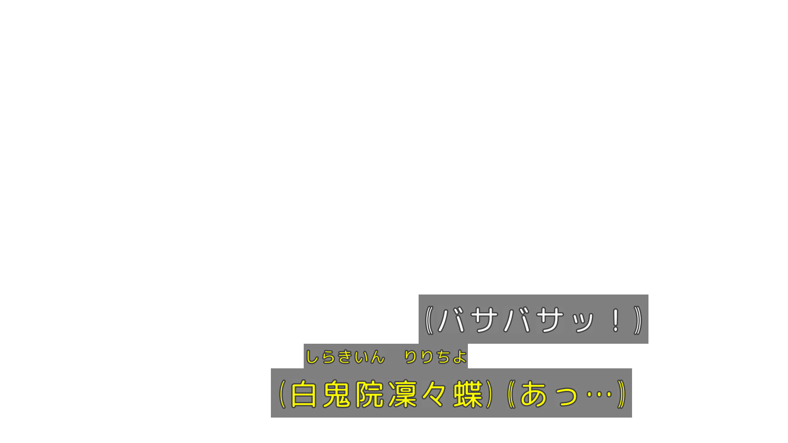

libaribcaption
======
[日本語](README_ja.md)

A portable caption decoder / renderer for handling ARIB STD-B24 based TV broadcast captions.

## Background
While **CEA-608/708** closed caption standards are used by the **ATSC** system in North America,
**DVB Subtitles / DVB Teletext** defined in **DVB** standard are used in Europe and many parts of the world,
Japan established its own TV broadcasting standard **ISDB** that includes a kind of caption service defined in **ARIB STD-B24**
by the **A**ssociation of **R**adio **I**ndustries and **B**usinesses (ARIB).

Brazil also adopted **ISDB-T** International for their broadcasting by establishing Brazilian version **SBTVD / ISDB-Tb** based on the Japanese standard,
which has been widely used in South America countries and around the world.
Brazilian version also includes a caption service for Latin languages defined in **ABNT NBR 15606-1** which is modified from **ARIB STD-B24** specification.
Philippines also adopted ISDB-T International based on the Brazilian standards,
but uses **UTF-8** for caption encoding based on the Japansese specification **ARIB STD-B24**.

Though ISDB-based TV broadcasting has been operating for about 20 years, ARIB based caption is still lacking support in general players.

## Overview
libaribcaption provides decoder and renderer for handling ARIB STD-B24 based broadcast captions,
making it possible for general players to render ARIB captions with the same effect (or even better) as Television.

libaribcaption is written in C++17 but also provides C interfaces to make it easier to integrate into video players.
It is a lightweight library that only depends on libfreetype and libfontconfig in the worst case.

libaribcaption is a cross-platform library that works on various platforms, including but not limited to:
- Windows 7+
- Windows XP+  (libfreetype required)
- Linux  (libfreetype and libfontconfig required)
- Android 2.x+  (libfreetype required)
- macOS
- iOS

## Screenshot


## Features
- Support captions in Japanese (ARIB STD-B24 JIS), Latin languages (ABNT NBR 15606-1) and Philippine (ARIB STD-B24 UTF-8)
- Full support for rendering ARIB additional symbols (Gaiji) and DRCS characters
- Lightweight and portable implementation that works on various platforms
- Performance optimized (SSE2 on x86/x64) graphics rendering
- Multiple text rendering backend driven by DirectWrite / CoreText / FreeType
- Zero third-party dependencies on Windows (using DirectWrite) and macOS / iOS (using CoreText)
- Built-in font fallback mechanism
- Built-in DRCS converting table for replacing / rendering known DRCS characters into / by alternative Unicode
- Caption encoder for re-emitting edited captions as ARIB STD-B24 packets

## Build
CMake 3.28+ and a C++17 compatible compiler will be necessary for building. Usually you just have to:
```bash
cd libaribcaption
mkdir build
cd build
cmake .. -DCMAKE_BUILD_TYPE=Release
cmake --build . -j8
cmake --install .      # Optional
```

By default libaribcaption is compiled as static library, indicate `ARIBCC_SHARED_LIBRARY:BOOL=ON` to build as a shared library:
```bash
cmake .. -DCMAKE_BUILD_TYPE=Release -DARIBCC_SHARED_LIBRARY:BOOL=ON    # or -DBUILD_SHARED_LIBS:BOOL=ON
```

libaribcaption has several CMake options that can be specified:
```bash
ARIBCC_BUILD_TESTS:BOOL            # Compile test codes inside /test. Default to OFF
ARIBCC_SHARED_LIBRARY:BOOL         # Compile as shared library. Default to OFF
ARIBCC_NO_EXCEPTIONS:BOOL          # Disable C++ Exceptions. Default to OFF
ARIBCC_NO_RTTI:BOOL                # Disable C++ RTTI. Default to OFF
ARIBCC_NO_RENDERER:BOOL            # Disable the renderer and leave only the decoder behind. Default to OFF
ARIBCC_IS_ANDROID:BOOL             # Indicate target platform is Android. Detected automatically by default.
ARIBCC_USE_DIRECTWRITE:BOOL        # Enable DirectWrite font provider & renderer. Default to ON on Windows
ARIBCC_USE_GDI_FONT:BOOL           # Enable GDI font provider which is necessary for WinXP support. Default to OFF.
ARIBCC_USE_CORETEXT:BOOL           # Enable CoreText font provider & renderer. Default to ON on macOS / iOS
ARIBCC_USE_FREETYPE:BOOL           # Enable FreeType based renderer. Default to ON on Linux / Android
ARIBCC_USE_EMBEDDED_FREETYPE:BOOL  # Use embedded FreeType instead of searching system library. Default to OFF
ARIBCC_USE_FONTCONFIG:BOOL         # Enable Fontconfig font provider. Default to ON on Linux and other platforms
```

By default, libaribcaption only enables DirectWrite on Windows and CoreText on macOS / iOS without any third-party
dependencies, But you can still enable the FreeType based text renderer by indicating
`-DARIBCC_USE_FREETYPE:BOOL=ON`.

For Windows XP support, you have to turn off DirectWrite (which will result in a crash), enable GDI font provider and FreeType:
```bash
cmake .. -DCMAKE_BUILD_TYPE=Release -ARIBCC_USE_DIRECTWRITE:BOOL=OFF -DARIBCC_USE_GDI_FONT:BOOL=ON -DARIBCC_USE_FREETYPE:BOOL=ON
```

For enabling FreeType text renderer on Windows, consider using `vcpkg` or `msys2` for accessing third-party libraries.

If you are under some kind of environment (like Android NDK or Windows) that is hard to prepare system-wide installed FreeType,
consider using embedded FreeType by indicating `-DARIBCC_USE_EMBEDDED_FREETYPE:BOOL=ON`.
This option will automatically fetch and compile a static-linked FreeType library internally.

## Usage
libaribcaption could be imported through `find_package()` if you have installed it into system:
```cmake
cmake_minimum_required(VERSION 3.28)
project(testarib LANGUAGES C CXX)

find_package(aribcaption REQUIRED)

add_executable(testarib main.cpp)

target_compile_features(testarib
    PRIVATE
        cxx_std_17
)

target_include_directories(testarib
    PRIVATE
        ${ARIBCAPTION_INCLUDE_DIR}
)

target_link_libraries(testarib
    PRIVATE
        aribcaption::aribcaption
)
```

Or using `add_subdirectory()` to import source folder directly:

```cmake
cmake_minimum_required(VERSION 3.28)
project(testarib2 LANGUAGES C CXX)

set(ARIBCC_USE_FREETYPE ON CACHE BOOL "Enable FreeType")    # Indicate options here (optional)
add_subdirectory(thirdparty/libaribcaption)

add_executable(testarib2 main.cpp)

target_compile_features(testarib2
    PRIVATE
        cxx_std_17
)

target_link_libraries(testarib2
    PRIVATE
        aribcaption::aribcaption
)
```

Or using pkg-config if you have installed it into system:
```bash
# Link to libaribcaption static library
gcc main.c -o main `pkg-config --cflags --libs --static libaribcaption`

# Link to libaribcaption shared library
gcc main.c -o main `pkg-config --cflags --libs libaribcaption`
```

## Encoding captions

`aribcaption::Encoder` (declared in `aribcaption/encoder.hpp`) performs the
reverse of `Decoder`: it turns an edited `Caption` back into ARIB STD-B24
caption packets. It is designed to be reused across calls; DRCS glyph
definitions are cached until `Reset()` is invoked.

```cpp
#include <aribcaption/encoder.hpp>

aribcaption::Encoder encoder;
std::vector<aribcaption::EncodedPES> packets;

if (!encoder.Encode(caption, packets)) {
    // unsupported properties or packet too large; packets/encoder unchanged
}

for (const auto& packet : packets) {
    // packet.pts  - inherited from caption.pts (PTS_NOPTS preserved)
    // packet.data - starts with 80 FF F0, no outer MPEG-TS / PES start code
}
```

On the first successful call after construction (or `Reset()`) the output is a
Japanese caption management packet followed by a statement packet; later calls
emit only a statement. Every statement starts with a clear-screen and describes
a complete screen. On failure both the output vector and the encoder's internal
state are left untouched, so a retry behaves exactly like a never-failed
encoder.

Supported subset:

- Japanese JIS encoding (`kARIB_STD_B24_JIS`), first language, Profile A
- 960x540 full-screen plane
- 36x36 characters, horizontal spacing 4, vertical spacing 24, scale 1.0
- transparent background, opaque text colors from palette 0 (indexes 0-7)
- no ruby, no decorations (bold / italic / underline / stroke / enclosure),
  no built-in sound
- DRCS-1 glyphs: width/height 1..64, depth 2 or 4, exact `depth_bits`, compact
  MSB-first pixels; 94-slot cache shared across calls
- non-negative character positions whose 40x60 box lies fully inside the plane

`EncodedPES::data` is a complete data group with a CRC-16 (0x1021, init 0xFFFF,
no reflection, no final XOR) covering the group header through the body. A
single group's payload may not exceed 65535 bytes; otherwise `Encode()` fails.

See `examples/caption_encode.cpp` for a complete write/decode example:

```bash
# Write two captions reusing one DRCS bitmap into a simple PES-like container
./caption_encode captured.pes

# Decode the container in a separate process with Decoder (no re-encoding)
./caption_encode --decode captured.pes
```

The container stores, per packet, an 8-byte big-endian signed PTS, a 4-byte
big-endian length, and the packet bytes.

The encoder round-trip tests live in `test/encode/roundtrip.cpp` and are run
through the task harness:

```bash
bash task_support/run.sh target
```

The `target` mode builds the library, compiles `src/encoder/encoder.cpp` and
`examples/caption_encode.cpp`, runs the example's write and `--decode` modes,
and executes the `mapping`, `dictionary`, `rollback` and `wire` test groups
along with the original decoder baseline.

## Documents
See the comments in [public headers](include/aribcaption), and [sample code with ffmpeg](test/ffmpeg)

## Hints
libaribcaption's C++ headers are also written in C++17. If your environment doesn't support C++17,
consider using the C API or switch to a newer compiler.

The C API ([public headers] with ".h" extensions) could be useful for calling from Pure C or other languages,
see [capi sample](test/capi) for usage.

[public headers]: include/aribcaption

## Recommended fonts
These fonts are recommended for Japanese ARIB caption rendering:

Windows TV MaruGothic

Hiragino Maru Gothic ProN (macOS)

[Rounded M+ 1m for ARIB](https://www.axfc.net/u/3107925)

[和田研中丸ゴシック2004ARIB](https://ja.osdn.net/projects/jis2004/wiki/FrontPage)

## License
libaribcaption is released under MIT License. You should include the copyright notice and permission notice in your distribution.

## References
[ARIB STD-B24](https://www.arib.or.jp/english/std_tr/broadcasting/std-b24.html)

[ARIB TR-B14](https://www.arib.or.jp/english/std_tr/broadcasting/tr-b14.html)

ABNT NBR 15606-1

[ISDB-T Standards (Philippines)](https://ntc.gov.ph/wp-content/uploads/2018/MC/MC-07-12-2014-Attachment.pdf)

## Other implementations
libaribcaption is heavily inspired by the following projects:

[aribb24](https://github.com/nkoriyama/aribb24)

[aribb24.js](https://github.com/monyone/aribb24.js)

[TVCaptionMod2](https://github.com/xtne6f/TVCaptionMod2)
