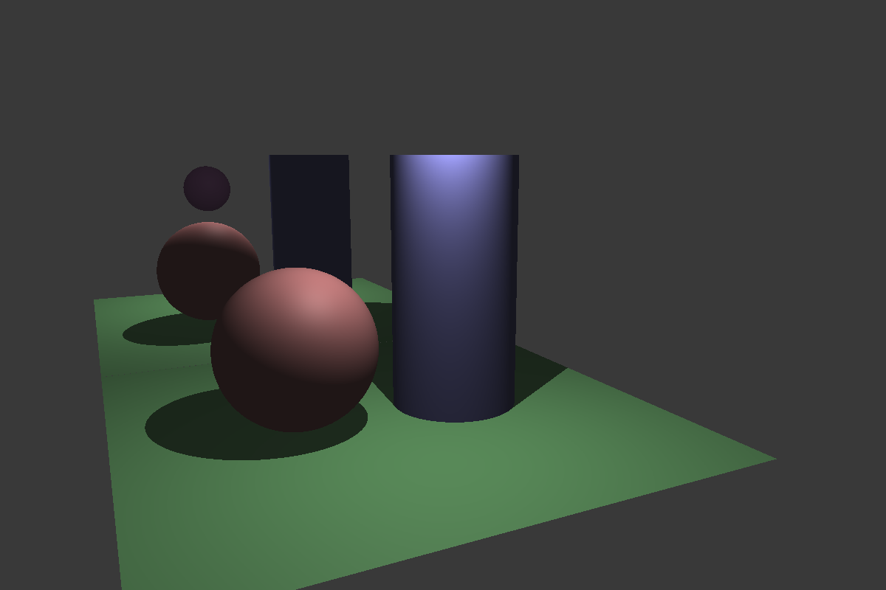
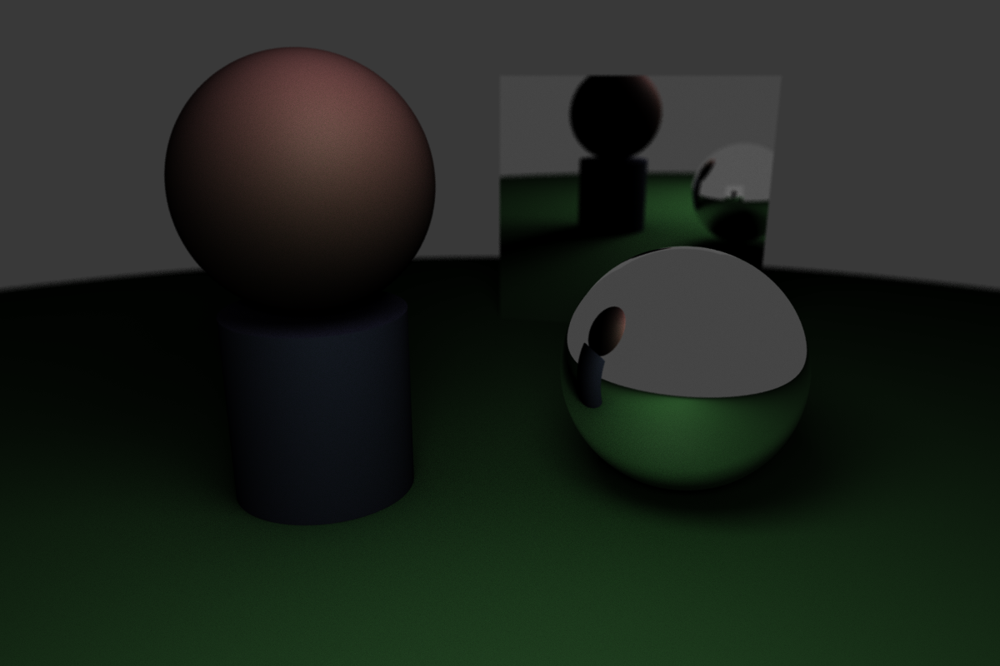
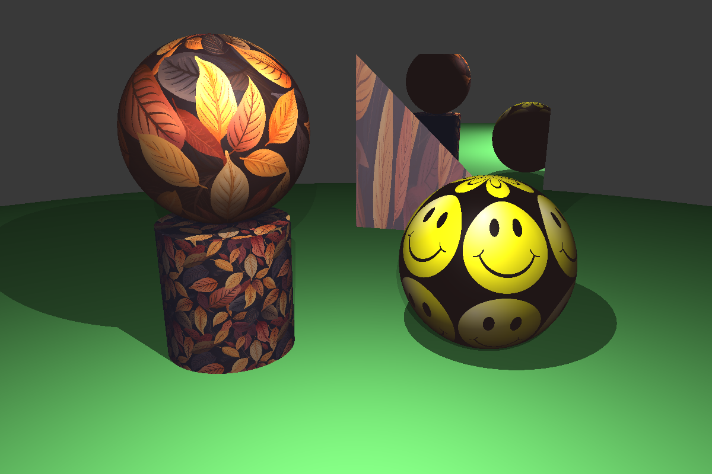
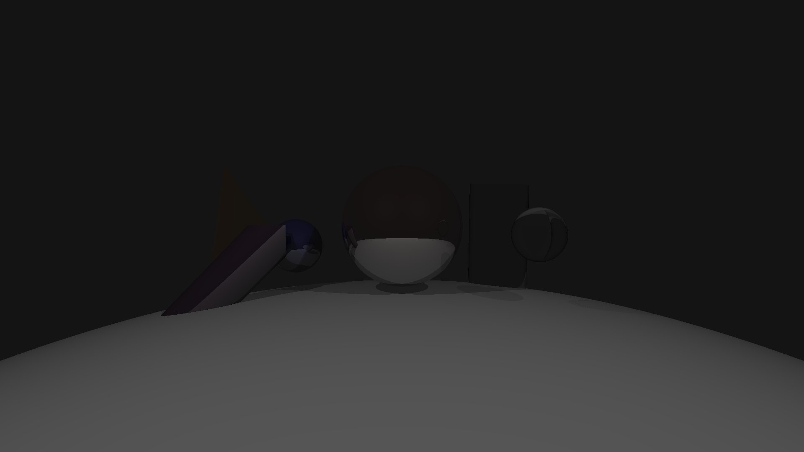

# C++ CPU Path Tracer -- Parallel Rendering with BVH Acceleration

A C++17 CPU renderer built as a systems and performance engineering project. Implements a tile-based parallel renderer with SAH BVH acceleration, reaching 15.7x speedup across 32 threads. Parses JSON scene descriptions and writes PPM output with support for PBR materials via GGX microfacet BRDFs, Monte Carlo path tracing, and multiple tone mappers.

[](https://isocpp.org/std/the-standard)
[](https://cmake.org/)
[](LICENSE)

## Sample Renders

| Binary | Phong | Reflection |
|:---:|:---:|:---:|
|  |  |  |

| Refraction | Path Tracing | Texture | BVH |
|:---:|:---:|:---:|:---:|
|  |  |  |  |

## Performance Engineering

Tile-based parallel rendering scales to 15.7x across 32 threads on a hybrid P-core/E-core CPU. The sweet spot is 8 threads (98% parallel efficiency), where the working set fits in cache and all P-cores are saturated without contention.

| Threads | Median Time (s) | Speedup | Parallel Efficiency |
|--------:|----------------:|--------:|--------------------:|
| 1       | 37.35           | 1.00x    | --                  |
| 2       | 20.16           | 1.85x    | 92%                 |
| 4       | 8.96            | 4.16x    | 104%                |
| 8       | 4.74            | 7.87x    | 98%                 |
| 16      | 3.28            | 11.38x   | 71%                 |
| 32      | 2.38            | 15.69x   | 49%                 |

Measured on path_scene.json (1200x800, 20 SPP, BVH enabled). Full methodology, hardware spec, and reproduction steps in [PERFORMANCE.md](PERFORMANCE.md).

```bash
# Run the built-in benchmark (3 runs, median timing per thread count)
cd build
./ray_tracer ../data/jsons/path_scene.json --benchmark
```

## Architecture

The render pipeline has a clear data flow with a single synchronization point between the tile scheduler and the PPM writer:

```
Parser -> Scene Graph -> BVH Build -> Tile Scheduler -> Worker Pool -> Framebuffer -> PPM
```

Key components:

- **Tile Scheduler**: Divides the framebuffer into 32x32 pixel blocks and dispatches them to the worker pool. Pre-allocates the output vector once, avoiding per-pixel allocations in the hot path.
- **Worker Pool**: Fixed-size thread pool (`std::thread` + task queue). Thread count configurable via `--threads N`. Each worker pulls tiles and renders them independently.
- **SAH BVH**: Surface Area Heuristic bounding volume hierarchy. Reduces ray-scene intersection from O(n) to O(log n) for typical scenes. Built once, shared immutably across all worker threads.
- **FancyBRDF**: PBR material system combining Lambert diffuse with GGX microfacet specular. Configurable roughness and metalness per material.
- **Per-thread RNG**: `thread_local std::mt19937` avoids contention on the random number generator during Monte Carlo sampling.

### Concurrency Design

The parallel renderer is designed around zero-contention writes and immutable shared state:

- **Fixed worker pool**: N `std::thread` instances, configurable via `--threads N` (default: 1, single-threaded). Workers are created once and joined on shutdown.
- **32x32 pixel tiles**: Each tile is an independent unit of work. Tiles are assigned to workers through a shared queue. The coarse granularity keeps scheduling overhead negligible.
- **Zero synchronization on framebuffer**: Tiles write to non-overlapping regions of a pre-allocated `std::vector`. No locks, no atomics on the output path.
- **Immutable scene graph + BVH**: The scene graph, BVH nodes, and material data are built once before rendering starts. All threads read from the same structures with no mutation.
- **Per-thread RNG**: Each worker has its own `thread_local std::mt19937` instance. No atomic contention on the random state during path tracing.
- **Per-thread counters**: Ray counts and intersection test counts are accumulated per-thread and summed after rendering completes, avoiding atomic operations in the hot intersection path.

### Design Decisions

| Decision | Rationale |
|----------|-----------|
| Tile-based scheduling | Cache locality within each 32x32 block. Minimal synchronization between workers. Natural load balancing since tiles vary in cost (BVH depth, material complexity). |
| Fixed worker pool | Lifecycle control (create once, join once). Clean shutdown without dangling threads. Simpler than `std::async` per-tile, which would spawn and join thousands of threads. |
| No external dependencies | Portability. The renderer compiles with CMake + a C++17 compiler. The only non-standard header is the vendored nlohmann/json. |
| Per-thread counters | Accumulating stats in thread-local storage avoids atomic contention in the intersection hot path. A single reduction at the end is cheaper than millions of `fetch_add` calls. |
| SAH BVH splitting | Surface Area Heuristic produces better trees than naive midpoint or equal-count splits, especially for scenes with uneven geometry distribution. The build cost is amortized over all rays. |

## Build & Run

Requirements: CMake 3.10+ and a C++17 compiler (g++ or clang++).

```bash
git clone https://github.com/JinBa1/cpp-path-tracer.git
cd cpp-path-tracer
mkdir build && cd build
cmake .. && make
```

Run a scene (you must run from the `build/` directory since paths in JSON files are relative):

```bash
cd build

# Single-threaded render
./ray_tracer ../data/jsons/scene.json ../output/ my_render

# Multi-threaded render (8 threads)
./ray_tracer ../data/jsons/path_scene.json ../output/ path_8t --threads 8

# Run benchmark (3 runs per thread count, reports median times)
./ray_tracer ../data/jsons/path_scene.json --benchmark
```

The first argument is the JSON scene file. The second and third are the output directory and filename (optional, defaults to `rendered` in the current directory). Output is written as a `.ppm` file.

## Features

### Ray Tracer

- **Three render modes**: binary (hit/miss), Blinn-Phong shading, and Monte Carlo path tracing
- **Geometry primitives**: sphere, triangle, cylinder with analytic intersection tests
- **Blinn-Phong shading**: ambient, diffuse, and specular components with configurable light intensity
- **Shadows**: hard shadow rays from point lights
- **Reflection**: recursive mirror reflections with configurable bounce depth
- **Refraction**: Snell's law refraction with Schlick's approximation for Fresnel terms
- **Textures**: PPM texture mapping on all primitive types, with UV coordinates and tile factors
- **BVH acceleration**: AABB bounding volume hierarchy with Surface Area Heuristic (SAH) splitting. Toggleable via scene JSON
- **Tone mapping**: four methods: linear, Reinhard, filmic, and luminance-based scaling. Configurable exposure
- **Image output**: PPM P3 format

### Path Tracer

- **Multi-bounce path tracing**: recursive Monte Carlo integration with configurable bounce depth
- **PBR materials**: Lambert diffuse combined with GGX microfacet specular (FancyBRDF), with roughness and metalness parameters
- **Anti-aliasing**: per-pixel multi-sampling with three strategies: random, jittered grid, and Poisson disk
- **Depth of field**: finite aperture camera with defocus blur, configurable aperture size and focus distance
- **Soft shadows**: rectangular area lights sampled with configurable sample count
- **Russian Roulette**: stochastic path termination (configurable probability) to cap computation at higher bounce depths

## Scene Format

Scenes are described in JSON. Here is a minimal example:

```json
{
    "rendermode": "phong",
    "useBVH": true,
    "camera": {
        "width": 800,
        "height": 800,
        "position": [0, 1, 3],
        "lookAt": [0, 0, -1],
        "upVector": [0, 1, 0],
        "fov": 60,
        "toneMapper": "reinhard",
        "exposure": 0.1,
        "samples_per_pixel": 4,
        "aperture": 0.02,
        "focus_dist": 1.5
    },
    "scene": {
        "ambient_light": [0.25, 0.25, 0.25],
        "background": [0.2, 0.3, 0.5],
        "lightsources": [
            { "type": "pointlight", "position": [5, 5, 5], "intensity": [1, 1, 1] }
        ],
        "shapes": [
            {
                "type": "sphere",
                "centre": [0, 0, -1],
                "radius": 1.0,
                "material": {
                    "diffuse_color": [0.8, 0.3, 0.3],
                    "specular_color": [1, 1, 1],
                    "shininess": 32,
                    "reflectivity": 0.0,
                    "transmittance": 0.0,
                    "ior": 1.5
                }
            }
        ]
    }
}
```

Key fields:

| Field | Values | Default | Notes |
|-------|--------|---------|-------|
| `rendermode` | `binary`, `phong`, `path` | `path` | Selects the rendering algorithm |
| `useBVH` | `true`, `false` | `true` | Toggles BVH acceleration |
| `toneMapper` | `linear`, `reinhard`, `filmic`, `luminance` | `luminance` | HDR to LDR conversion method |
| `samples_per_pixel` | integer | `1` | Anti-aliasing sample count (path mode) |
| `sampling_method` | `random`, `jittered`, `poisson_disk` | `poisson_disk` | Pixel sampling strategy |
| `allowBRDF` | `true`, `false` | `false` | Enables PBR microfacet shading (path mode) |
| `RR_PROB` | 0.0 to 1.0 | `0.8` | Russian Roulette termination probability |
| `aperture` | float | `0.02` | Lens aperture for depth of field |
| `focus_dist` | float | `1.5` | Focal plane distance |

Shape materials support an optional `texture` field pointing to a PPM file, plus `has_brdf`, `roughness`, `metalness`, and `base_color` for PBR rendering.

Rectangular area lights use `type: "rectlight"` with `u`, `v`, `width`, `height`, and `num_samples` fields.

## Render Modes

| Mode | Description | Output |
|------|-------------|--------|
| `binary` | Casts a single ray per pixel. White if the ray hits geometry, black otherwise. Fast diagnostic mode. | Black and white silhouette |
| `phong` | Blinn-Phong shading with shadow rays, recursive reflection, and refraction via Schlick's approximation. Configurable bounce depth. | Lit scene with highlights, shadows, mirrors, and glass |
| `path` | Monte Carlo path tracing. Each pixel sends multiple samples, bouncing through the scene with BRDF importance sampling. Russian Roulette terminates paths stochastically. | Physically-based global illumination with soft shadows and indirect lighting |

## Gaussian Participating Medium

The renderer also supports a volume made of interpenetrating, anisotropic
Gaussian emitting/absorbing kernels. Kernels are never projected to screen
ellipses and never alpha-composited layer by layer: overlapping kernels act
simultaneously through one continuous extinction and emission field.

### Kernel and query contract

A `GaussianKernel` holds a world-space mean, a symmetric positive-definite
covariance `C` (stored as `xx, xy, xz, yy, yz, zz`), a non-negative
`extinction`, and an RGB `source` (emission per unit extinction). With
`q(x) = (x-mean)^T C^-1 (x-mean)`, the kernel is `g = exp(-q/2)` on its finite
support `q <= 9` and zero outside it:

```
sigma(x) = sum_i extinction_i * g_i(x)
j(x)     = sum_i extinction_i * g_i(x) * source_i(x)
tau(a,b) = |D| * integral sigma(O + tD) dt
T        = exp(-tau)
E        = |D| * integral exp(-tau(a,t)) j(O + tD) dt
```

Optical thickness uses exact truncated-Gaussian line integrals (an `erf`
antiderivative), not fixed step sizes. Emission uses adaptive composite
Simpson with a rigorous fourth-derivative enclosure, so the returned
per-channel absolute error is a genuine bound (never the difference of two
numeric runs).

`set_kernels` validates the entire candidate snapshot (finite fields,
positive-definite covariance, non-negative extinction/source, representable
inverse and bounds) before replacing the live snapshot; a rejected update
throws `std::invalid_argument` and leaves the previous data intact. The empty
set is legal.

### Direct medium query

```cpp
#include "GaussianMedium.h"

GaussianKernel k;
k.mean = Point3(0, 0, -2);
k.covariance = {0.25, 0.05, 0.0, 0.30, 0.0, 0.20}; // SPD, row-major symmetric
k.extinction = 0.8;
k.source = Radiance(1.2, 0.3, 0.2);

GaussianMedium medium(std::vector<GaussianKernel>{k});

Ray ray(Point3(0, 0, 0), Vector3(0, 0, -1)); // direction need not be unit
SegmentResult result;
MediumStats stats;

// E and T together; false means the interval budget was exhausted and
// `result` is left untouched.
if (medium.segment(ray, Interval(0.0, infinity), /*abs_error=*/1e-6,
                   /*max_work=*/100000, result, stats)) {
    double T = result.transmittance;       // finite, in [0, 1]
    Radiance E = result.emission;          // RGB emission, linear
    Radiance err = result.error;           // conservative per-channel bound
}

// Extinction only: never performs emission integration.
double shadow_T = medium.transmittance(ray, Interval(0.0, 5.0), stats);
```

`stats.kernel_tests` counts every actual ray-vs-support-ellipsoid test
(including BVH preparation), and `stats.interval_evaluations` counts the
emission intervals actually evaluated. Both counters reset on every query.
The medium owns its own BVH and only visits kernels whose support intersects
the ray.

### Camera pass with three outputs

`Camera::render_gaussian` performs one traversal and returns an owning
`GaussianFrame` holding linear RGB `value`, linear RGB absolute `error`, and
the scalar first-camera-segment `transmittance`. It reuses the existing
Phong pixel-center projection, nearest-hit, material and mirror code; no
surface shader is duplicated. Only `PointLight` leaves (possibly nested in a
`LightList`) and non-refractive, non-BRDF materials are supported — anything
else makes the call return `false` without modifying the output frame. No
tone mapping is applied.

```cpp
#include "Camera.h"
#include "GaussianMedium.h"
#include "object/ObjectList.h"
#include "object/Triangle.h"
#include "light/PointLight.h"
#include "light/LightList.h"

ObjectList world;
Material mat;                       // ordinary, non-refractive, non-BRDF
world.add(std::make_shared<Triangle>(p0, p1, p2, &mat));
world.build();

auto light = std::make_shared<PointLight>(Point3(2, 2, 0), Radiance(9, 9, 9));
LightList lights;
lights.add(light);

GaussianMedium medium(kernels);     // interpenetrating Gaussian kernels

Camera cam;
cam.image_width = cam.image_height = 64;
cam.lookfrom = Point3(0, 0, 0);
cam.lookat = Point3(0, 0, -1);
cam.nbounces = 4;

GaussianFrame frame;
bool ok = cam.render_gaussian(world, lights, medium,
                              /*abs_error=*/1e-4, /*max_work=*/1000000, frame);
// frame.value / frame.error are width*height linear RGB arrays;
// frame.transmittance is a width*height scalar array.
```

Each camera or mirror ray integrates the medium from its origin to its next
surface hit (or to the end of all kernel support on a miss) and composites as
`E + T * surfaceRadiance`. Finite point-light shadow lines multiply by
extinction only (no in-scatter emission) and ignore kernels behind the light
or an occluder. The mirror branch shares the pixel's emission budget, and its
error propagates through the transmittance and reflection weights; the
reported pixel transmittance is always the camera's own first segment. The
original `render` / path-tracing entry points are unchanged.

A runnable example lives in `examples/gaussian_medium.cpp` and writes
`.task-build/gaussian.ppm`, `.task-build/error.ppm`, and
`.task-build/transmittance.ppm`.

## Test Suite

A smoke test builds the project and renders all scenes in `TestSuite/`:

```bash
bash scripts/smoke_test.sh
```

This compiles the project, runs each JSON scene through the renderer, and checks that valid PPM output files are produced. Scenes that time out (120s limit) or produce missing/empty output are reported as failures.

## Code Map

The codebase uses a header-heavy architecture where most implementation lives in `.h` files. Only four modules have separate `.cpp` files (Camera, Node, ObjectList, ImageWriter).

```
include/
  Camera.h          -- Ray generation, render dispatch, tone mapping, all trace functions
  GaussianMedium.h  -- Gaussian kernels, segment/transmittance queries, GaussianFrame
  Parser.h          -- Header-only JSON scene parser (nlohmann/json)
  Material.h        -- Material data struct, texture loading, GGX helpers
  ImageWriter.h     -- PPM P3 file writer
  object/
    Object.h        -- Abstract base class (intersect, bounding_box)
    Sphere.h        -- Analytic sphere intersection
    Triangle.h      -- Moller-Trumbore ray-triangle test
    Cylinder.h      -- Finite cylinder intersection
    ObjectList.h    -- Scene geometry collection, BVH entry point
  bvh/
    BoundingBox.h   -- AABB with ray-axis slab test
    Node.h          -- BVH node, 3 split strategies (SAH active)
  brdf/
    BRDF.h          -- Abstract BRDF (Evaluate, Sample)
    Lambert.h       -- Lambertian diffuse
    Microfacet.h    -- GGX NDF, Smith G, Fresnel-Schlick
    FancyBRDF.h     -- Combined Lambert + Microfacet PBR material
  light/
    Light.h         -- Abstract light (phong_shading, brdf_shading)
    PointLight.h    -- Point light with shadow rays
    RectangularLight.h -- Area light with stratified sampling
    LightList.h     -- Light collection
  util/
    Vector3.h       -- Core math: Vector3, Point3, Radiance aliases
    Ray.h           -- Ray origin + direction
    Radiance.h      -- Tone mapping functions
    Interval.h      -- Min/max interval for ray parameter bounds
    Utilities.h     -- Enums, constants, RNG, math helpers
```

The Gaussian medium implementation lives in `src/GaussianMedium.cpp` (kernel
validation/snapshots, the medium's own BVH, exact line integrals and the
bounded emission integrator), and its camera integration in
`src/Camera.cpp` (`render_gaussian` and the shared Phong helpers).

## Performance

Single-threaded baseline timings on an 800x800 image, compiled with `-O1`:

| Scene | Mode | Samples | BVH | Time |
|-------|------|---------|-----|------|
| `binary_primitives` | Binary | 1 | On | 0.19s |
| `phong_scene` | Phong | 1 | On | 0.33s |
| `path_scene` | Path | 20 | On | 37.31s |

Timed with `std::chrono::high_resolution_clock` on the render phase only (excludes scene parsing and BVH construction). Hardware: single-threaded, GCC 13.3, Linux x86_64.

For multi-threaded scaling results and full benchmark methodology, see [PERFORMANCE.md](PERFORMANCE.md).

## Dependencies

| Dependency | Version | Notes |
|------------|---------|-------|
| CMake | 3.10+ | Build system |
| C++ compiler | C++17 | g++ or clang++ |
| nlohmann/json | 3.11.3 | Vendored in `include/json.hpp` |

No external libraries need to be installed. The JSON parser header is included in the repository.

## License

This project is licensed under the [MIT License](LICENSE).
