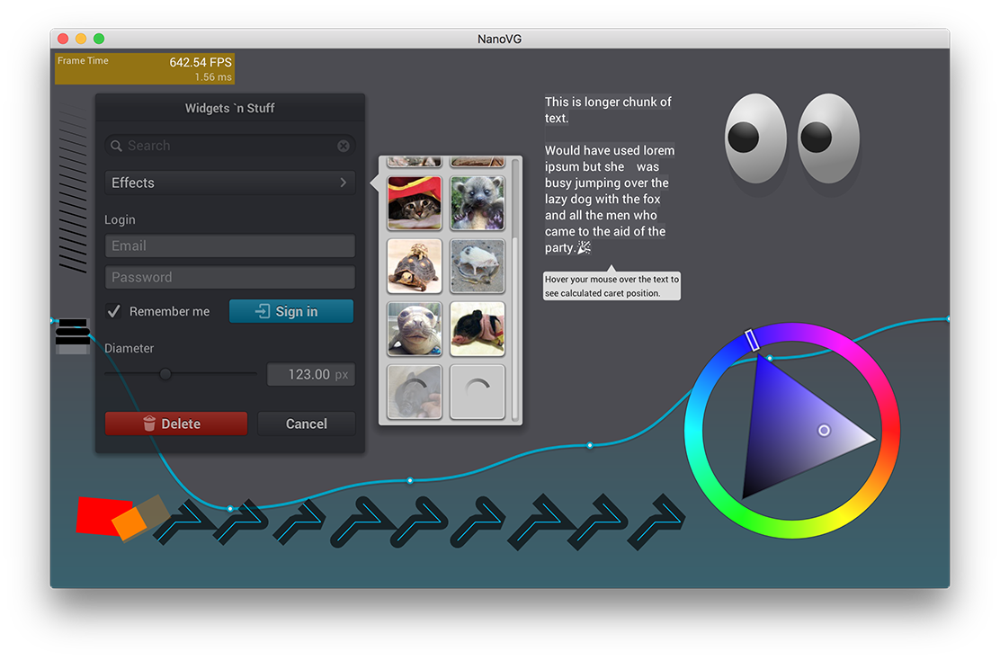

*This project is not actively maintained.*

NanoVG
==========

NanoVG is small antialiased vector graphics rendering library for OpenGL. It has lean API modeled after HTML5 canvas API. It is aimed to be a practical and fun toolset for building scalable user interfaces and visualizations.

## Screenshot



Usage
=====

The NanoVG API is modeled loosely on HTML5 canvas API. If you know canvas, you're up to speed with NanoVG in no time.

## Creating drawing context

The drawing context is created using platform specific constructor function. If you're using the OpenGL 2.0 back-end the context is created as follows:
```C
#define NANOVG_GL2_IMPLEMENTATION	// Use GL2 implementation.
#include "nanovg_gl.h"
...
struct NVGcontext* vg = nvgCreateGL2(NVG_ANTIALIAS | NVG_STENCIL_STROKES);
```

The first parameter defines flags for creating the renderer.

- `NVG_ANTIALIAS` means that the renderer adjusts the geometry to include anti-aliasing. If you're using MSAA, you can omit this flags. 
- `NVG_STENCIL_STROKES` means that the render uses better quality rendering for (overlapping) strokes. The quality is mostly visible on wider strokes. If you want speed, you can omit this flag.

Currently there is an OpenGL back-end for NanoVG: [nanovg_gl.h](/src/nanovg_gl.h) for OpenGL 2.0, OpenGL ES 2.0, OpenGL 3.2 core profile and OpenGL ES 3. The implementation can be chosen using a define as in above example. See the header file and examples for further info. 

*NOTE:* The render target you're rendering to must have stencil buffer.

## CPU off-screen back-end

For builds without a window or GPU (continuous integration, preview or
thumbnail generation) [nanovg_cpu.h](/src/nanovg_cpu.h) rasterizes the exact
geometry NanoVG already tessellates on the CPU into a caller owned buffer. It
links only the in-tree C sources — no windowing or GPU library is needed.

```C
#include "nanovg_cpu.h"
...
unsigned char* rgba = malloc(width * height * 4); // premultiplied RGBA8
NVGcontext* vg = nvgCreateCPU(rgba, width, height, width * 4);

nvgBeginFrame(vg, width, height, 1.0f);   // logical size * DPR == buffer size
nvgBeginPath(vg);
nvgRect(vg, 10, 10, 40, 30);
nvgFillColor(vg, nvgRGBA(255, 192, 0, 255));
nvgFill(vg);
nvgEndFrame(vg);                          // results are published here
...
nvgDeleteCPU(vg);
free(rgba);
```

The buffer is borrowed, never allocated or freed by the back-end. Its origin
is the top-left corner, the format is premultiplied RGBA8 (R, G, B, A, one
byte each), and the stride must be at least `4 * width`. Invalid arguments to
`nvgCreateCPU()` return `NULL`; the caller guarantees the buffer length.

Edge rules used by the CPU rasterizer:

- edge anti-aliasing is disabled (`edgeAntiAlias = 0`); coverage is evaluated
  at the centers of a regular 4x4 sub-pixel grid, i.e. 16 samples per pixel;
- fills combine all sub-paths with the non-zero winding number rule, so
  concave shapes, holes, multiple contours and self-intersections are handled;
  the tessellated triangle fans are never treated as independent solid faces;
- strokes merge the triangle strips of one `nvgStroke()` call into a coverage
  union (overlapping joins and self-intersections paint a sub-pixel at most
  once), while separate stroke calls still blend in submission order;
- glyph and triangle lists use a half-open shared-edge rule so adjacent
  triangles never cover a shared edge twice; UVs are barycentric-interpolated
  from the vertices;
- coordinates, paints and scissors are interpreted in the logical coordinates
  given to the back-end callbacks; the device pixel ratio is not applied a
  second time. When rendering at DPR != 1, scale the geometry yourself (for
  example `nvgScale(vg, dpr, dpr)`) so that `logicalWidth * dpr` equals the
  physical buffer width;
- scissors are hard inside/outside tests on the inverse-transformed rectangle,
  with no GL-style fringe smoothing.

The frame is cancelable: the borrowed buffer keeps its previous bytes until
`nvgEndFrame()` publishes the accumulated drawing in call order;
`nvgCancelFrame()` discards the frame and the next frame starts from the
buffer's latest contents. Textures are copied on creation (`NULL` data means
all zeros), updates replace only the given rectangle, and textures updated or
deleted after a draw was recorded cannot affect that draw.

Image filtering supports nearest and texel-center bilinear sampling with
`NVG_IMAGE_REPEATX`, `NVG_IMAGE_REPEATY` and `NVG_IMAGE_FLIPY`; texture sizes
do not need to be powers of two. Mipmaps are not generated, so
`NVG_IMAGE_GENERATE_MIPMAPS` is accepted but ignored.

A complete C program that renders a scene and writes a binary PPM image is in
[example/example_cpu.c](/example/example_cpu.c):

```
cc -std=c99 -O1 -Isrc src/nanovg.c src/nanovg_cpu.c example/example_cpu.c -lm -o example_cpu
./example_cpu preview.ppm
```

## Drawing shapes with NanoVG

Drawing a simple shape using NanoVG consists of four steps: 1) begin a new shape, 2) define the path to draw, 3) set fill or stroke, 4) and finally fill or stroke the path.

```C
nvgBeginPath(vg);
nvgRect(vg, 100,100, 120,30);
nvgFillColor(vg, nvgRGBA(255,192,0,255));
nvgFill(vg);
```

Calling `nvgBeginPath()` will clear any existing paths and start drawing from blank slate. There are number of number of functions to define the path to draw, such as rectangle, rounded rectangle and ellipse, or you can use the common moveTo, lineTo, bezierTo and arcTo API to compose the paths step by step.

## Understanding Composite Paths

Because of the way the rendering backend is build in NanoVG, drawing a composite path, that is path consisting from multiple paths defining holes and fills, is a bit more involved. NanoVG uses even-odd filling rule and by default the paths are wound in counter clockwise order. Keep that in mind when drawing using the low level draw API. In order to wind one of the predefined shapes as a hole, you should call `nvgPathWinding(vg, NVG_HOLE)`, or `nvgPathWinding(vg, NVG_CW)` _after_ defining the path.

``` C
nvgBeginPath(vg);
nvgRect(vg, 100,100, 120,30);
nvgCircle(vg, 120,120, 5);
nvgPathWinding(vg, NVG_HOLE);	// Mark circle as a hole.
nvgFillColor(vg, nvgRGBA(255,192,0,255));
nvgFill(vg);
```

## Rendering is wrong, what to do?

- make sure you have created NanoVG context using one of the `nvgCreatexxx()` calls
- make sure you have initialised OpenGL with *stencil buffer*
- make sure you have cleared stencil buffer
- make sure all rendering calls happen between `nvgBeginFrame()` and `nvgEndFrame()`
- to enable more checks for OpenGL errors, add `NVG_DEBUG` flag to `nvgCreatexxx()`
- if the problem still persists, please report an issue!

## OpenGL state touched by the backend

The OpenGL back-end touches following states:

When textures are uploaded or updated, the following pixel store is set to defaults: `GL_UNPACK_ALIGNMENT`, `GL_UNPACK_ROW_LENGTH`, `GL_UNPACK_SKIP_PIXELS`, `GL_UNPACK_SKIP_ROWS`. Texture binding is also affected. Texture updates can happen when the user loads images, or when new font glyphs are added. Glyphs are added as needed between calls to  `nvgBeginFrame()` and `nvgEndFrame()`.

The data for the whole frame is buffered and flushed in `nvgEndFrame()`. The following code illustrates the OpenGL state touched by the rendering code:
```C
	glUseProgram(prog);
	glBlendFunc(GL_SRC_ALPHA, GL_ONE_MINUS_SRC_ALPHA);
	glEnable(GL_CULL_FACE);
	glCullFace(GL_BACK);
	glFrontFace(GL_CCW);
	glEnable(GL_BLEND);
	glDisable(GL_DEPTH_TEST);
	glDisable(GL_SCISSOR_TEST);
	glColorMask(GL_TRUE, GL_TRUE, GL_TRUE, GL_TRUE);
	glStencilMask(0xffffffff);
	glStencilOp(GL_KEEP, GL_KEEP, GL_KEEP);
	glStencilFunc(GL_ALWAYS, 0, 0xffffffff);
	glActiveTexture(GL_TEXTURE0);
	glBindBuffer(GL_UNIFORM_BUFFER, buf);
	glBindVertexArray(arr);
	glBindBuffer(GL_ARRAY_BUFFER, buf);
	glBindTexture(GL_TEXTURE_2D, tex);
	glUniformBlockBinding(... , GLNVG_FRAG_BINDING);
```

## API Reference

See the header file [nanovg.h](/src/nanovg.h) for API reference.

## Ports

- [DX11 port](https://github.com/cmaughan/nanovg) by [Chris Maughan](https://github.com/cmaughan)
- [Metal port](https://github.com/ollix/MetalNanoVG) by [Olli Wang](https://github.com/olliwang)
- [bgfx port](https://github.com/bkaradzic/bgfx/tree/master/examples/20-nanovg) by [Branimir Karadžić](https://github.com/bkaradzic)

## Projects using NanoVG

- [Processing API simulation by vinjn](https://github.com/island-org/island/blob/master/include/sketch2d.h)
- [NanoVG for .NET, C# P/Invoke binding](https://github.com/sbarisic/nanovg_dotnet)

## License
The library is licensed under [zlib license](LICENSE.txt)
Fonts used in examples:
- Roboto licensed under [Apache license](http://www.apache.org/licenses/LICENSE-2.0)
- Entypo licensed under CC BY-SA 4.0.
- Noto Emoji licensed under [SIL Open Font License, Version 1.1](http://scripts.sil.org/cms/scripts/page.php?site_id=nrsi&id=OFL)

## Discussions
[NanoVG mailing list](https://groups.google.com/forum/#!forum/nanovg)

## Links
Uses [stb_truetype](http://nothings.org) (or, optionally, [freetype](http://freetype.org)) for font rendering.
Uses [stb_image](http://nothings.org) for image loading.
