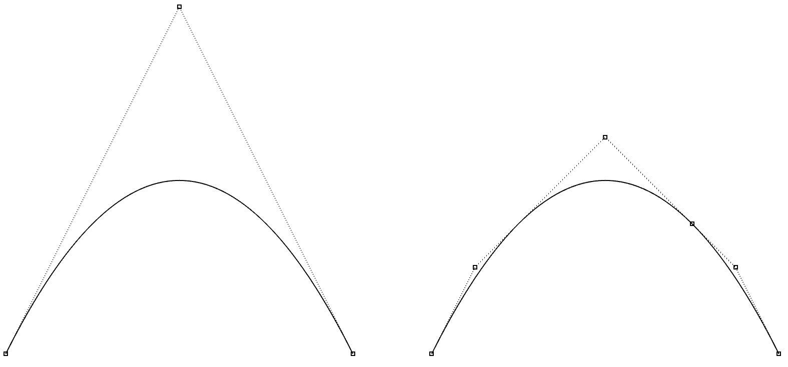
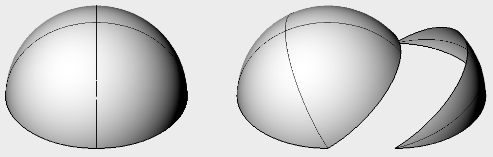

# tinynurbs

[](https://travis-ci.com/pradeep-pyro/tinynurbs)

This is a lightweight header-only C++14 library for Non-Uniform Rational B-Spline curves and surfaces. The API is simple to use and the code is readable while being efficient.

Some of the main features include:

- Supports non-rational and rational curves and surfaces of any order
- Evaluate point and derivatives of any order
- Knot insertion, splitting without affecting the original shape
- Simultaneous C1 editing of touching rational patches with point handles
- Wavefront OBJ format I/O

The library is under development.

## Dependencies

- [glm] (version 0.9.9 where PR #584 is merged is required since tinynurbs uses the `glm::vec<dim, T>` type)
- C++14 compliant compiler

## Usage

The entire API consists of free functions named `curve*` and `surface*` which accept a `Curve` / `RationalCurve` and `Surface` / `RationalSurface` object, respectively.
Some example usage is given below.

Create a non-rational planar curve:
```cpp
tinynurbs::Curve<float> crv; // Planar curve using float32
crv.control_points = {glm::vec3(-1, 0, 0), // std::vector of 3D points
                      glm::vec3(0, 1, 0),
                      glm::vec3(1, 0, 0)
                     };
crv.knots = {0, 0, 0, 1, 1, 1}; // std::vector of floats
crv.degree = 2;
```

Check if created curve is valid:
```cpp
if (!tinynurbs::curveIsValid(crv)) {
    // check if degree, knots and control points are configured as per
    // #knots == #control points + degree + 1
}
```

Evaluate point and tangent on curve:
```cpp
glm::vec3 pt = tinynurbs::curvePoint(crv, 0.f);
// Outputs a point [-1, 0]
glm::vec3 tgt = tinynurbs::curveTangent(crv, 0.5f);
// Outputs a vector [1, 0]
```

Insert a single knot at u=0.25 and double knot at u=0.75:
```cpp
crv = tinynurbs::curveKnotInsert(crv, 0.25);
crv = tinynurbs::curveKnotInsert(crv, 0.75, 2);
```
Left: original curve, Right: after knot insertion



Write the curve to an OBJ file:
```cpp
tinynurbs::curveSaveOBJ("output_curve.obj", crv);
```
creates a file with the following contents:
```
v -1 0 0 1
v -0.75 0.5 0 1
v 0 1.25 0 1
v 0.5 0.75 0 1
v 0.75 0.5 0 1
v 1 0 0 1
cstype bspline
deg 2
curv 0 1 1 2 3 4 5 6
parm u 0 0 0 0.25 0.75 0.75 1 1 1
end
```

Create a rational surface shaped like a hemisphere:

```cpp
tinynurbs::RationalSurface<float> srf;
srf.degree_u = 3;
srf.degree_v = 3;
srf.knots_u = {0, 0, 0, 0, 1, 1, 1, 1};
srf.knots_v = {0, 0, 0, 0, 1, 1, 1, 1};

// 2D array of control points using tinynurbs::array2<T> container
// Example from geometrictools.com/Documentation/NURBSCircleSphere.pdf
srf.control_points = {4, 4, 
                      {glm::vec3(0, 0, 1), glm::vec3(0, 0, 1), glm::vec3(0, 0, 1), glm::vec3(0, 0, 1),
                       glm::vec3(2, 0, 1), glm::vec3(2, 4, 1),  glm::vec3(-2, 4, 1),  glm::vec3(-2, 0, 1),
                       glm::vec3(2, 0, -1), glm::vec3(2, 4, -1), glm::vec3(-2, 4, -1), glm::vec3(-2, 0, -1),
                       glm::vec3(0, 0, -1), glm::vec3(0, 0, -1), glm::vec3(0, 0, -1), glm::vec3(0, 0, -1)
                      }
                     };
srf.weights = {4, 4,
               {1,       1.f/3.f, 1.f/3.f, 1,
               1.f/3.f, 1.f/9.f, 1.f/9.f, 1.f/3.f,
               1.f/3.f, 1.f/9.f, 1.f/9.f, 1.f/3.f,
               1,       1.f/3.f, 1.f/3.f, 1
               }
              };
```

Split the surface into two along v=0.25:
```cpp
tinynurbs::RationalSurface<float> left, right;
std::tie(left, right) = tinynurbs::surfaceSplitV(srf, 0.25);
```
Left: original surface, Right: after splitting



Write the surface to an OBJ file:
```cpp
tinynurbs::surfaceSaveOBJ("output_surface.obj", srf);
```
creates a file with the following contents:
```
v 0 0 1 1
v 2 0 1 0.333333
v 2 0 -1 0.333333
v 0 0 -1 1
v 0 0 1 0.333333
v 2 4 1 0.111111
v 2 4 -1 0.111111
v 0 0 -1 0.333333
v 0 0 1 0.333333
v -2 4 1 0.111111
v -2 4 -1 0.111111
v 0 0 -1 0.333333
v 0 0 1 1
v -2 0 1 0.333333
v -2 0 -1 0.333333
v 0 0 -1 1
cstype rat bspline
deg 3 3
surf 0 1 0 1 1 2 3 4 5 6 7 8 9 10 11 12 13 14 15 16
parm u 0 0 0 0 1 1 1 1
parm v 0 0 0 0 1 1 1 1
end
```

## Patch networks: `PatchEditor`

`tinynurbs::PatchEditor` (declared in `tinynurbs/core/patch_editor.h`, included
by `tinynurbs/tinynurbs.h`) drags several touching rational CAD patches
together.  The seam conditions hold along the *whole* edge, and the editor
solves one global system instead of repairing one seam at a time.

```cpp
#include <tinynurbs/tinynurbs.h>

std::vector<tinynurbs::RationalSurface3d> patches = {/* ... */};
std::vector<tinynurbs::PatchSeam> seams = {
    {0, tinynurbs::SurfaceEdge::UMax, 1, tinynurbs::SurfaceEdge::UMin, false},
};

tinynurbs::PatchEditor editor(patches, seams);

tinynurbs::PatchHandle handle;
handle.id = 1;
handle.patch = 1;
handle.u = 22.0;                          // original patch parameter
handle.v = 1.0;
handle.target = glm::dvec3(4.0, 3.0, 2.0);
editor.set_handles({handle});

tinynurbs::PatchEditorSnapshot snapshot = editor.solve(); // owned copies
tinynurbs::PatchMesh mesh = tinynurbs::buildPatchMesh(snapshot);
tinynurbs::writePatchMeshOBJ(mesh, "dragged.obj");
```

### Public structures

| Type | Meaning |
| --- | --- |
| `SurfaceEdge` (`UMin`, `UMax`, `VMin`, `VMax`) | The four boundary edges of a patch in its own effective parameter domain. |
| `PatchSeam` | Whole-edge pair: `patch_a`, `edge_a`, `patch_b`, `edge_b`, and `reversed` (the normalized along-edge parameter of B runs opposite to A). A patch edge may appear in **at most one** seam. |
| `PatchHandle` | Hard point handle: unique `id`, `patch`, original-domain `u`/`v`, and 3-D `target`. |
| `PatchEditorSnapshot` | Owned snapshot of a successful solve: `patches`, `seams`, the committed `handles`, plus the per-patch `original_knots_u` / `original_knots_v`. |
| `PatchMesh` | Indexed triangle mesh: `positions` plus `triangles`; each `PatchMeshCorner` keeps `position`, `patch`, original `u`/`v` and an analytic `normal`. |
| `buildPatchMesh(snapshot)` | Splits every original knot cell into a fixed 4x4 grid, merges seam stations, welds shared positions, and keeps per-patch corner attributes. Undeclared patches are never welded. |
| `writePatchMeshOBJ(mesh, path)` / `writePatchMeshOBJ(snapshot, path)` | Writes a Wavefront OBJ (`v`, `vn`, `f`). Returns `false` if the file cannot be created. |

### What the editor guarantees

* Weights are never modified.  They may vary along an edge and need not agree
  between the two patches.
* For every seam and every normalized along-edge parameter `t`,
  `A(t) = B(t)` and `DA(t) + DB(t) = 0`, where `DA`/`DB` are the derivatives
  with respect to the normalized transverse parameter measured *from the
  boundary into the patch interior* (and B is evaluated at `1-t` when the seam
  is reversed).  This is C1 along the whole edge, not merely a small normal
  angle, and not equality of homogeneous control points.
* At construction the along-edge knot bases of seamed edges are unified with
  exact knot insertion, which does not change the geometry.  The Cartesian
  control points in that compatible basis are the fixed *rest* configuration.
* Every solve returns the minimum total squared control-point displacement from
  the rest configuration among all configurations satisfying every seam and
  every staged handle simultaneously.  It is a single equality-constrained
  projection, not a sequence of per-seam fixes and not a penalty method.
* Handles constrain the surface point at `(u, v)`, not a control point.
* `factorization_count()` counts numerical factorizations of the global
  constraint matrix.  Re-targeting the same handle ids at the same patch,
  `u`, `v` reuses the factorization; moving a handle, changing the handle set,
  or changing the seam basis rebuilds it.

### Errors

| Exception | Raised when |
| --- | --- |
| `std::invalid_argument` (from the constructor) | Degree outside 1..3, non-clamped knots, interior knot multiplicity above the degree, non-positive or non-finite weights, non-finite coordinates, a degenerate patch, an out-of-range patch index, an invalid edge value, a patch edge used by more than one seam, or a seam degree mismatch. |
| `std::invalid_argument` (from `set_handles`) | Out-of-range patch index, non-finite parameters or target, a parameter outside the patch domain, a duplicate id, or the same surface point constrained to two different targets.  The previously staged handles are left untouched. |
| `std::runtime_error` (from `solve`) | Well-formed input whose simultaneous seam and handle constraints are incompatible, or a numerical failure.  The editor returns to the state of the last successful solve (initially the rest configuration with no handles), including the committed handle set. |

Empty networks are valid: `solve()` returns an empty snapshot.  Staging an
empty handle list still repairs the seams, and releasing all handles always
solves relative to the original rest (a release is not a new rest).

### Notes on the numerics

The seam identities are multiplied through by the positive denominators, which
turns them into polynomial identities.  On each span of the common knot
segmentation the power-basis coefficients of those polynomials are required to
vanish, yielding linear equations in the Cartesian control points.  The
coefficient matrix is the same for all three coordinates, so it is factored
once with a rank-revealing, row-pivoted modified Gram-Schmidt orthogonalization;
dependent rows are dropped, which handles redundant seam equations and
redundant coincident handles.  An inconsistent right-hand side (handles that
cannot coexist with the seams) is reported as `std::runtime_error`.

## Primary Reference

- "The NURBS Book," Les Piegl and Wayne Tiller, Springer-Verlag, 1995.

[glm]: https://github.com/g-truc/glm
