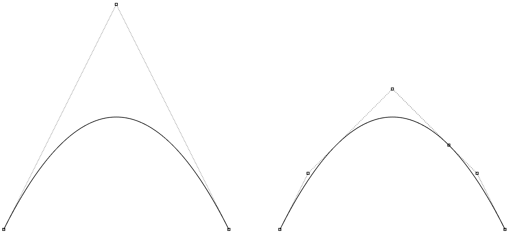
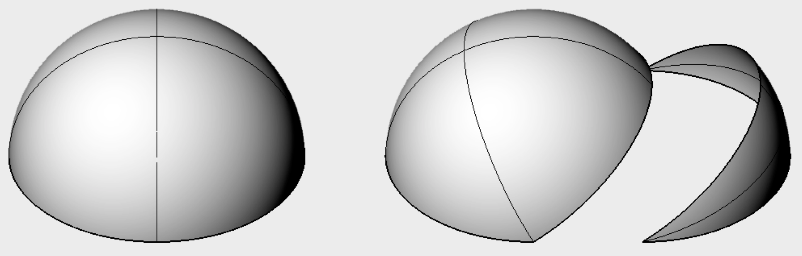

# tinynurbs

[](https://travis-ci.com/pradeep-pyro/tinynurbs)

This is a lightweight header-only C++14 library for Non-Uniform Rational B-Spline curves and surfaces. The API is simple to use and the code is readable while being efficient.

Some of the main features include:

- Supports non-rational and rational curves and surfaces of any order
- Evaluate point and derivatives of any order
- Knot insertion, splitting without affecting the original shape
- Adaptive tessellation of several surfaces into one seam-conforming triangle mesh
- Wavefront OBJ format I/O

The library is under development.

## Dependencies

- [glm] (version 0.9.9 where PR #584 is merged is required since tinynurbs uses the `glm::vec<dim, T>` type)
- C++14 compliant compiler

## Usage

The entire API consists of free functions named `curve*` and `surface*` which accept a `Curve` / `RationalCurve` and `Surface` / `RationalSurface` object, respectively.
Some example usage is given below.

Create a non-rational planar curve:
```cpp
tinynurbs::Curve<float> crv; // Planar curve using float32
crv.control_points = {glm::vec3(-1, 0, 0), // std::vector of 3D points
                      glm::vec3(0, 1, 0),
                      glm::vec3(1, 0, 0)
                     };
crv.knots = {0, 0, 0, 1, 1, 1}; // std::vector of floats
crv.degree = 2;
```

Check if created curve is valid:
```cpp
if (!tinynurbs::curveIsValid(crv)) {
    // check if degree, knots and control points are configured as per
    // #knots == #control points + degree + 1
}
```

Evaluate point and tangent on curve:
```cpp
glm::vec3 pt = tinynurbs::curvePoint(crv, 0.f);
// Outputs a point [-1, 0]
glm::vec3 tgt = tinynurbs::curveTangent(crv, 0.5f);
// Outputs a vector [1, 0]
```

Insert a single knot at u=0.25 and double knot at u=0.75:
```cpp
crv = tinynurbs::curveKnotInsert(crv, 0.25);
crv = tinynurbs::curveKnotInsert(crv, 0.75, 2);
```
Left: original curve, Right: after knot insertion



Write the curve to an OBJ file:
```cpp
tinynurbs::curveSaveOBJ("output_curve.obj", crv);
```
creates a file with the following contents:
```
v -1 0 0 1
v -0.75 0.5 0 1
v 0 1.25 0 1
v 0.5 0.75 0 1
v 0.75 0.5 0 1
v 1 0 0 1
cstype bspline
deg 2
curv 0 1 1 2 3 4 5 6
parm u 0 0 0 0.25 0.75 0.75 1 1 1
end
```

Create a rational surface shaped like a hemisphere:

```cpp
tinynurbs::RationalSurface<float> srf;
srf.degree_u = 3;
srf.degree_v = 3;
srf.knots_u = {0, 0, 0, 0, 1, 1, 1, 1};
srf.knots_v = {0, 0, 0, 0, 1, 1, 1, 1};

// 2D array of control points using tinynurbs::array2<T> container
// Example from geometrictools.com/Documentation/NURBSCircleSphere.pdf
srf.control_points = {4, 4, 
                      {glm::vec3(0, 0, 1), glm::vec3(0, 0, 1), glm::vec3(0, 0, 1), glm::vec3(0, 0, 1),
                       glm::vec3(2, 0, 1), glm::vec3(2, 4, 1),  glm::vec3(-2, 4, 1),  glm::vec3(-2, 0, 1),
                       glm::vec3(2, 0, -1), glm::vec3(2, 4, -1), glm::vec3(-2, 4, -1), glm::vec3(-2, 0, -1),
                       glm::vec3(0, 0, -1), glm::vec3(0, 0, -1), glm::vec3(0, 0, -1), glm::vec3(0, 0, -1)
                      }
                     };
srf.weights = {4, 4,
               {1,       1.f/3.f, 1.f/3.f, 1,
               1.f/3.f, 1.f/9.f, 1.f/9.f, 1.f/3.f,
               1.f/3.f, 1.f/9.f, 1.f/9.f, 1.f/3.f,
               1,       1.f/3.f, 1.f/3.f, 1
               }
              };
```

Split the surface into two along v=0.25:
```cpp
tinynurbs::RationalSurface<float> left, right;
std::tie(left, right) = tinynurbs::surfaceSplitV(srf, 0.25);
```
Left: original surface, Right: after splitting



Write the surface to an OBJ file:
```cpp
tinynurbs::surfaceSaveOBJ("output_surface.obj", srf);
```
creates a file with the following contents:
```
v 0 0 1 1
v 2 0 1 0.333333
v 2 0 -1 0.333333
v 0 0 -1 1
v 0 0 1 0.333333
v 2 4 1 0.111111
v 2 4 -1 0.111111
v 0 0 -1 0.333333
v 0 0 1 0.333333
v -2 4 1 0.111111
v -2 4 -1 0.111111
v 0 0 -1 0.333333
v 0 0 1 1
v -2 0 1 0.333333
v -2 0 -1 0.333333
v 0 0 -1 1
cstype rat bspline
deg 3 3
surf 0 1 0 1 1 2 3 4 5 6 7 8 9 10 11 12 13 14 15 16
parm u 0 0 0 0 1 1 1 1
parm v 0 0 0 0 1 1 1 1
end
```

## Tessellating several surfaces together

`tinynurbs::tessellatePatches` converts a list of rational surfaces into one
indexed triangle mesh.  Unlike per-surface grids it processes all inputs in a
single pass, so declared shared boundaries are meshed identically and the
result has no chord gaps along them.  Plain `Surface` objects can be passed by
converting them with the existing constructor, which assigns unit weights:

```cpp
tinynurbs::Surface3d srf = /* ... */;
std::vector<tinynurbs::RationalSurface3d> patches;
patches.push_back(tinynurbs::RationalSurface3d(srf)); // unit weights
```

The API lives in `include/tinynurbs/core/tessellate.h` and is exported from
`tinynurbs/tinynurbs.h`.

### Seams

Two boundary edges are declared coincident with `PatchSeam`:

```cpp
tinynurbs::PatchSeam seam;
seam.patch_a = 0;                      // index into the surface list
seam.patch_b = 1;
seam.edge_a = tinynurbs::PatchEdge::UMax;
seam.edge_b = tinynurbs::PatchEdge::UMin;
seam.reversed = true;                  // t on A maps to 1 - t on B
```

`UMin`/`UMax` traverse the boundary in the direction of increasing `v`,
`VMin`/`VMax` in the direction of increasing `u`.  The seam parameter is
normalized over each patch's valid domain (the interval between the first and
last non-zero knot spans, which need not be `[0, 1]`) before `reversed` is
applied.  Only whole-edge correspondences are supported; no automatic
adjacency search or non-linear reparameterization is attempted.

### Options and result

```cpp
tinynurbs::TessellationOptions options;
options.chord_tolerance = 1e-3;   // positive and finite
options.seam_tolerance  = 1e-9;   // positive and finite
options.max_depth       = 12;     // subdivision generations per initial knot span

tinynurbs::TessellationMesh mesh =
    tinynurbs::tessellatePatches(patches, {seam}, options);
```

`TessellationMesh` contains:

- `positions`: one `glm::dvec3` per vertex,
- `triangles`: three `size_t` vertex indices per triangle,
- `triangle_patch`: the source surface index per triangle,
- `triangle_uv`: three `glm::dvec2` values per triangle, one per corner, in
  the source patch's own parameter domain.

UVs are stored per corner rather than per vertex: a welded seam vertex has one
shared position but keeps a distinct UV for each adjacent patch.  Vertices
that are not on a seam are the exact surface point of their own UV.

### Error criterion

Refinement is driven by the distance between the true surface and the linear
triangle at four sample points of each parameter triangle: the three edge
midpoints and the centroid.  Every such distance must stay within
`chord_tolerance`.  This is a sampled flatness criterion, not a continuous
global bound on the surface-to-mesh distance.  Each non-zero knot interval is
refined independently, no parameter triangle crosses a knot line, and cells
outside the admissible range of `max_depth` cause an explicit
`std::runtime_error` rather than a partially refined mesh.

### Guarantees

- Every non-zero knot interval is covered; refined cells meet without
  T-junctions, overlaps or gaps.
- Seam sites sampled on either side appear as actual polygon vertices on both
  sides, so one side's refinement is reflected in the other side's triangles.
- Each seam segment borders exactly one triangle in each adjacent patch.
- Corners shared by several seams get a single merged vertex identity.
- Patches with coincident geometry but no declared seam are never welded.
- The seam position is taken from one side's true surface point; mismatches
  beyond `seam_tolerance` at seam sites or segment midpoints are rejected.
- Triangle winding is kept positive in each patch's own UV domain; input
  orientation is never flipped.
- The input surfaces are never modified, and repeated calls produce identical
  vertex and triangle ordering.

### Supported inputs

Degrees 1 to 3, clamped and continuous surfaces, interior knot multiplicities
at most the degree, finite control points, and positive finite weights.

`std::invalid_argument` is thrown for malformed knots, weights, parameters,
out-of-range seam indices, a patch edge paired with itself, or an edge used by
two seams; these checks run before any evaluation.  `std::runtime_error` is
thrown for degenerate parameter regions, numerical subdivision limits, or an
unmet error/connection requirement within `max_depth`.  Trimming, periodic
surfaces and automatic repair of mismatched boundaries are out of scope.

### Example

Two quarter-cylinder bands that share an edge, running in opposite directions:

```cpp
std::vector<tinynurbs::RationalSurface3d> bands = {first_band, second_band};

tinynurbs::PatchSeam seam;
seam.patch_a = 0;
seam.patch_b = 1;
seam.edge_a = tinynurbs::PatchEdge::UMax;
seam.edge_b = tinynurbs::PatchEdge::UMin;
seam.reversed = true;

tinynurbs::TessellationOptions options;
options.chord_tolerance = 1e-3;

tinynurbs::TessellationMesh mesh =
    tinynurbs::tessellatePatches(bands, {seam}, options);

// mesh.triangles[t] indexes mesh.positions; mesh.triangle_patch[t] says
// which band the triangle came from, and mesh.triangle_uv[t] holds that
// band's own parameter values for each corner.
```

## Primary Reference

- "The NURBS Book," Les Piegl and Wayne Tiller, Springer-Verlag, 1995.

[glm]: https://github.com/g-truc/glm
